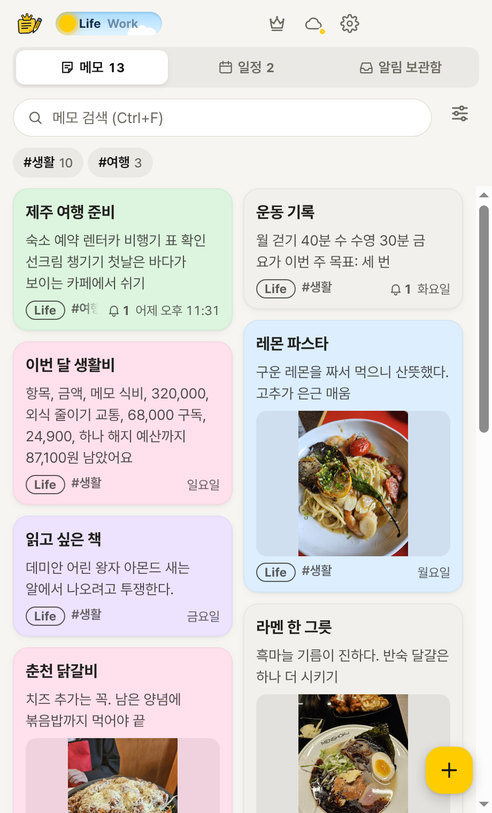
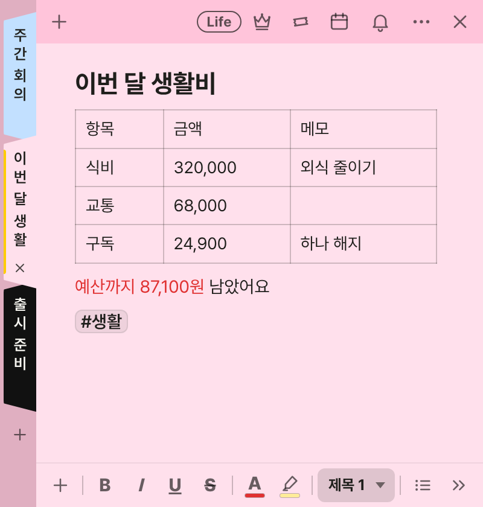
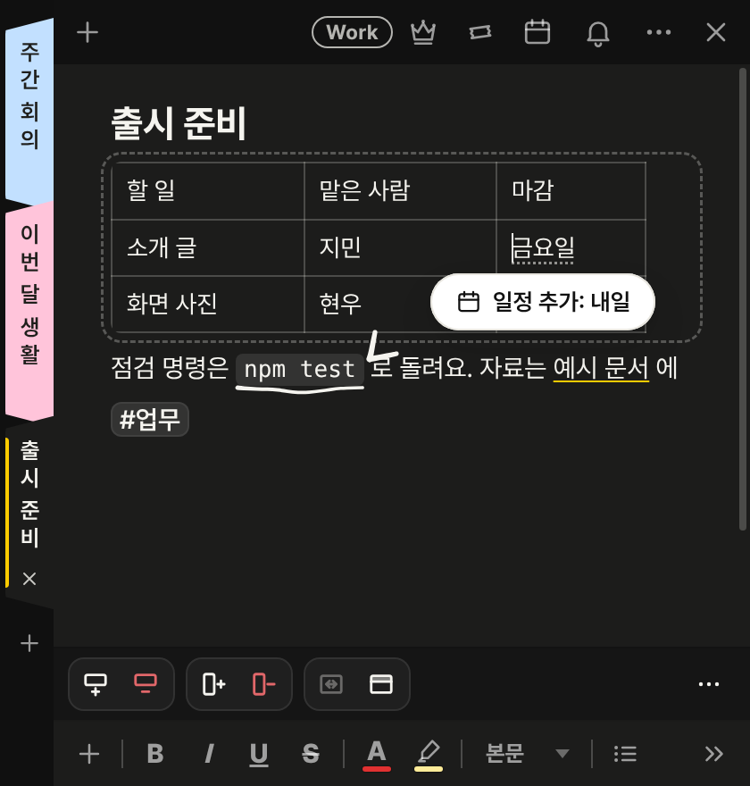
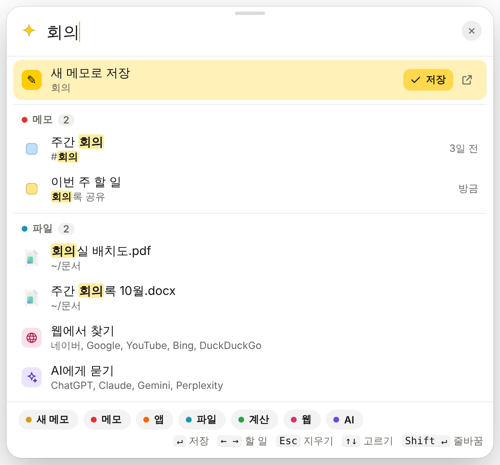
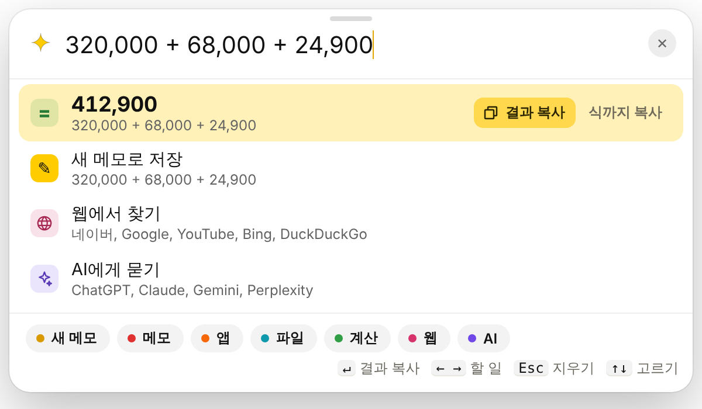

<div align="center">


# 메모킹 · MemoKing

**바탕화면에 붙여 쓰는 스티커 메모 — PC와 휴대폰에서 같은 메모를.**

메모 하나는 마크다운 파일 하나. 내 폴더에 저장되고, Google Drive로 맞추고, AI 비서도 읽어요.

[](https://github.com/lmg6983-dotcom/MemoKing/releases/latest)
[](https://github.com/lmg6983-dotcom/MemoKing/releases)
[](https://github.com/lmg6983-dotcom/MemoKing/actions/workflows/pc.yml)
[](https://github.com/lmg6983-dotcom/MemoKing/actions/workflows/android.yml)
[](LICENSE)

<br>

[](https://github.com/lmg6983-dotcom/MemoKing/releases/latest/download/MemoKing-Setup.exe)
&nbsp;
[](https://github.com/lmg6983-dotcom/MemoKing/releases/download/android/MemoKing-android.apk)

[기능](#-이런-걸-할-수-있어요) · [단축키](#-자주-쓰는-단축키) · [저장 위치](#-메모는-어디에-저장되나요) · [개발](#-개발) · [바뀐 점](#-바뀐-점-버전별)

<br>

&nbsp;
&nbsp;


<sub>메모 목록 · 탭으로 묶은 메모 창 · 글 위에 그리는 주석 (실제 앱 화면)</sub>

</div>

<br>

## ✨ 이런 걸 할 수 있어요

| | |
|---|---|
| ✍️ **쓰기** | 제목 · 목록 · 체크리스트 · 표 · 수식 · 글자 색을 화면에서 꾸미면 파일에는 마크다운으로 저장돼요. 사진 · 파일 · 링크 카드를 넣고, 웹이나 워드에서 붙여 넣어도 서식이 그대로 와요. 음성 녹음과 받아쓰기, 손글씨, 글 위에 그리기(주석)도 돼요. |
| 💾 **알아서 저장** | 입력을 멈추면 저절로 저장해요. 지난 버전으로 되돌리기, 휴지통, 비밀번호 잠금도 있어요. |
| ⚡ **어디서든 빠르게** | `Ctrl+Alt+Space` **매직키**로 메모 · 파일 · 폴더 · 앱 찾기, 계산, 새 메모 저장까지 한 입력창에서. `Ctrl+Alt+C` **매직 카피**는 어느 앱에서든 고른 글이나 그림을 새 메모로 (두 번 누르면 화면 영역 캡처). `Ctrl+Alt+1~9`로 정해 둔 메모를 바로 복사하거나 띄워요. |
| 🗂️ **정리하고 찾기** | `#태그`로 나누고, 색 · 고정 · 사진 같은 조건으로 거르고, 검색해요. 메모 창 여러 개를 탭 하나로 묶거나(스택), 늘 위에 두거나(왕관), 바탕화면에 붙여요(테이프). |
| 📅 **일정과 알림** | 글에 "내일 오후 3시"처럼 쓰면 일정으로 넣을 수 있고 미리 알림도 받아요. Windows 알림을 보관함에 모아 둘 수도 있어요 (처음에는 꺼져 있어요). |
| 🤖 **AI — 인터넷 없이 이 PC 안에서** | 맞춤법 검사, 문체 다듬기, 초안 쓰기, 태그 붙이기. Claude 데스크톱 같은 AI 비서와 연결하면(MCP) 메모를 찾고 읽고 남기게 할 수 있어요. |
| 📱 **휴대폰도 같이** | 안드로이드 앱이 같은 메모 폴더 형식을 쓰고 Google Drive로 PC와 맞춰요. 홈 화면 위젯, 녹음과 받아쓰기, 다른 앱에서 공유해 메모 만들기도 돼요. → [android/README.md](android/README.md) |

<div align="center">
&nbsp;


<sub>매직키 <code>Ctrl+Alt+Space</code> — 메모 · 파일 찾기와 계산을 한 입력창에서</sub>
</div>

> [!TIP]
> 기능마다 자세한 동작과 전체 단축키 표는 **[기능 자세히](guides/FEATURES.md)** 에 있어요.

## 📦 설치

| | 받기 | |
|---|---|---|
| 🪟 **Windows PC** | [MemoKing-Setup.exe](https://github.com/lmg6983-dotcom/MemoKing/releases/latest/download/MemoKing-Setup.exe) | 관리자 권한 없이 설치 · Windows를 켜면 알림 영역에서 저절로 실행 |
| 🤖 **안드로이드** | [MemoKing-android.apk](https://github.com/lmg6983-dotcom/MemoKing/releases/download/android/MemoKing-android.apk) | 휴대폰에서 받아 바로 설치 |

- 새 버전이 나오면 앱이 알려 주고, 누르면 바로 업데이트돼요.
- 앱을 지워도 메모는 메모 폴더에 그대로 남아요. 지우는 곳은 Windows 설정 › 앱 › 메모킹이에요.

> [!NOTE]
> 처음 실행할 때 "Windows의 PC 보호" 경고가 뜨면 **추가 정보 › 실행**을 누르세요. 코드 서명이 아직 없어서 뜨는 경고예요 ([코드 서명 정책](#-코드-서명-정책)).

## 🔑 자주 쓰는 단축키

| 하는 일 | 단축키 | 하는 일 | 단축키 |
|---|---|---|---|
| 새 메모 | <kbd>Ctrl</kbd>+<kbd>N</kbd> | 단축키 모두 보기 | <kbd>Ctrl</kbd>+<kbd>/</kbd> |
| 매직키 (어디서든) | <kbd>Ctrl</kbd>+<kbd>Alt</kbd>+<kbd>Space</kbd> | 매직 카피 (어디서든) | <kbd>Ctrl</kbd>+<kbd>Alt</kbd>+<kbd>C</kbd> |
| 늘 위에 두기 (왕관) | <kbd>Ctrl</kbd>+<kbd>Shift</kbd>+<kbd>T</kbd> | 바탕화면에 붙이기 (테이프) | <kbd>Ctrl</kbd>+<kbd>Shift</kbd>+<kbd>G</kbd> |
| 체크리스트 | <kbd>Ctrl</kbd>+<kbd>Shift</kbd>+<kbd>9</kbd> | 알림 | <kbd>Ctrl</kbd>+<kbd>Shift</kbd>+<kbd>A</kbd> |
| 음성 녹음 | <kbd>Ctrl</kbd>+<kbd>Shift</kbd>+<kbd>R</kbd> | 닫기 (저장) | <kbd>Ctrl</kbd>+<kbd>W</kbd> |

## 📁 메모는 어디에 저장되나요

처음에는 `문서\메모킹` 폴더에 저장돼요. 설정 › 메모 폴더에서 바꿀 수 있어요.

```text
메모킹/
├── 장보기.md          메모 하나 = 파일 하나 (첫 줄 제목이 파일 이름)
├── attachments/       넣은 사진 · 파일
└── _memoking/
    ├── index.json     AI 가 읽는 메모 색인 (안내서: README.md)
    ├── versions/      지난 버전
    └── trash/         휴지통
```

## 🔧 개발

[Node.js](https://nodejs.org) 22 이상이 필요해요.

```sh
npm start        # 앱 실행
npm test         # 단위 테스트
npm run dist     # 설치 파일 만들기 → dist/MemoKing-Setup-<버전>.exe
```

| 문서 | 내용 |
|---|---|
| [개발 안내](guides/DEVELOP.md) | 모든 명령과 폴더 구조 |
| [배포 안내](guides/RELEASE.md) | 설치 파일 배포와 자동 업데이트 설정 |
| [기여 안내](CONTRIBUTING.md) | 커밋 · PR · 릴리스 글 쓰는 법 |
| [오픈소스 목록](app/vendor/LICENSES.md) | 함께 묶은 오픈소스와 라이선스 |

README의 화면 사진은 `npm run shots:sns`로 실제 앱을 띄워 찍은 것이에요 (`out/sns/` → `assets/screenshots/`).

## 📜 라이선스

메모킹은 [MIT 라이선스](LICENSE)예요. 함께 묶은 오픈소스는 각자의 라이선스를 따르고, [app/vendor/LICENSES.md](app/vendor/LICENSES.md)에 정리돼 있어요.

## 🔏 코드 서명 정책

Windows 설치 파일은 [SignPath.io](https://about.signpath.io)가 무료로 제공하는 코드 서명을 받고, 인증서는 [SignPath Foundation](https://signpath.org)이 발급해요. (승인을 받은 뒤부터 적용돼요.)

- 서명은 이 저장소의 GitHub Actions(`.github/workflows/release.yml`)에서 소스로 빌드한 설치 파일에만 해요.
- 만들고 검토하는 사람(Committer · Reviewer)과 서명을 승인하는 사람(Approver): [lmg6983-dotcom](https://github.com/lmg6983-dotcom)
- 개인정보: 메모킹은 사용자가 쓰기로 한 기능(Google Drive 동기화, 업데이트 확인, 링크 미리보기 등)이 아니면 다른 시스템으로 어떤 정보도 보내지 않아요. 개발자에게 보내는 정보는 없어요. 자세한 내용은 [개인정보 처리방침](docs/privacy.html)에 있어요.

## 📝 바뀐 점 (버전별)

버전마다 바뀐 점이에요. 새 버전이 위에 있어요.

<details>
<summary>펼쳐 보기</summary>

<!-- HISTORY:START -->
| 태그 | 날짜 | 단계 | 내용 |
|---|---|---|---|
| `v0.76.1` | 2026-11-04 | 5. 고침 | **휴대폰 동영상 첫 장면이 검게 나오던 것 (휴대폰 0.54.1)**: 갤럭시 카메라로 찍은 동영상(HDR · HEVC)은 목록 카드의 첫 장면이 검은 화면이었어요. 이제 휴대폰의 동영상 재생기로 장면을 그려요 (예전에 검게 기억한 그림은 저절로 다시 그려요). 메모를 열었을 때도 동영상 재생 전 그림이 회색 기본 그림 대신 그 영상의 장면이에요 (PC · 휴대폰) |
| `v0.76.0` | 2026-11-04 | 6. 배포 | **설치 파일과 업데이트가 메모킹 저장소에서 나와요 (휴대폰 0.54.0)**: 저장소를 공개로 바꾸면서 PC 설치 파일 · 휴대폰 APK · 자동 업데이트를 따로 둔 배포 저장소(memoking-releases) 대신 메모킹 저장소의 릴리스에서 받아요. 이 버전으로 업데이트하면 그다음부터는 새 주소에서 새 버전을 찾아요. 쓰는 기능은 그대로예요 |
| `v0.75.3` | 2026-11-03 | 5. 다듬기 | **설치 파일이 가벼워졌어요**: PC 메모킹이 설치 뒤 차지하는 공간이 50MB 넘게 줄고, 내려받는 설치 파일도 작아졌어요. 메모킹 화면에 쓰지 않는 Electron 언어 파일(한국어 · 영어 말고 50여 개)과 쓰이지 않던 글자 인식 파일을 빼고, 설치 파일을 최대로 압축했어요. 쓰는 기능은 그대로예요 |
| `v0.75.2` | 2026-11-02 | 5. 고침 | **알림을 누르면 메모가 열려요**: 메모킹이 띄운 알림을 눌렀는데 메모 대신 메모 목록이 뜨던 것을, 그 알림의 메모가 열리게 고쳤어요. 개발 실행에서 알림을 누르면 빈 "Electron" 창이 뜨고 작업 표시줄 아이콘이 Electron 으로 보이던 것도 고쳤어요 |
| `v0.75.1` | 2026-11-02 | 5. 고침 | **Word · 파워포인트를 그림으로 넣을 때 PDF 로 바꿔 또렷하게 · 매직 카피 랙 줄임 (휴대폰 0.53.1)**: PC 에 Office 가 있으면 Word(DOCX) · 파워포인트(PPTX)를 먼저 PDF 로 바꾼 뒤 장마다 그림으로 넣어요 — 파워포인트 그림이 깨지던 것을 고쳤어요 (Office 가 없으면 예전처럼 메모킹이 직접 그려요). 다른 프로그램이 만든 Word 문서가 장이 나뉘지 않고 긴 그림 한 장으로 들어가던 것도 쪽 크기대로 나눠요(휴대폰도). Word · 엑셀 같은 곳에서 Ctrl+Alt+C 를 누르면 잠깐 멈추던 것(쓰지 않을 그림까지 꺼내던 것)을 줄였어요 |
| `v0.75.0` | 2026-10-31 | 3. 개선 | **일정과 알림을 따로 — 새 일정은 하나로, 알림은 구글 리마인더처럼 (휴대폰 0.53.0)**: 메모 위 단추가 📅 일정과 🔔 알림 둘이 됐어요. 📅 는 일정 탭과 같은 "새 일정" 창으로 이 메모에 일정을 넣어요. 🔔 알림은 할 일과 때만 정하면 돼요 — 1시간 뒤 · 오늘 저녁 · 내일 아침 · 월요일 아침 또는 날짜와 시각 고르기, 메모킹을 열 때, 반복(매일 · 매주 · 매월 · 매년). 미리 알림은 일정에만 있어요. 다 한 알림은 동그라미를 눌러 완료하고, 일정 탭 달력에도 동그라미로 보여요. 일정 빠른 추가에 "10월 31일 치과 오후 3시" 처럼 적으면 하루 종일 일정과 3시 일정 두 개가 생기던 것, 어두운 화면에서 새 일정 창의 칸이 안 보이던 것, 휴대폰 메모 위에 남아 있던 메모 연결(사슬) 단추, 휴대폰에서 복사하면 "복사했어요" 가 위아래로 두 번 뜨던 것(안드로이드 13 이상)을 고쳤어요 |
| `v0.74.2` | 2026-10-30 | 5. 다듬기 | **일정·알림 모달 UI 폴리싱 및 매직키 개선 (휴대폰 0.52.2)**: 일정/알림 50:50 동적 헤더 타이틀, 달력 하단 하루종일 토글 통합, '+ 직접' 캡슐 칩 일원화, 모든 모달 전체 너비 CTA 버튼, 카드형 선택지, 타이머/반복 폼 여백 및 수직 리듬 최적화, 매직키 복사 후 닫힘 방지, 메모 연결 비활성화 |
| `v0.74.1` | 2026-10-29 | 5. 고침 | **일정 탭의 플로팅 + 를 없애고, 아래 빠른 추가 캡슐이 탭을 가리던 것을 고쳤어요 (휴대폰 0.52.1)**: 휴대폰 일정 탭에서는 이제 오른쪽 아래 노란 + 단추가 없어요. 새 일정은 아래의 "N월 N일에 추가" 캡슐로 추가해요. 이 캡슐이 화면 맨 아래에 붙어 하단 탭(메모 · 일정 · 알림 보관함)을 덮던 것도 탭 바로 위로 올렸어요 |
| `v0.74.0` | 2026-10-29 | 3. 개선 | **PDF 쪽 나눔 다듬기 · 목록에는 글만 · Ctrl+Alt+V 서식 없이 붙여넣기 · 매직키 끊김 해결 · 일정 빠른 추가 (휴대폰 0.52.0)**: PDF 저장(휴대폰은 인쇄)에 「그림을 쪽 안에 맞추기」가 생겼어요(기본 켬). 켜면 쪽보다 긴 그림은 한 쪽 안으로, 쪽 끝에 걸친 그림은 남은 자리에 줄여 넣거나 다음 쪽으로, 이어진 그림은 쪽에 두 장씩, 아주 긴 캡처는 여러 쪽에 나눠 "다음 쪽에 이어져요"로, 긴 표는 행 사이에서 나누고 머리글을 쪽마다 보여 줘요. 목록 안에는 글만 — 그림 · 소리 · 동영상 · 파일 · 링크 카드 · 표 · 수식은 목록이 끝난 뒤로 놓이고, 예전 메모도 열 때 정리돼요. 메모 창에서 Ctrl+Alt+V 는 서식 없이 붙여넣기예요. 매직키에 글을 칠 때 툭툭 끊기던 것(폴더 다시 찾기가 앱을 몇 초씩 멈춤)을 고쳤어요. 재생 단추는 배경 없이 깔끔하게, 소리 플레이어의 잘리던 말풍선은 없앴어요. 휴대폰 일정은 아래 빠른 추가 · 추천 시간 · 시작~종료 범위 고르기 · 여러 날 일정 · 좌우로 밀어 달 넘기기가 되고, 사진 보기는 2초 뒤 단추가 숨어 사진만 보여요 |
| `v0.73.0` | 2026-10-28 | 3. 개선 | **녹음 알약 · 녹음 이름 · 상태 막대 캡슐, 두 번 눌러 열기, 동영상 · 소리 새 모양, 주석이 그 낱말 위에 (휴대폰 0.51.0)**: 휴대폰에서 녹음하는 동안 왼쪽 위에 시간 · 멈춤 · 끝내기만 있는 작은 알약이 떠요 (받아쓴 글은 메모를 가리지 않게 끝난 뒤 본문에). 녹음을 켜면 + · 다이얼 단추가 화면 위로 올라가던 것을 고쳤어요. 녹음을 끝내면 이름을 정할 수 있고, 안드로이드 16(갤럭시 One UI 8)부터는 다른 앱을 써도 상태 막대 맨 위 빨간 캡슐로 녹음 중임이 보여요. 파일 캡슐 옆 「열기」 버튼 대신 PC · 휴대폰 모두 **두 번 눌러 열어요**. 휴대폰에서 파일을 복사하면 이름 글이 아니라 파일 그대로 붙여 넣어져요. 동영상은 위의 이름 줄 없이 이름이 영상 위에 뜨고, 소리 · 음성 카드는 둥근 재생 단추가 있는 한 덩어리로 얇아졌어요 (재생 단추는 메모 색). 사진 · 동영상 · 소리 둥글기를 맞췄어요. 매직키 아래 기능 캡슐이 한 줄에 들어가요. 글 위에 그린 주석이 화면 폭이 다른 기기에서도 그 낱말 위에, 여러 획 그림은 흩어지지 않게 고쳤어요 |
| `v0.72.0` | 2026-10-28 | 3. 개선 | **문서(PPTX · HWP · TXT) 그림 변환과 파일 캡슐 열기 버튼, 매직키 앱 검색 · 폴더 자동 재색인 · 경로 복사, 필기 · AI 다듬기 (휴대폰 0.50.0)**: PDF · DOCX · HWPX 뿐 아니라 PPTX · HWP · TXT 문서도 장마다 그림으로 넣을 수 있고, 이미 파일로 넣은 캡슐도 오른쪽 클릭 메뉴의 「그림으로 펼치기」·「텍스트로 본문에 풀기」로 언제든 다시 펼칠 수 있어요. 파일 캡슐 옆에 전용 「열기」 버튼이 생기고 캡슐 안으로 커서가 들어가지 않아요. 매직키에 **앱 검색** 모듈이 추가되었고, 폴더를 찾지 못했을 때 자동으로 빠르게 다시 색인하며, 폴더·파일 경로 복사가 한글 깨짐 없이 바로 복사돼요. 메모 목록도 전역 단축키(`Ctrl+Alt+L`)로 부를 수 있어요. 복사 아이콘을 누르면 초록색 체크 표시가 나타나고, 삭제 되돌리기 안내는 편집 영역을 가리지 않게 아래 바깥에 뜨며, 녹음 중 표시는 손목이 닿지 않게 왼쪽 위에 작게 떠요. 태블릿 필기 데스존 제거 · 확대/축소 시 글자 간격 유지 · 데스크탑과 주석 위치 동기화 · 목록 맨 앞 Delete 시 서식 유지 · 카카오톡 PC 알림 글자 인식 · AI 참고 문헌 인용 및 지시 기반 메모 덮어쓰기 편집을 개선했어요 |
| `v0.71.0` | 2026-10-25 | 3. 개선 | **목록 카드에 동영상 첫 장면 (휴대폰 0.49.0)**: 사진 없이 동영상만 든 메모는 목록 카드에 영상의 1초쯤 장면과 가운데 ▶ 가 보여요 (PC · 휴대폰 같게). 카드가 화면에 들어올 때 한 번 그려 이 기기에 기억해 두고, 다음부터는 그림만 띄워요. 메모 파일은 그대로이고, 열 수 없는 영상은 지금처럼 카드 아래 동영상 아이콘만. **Work / Life 스위치를 작게**: 해와 달 그림은 그대로, 높이를 PC 26 → 22px · 휴대폰 40 → 32px, 가로를 PC 120 → 99px · 휴대폰 147 → 126px 로 줄여 제목 줄 · 검색 줄이 덜 붐벼요 |
| `v0.70.1` | 2026-10-25 | 5. 고침 | **매직키 계산 결과가 한 번만 나와요**: 식을 쓰면 같은 결과 줄이 두 번 보이던 것을 고쳤어요. **화면 다듬기**: 좁은 메모 창의 표 막대는 자주 쓰는 도구만 한 줄에 두고 나머지는 ⋯ 로 (휴대폰과 같이), 휴대폰에서 고친 메모 알림은 탭 · 검색창을 가리지 않게 아래쪽에, 에이전트 확인 카드는 할 일 제목이 맨 위에, 설정의 Google Drive 칸은 상태를 읽기 전에 엉뚱한 단추가 보이지 않게, 단축키는 한 번만 보이게, 공유 폭죽은 처음 한 번만 **태그 추천이 파일 이름에 속지 않아요**: 메모에 "회의자료.txt" 가 있으면 #txt 를 추천하던 것을 고쳤어요. **메모 창 메뉴가 짧아졌어요**: PDF · 그림으로 복사 · 그림으로 저장 · 삭제는 맨 위 아이콘 한 줄로(목록 카드 메뉴와 같이), 나머지는 묶음마다 구분선. 매직키의 OPMS 단추는 회사 서버 주소를 넣었을 때만 보이고, 계산 결과의 둘째 단추는 "식까지 복사" 글자로. 설정 설명은 한 줄로(자세한 것은 마우스를 올리면), 탭 숫자는 휴대폰처럼 숫자만. **글에서 읽은 일정 시각을 그 자리에서 고쳐요**: 메모 속 날짜로 연 일정 창에 "바꾸기" — 날짜와 시각을 고를 수 있어요(잘못 읽으면 취소하고 글을 다시 쓰던 것). 메모 창 메뉴는 목록 카드 메뉴와 같은 아이콘 · 같은 진한 색 점이고, 기본 창 크기에 스크롤 없이 들어가요(목록 열기 · 단축키 보기는 단축키로). 매직키는 "Enter로 메모를 저장" 안내가 AI 줄을 골랐을 때도 나오던 것을 뺐어요. **메모 창 메뉴를 목록 카드 메뉴와 같게**: 맨 위 아이콘이 글 복사 · 공유 · PDF · 휴지통(같은 순서, 메모 창에서도 글 복사 · 공유가 돼요), 그림 복사 · 그림 저장 · 목록 · 단축키는 아래 작은 줄로. 메모 창의 글자 단추(바꾸기 · 그대로 두기)가 브라우저 기본 단추로 보이던 것도 고쳤어요. **알아보기 쉽게**: "이 날의 기록으로" 는 "회상 날짜 정하기"(정하지 않았으면 "만든 날")로, 목록 카드 메뉴의 아이콘도 메모 창과 같은 자리로(잘라내기는 휴지통 옆), 메뉴에 메모 연결(Ctrl+K) · 바꾸기(Ctrl+H) 키도, 구름은 연결 전이면 속이 빈 고리 · 동기화 중이면 노란 점. 설정 맨 아래 "처음 안내 다시 보기" 로 지나간 작은 안내를 다시 볼 수 있어요 |
| `v0.70.0` | 2026-10-24 | 3. 개선 | **휴대폰 메모도 PC가 정리해요**: 설정 › AI 도우미 › 「휴대폰 메모도 이 PC에서」를 켜면 휴대폰에서 쓴 메모가 들어오고 1분 뒤 이 PC가 태그와 일정을 달아요 (PC가 여러 대면 한 대에서만 켜 주세요). **문제 보내기**: 설정 맨 아래 「문제 보내기」를 누르면 이 PC에만 남겨 둔 최근 오류 기록을 붙인 새 메일이 열려요 (전체 기록은 클립보드에, 보낼지는 직접 정해요). 개발: PR마다 PC 자동 점검(Linux · Windows)과 화면 이벤트 등록 시험이 돌아요. **Work / Life는 화면을 바꾸지 않아요**: Work로 바꿔도 화면 밝기와 색은 그대로(늘 시스템 설정 따라), 대신 메모마다 고칠 수 없는 Work · Life 태그가 붙고(메뉴의 「…로 옮기기」로만 바뀜), 지금 모드는 작업 표시줄 아이콘의 작은 표시와 알림 영역 글로 보여요 (휴대폰 0.48.0). **매직 에이전트**: 목록 검색창 ✦ 와 매직키 AI 줄(Enter)이 같은 에이전트예요. 질문엔 내 메모에서 찾아 답하고, 일정 · 알림 등록 · 새 메모 · 할 일 · 메모에 덧붙이기 · 요약은 확인 카드로 고친 뒤 넣어요. "내일 뭐 있어?" 는 일정 탭에서 바로. **AI 검색이 덜 못 찾아요**: 낱말이 조금 달라도("회의했어" ↔ "회의", "출시" ↔ "출시일") 두 글자 조각으로 찾고, 물음 말(언제 · 뭐야)은 빼고, 제목에 든 말 · 물은 때(어제 · 지난주) 고친 메모를 앞으로. 작은 모델이 "못 찾았어요" 로 물러서도 찾은 메모의 문장을 그대로 보여 줘요 (번호 없는 답엔 근거 문장). **태그가 내용에 맞게**: AI가 많이 쓰는 기존 태그 중에서만 고르던 것을 메모 내용에서 태그를 짓게 바꿨어요. 기존 태그는 본문에 나오거나 닮은 메모들이 단 것만 쓰고(인사 메일에 #공유 · #ETRI 가 붙던 것), 억지로 3개를 채우지 않으며 인사 · 짧은 대답에는 달지 않아요. AI 없는 추천도 아주 조금 닮은 메모의 태그 · 많이 쓰는 태그 덤을 뺐어요. **매직키 다듬기가 질문에 답하지 않아요**: 「~작동하니?」 같은 질문을 맞춤법만 고치지 않고 답으로 바꾸던 것을 막아요 (물음표가 사라지거나 원래 글이 많이 바뀐 답은 버림). **AI를 쓰던 자리에서 바로**: AI 검색은 검색창 안 오른쪽 ✦ 로(답은 검색창 바로 아래, 못 찾으면 번호 없이 「관련 있어 보이는 메모」), 메모 창 AI는 메뉴 · 옆 패널 대신 서식 막대 끝 ✦ 의 작은 창(부탁 한 줄 + 맞춤법 · 문체 칩). **설정 줄 모양 통일**: 글은 왼쪽, 스위치 · 단추는 오른쪽 (내 손에 맞추기 · 넣을 때 묻기 · 휴지통) **화면 다듬기**: 목록 위 Google 연결 안내 줄 대신 구름 단추에 노란 점, 「보기」 판은 카드 위에 떠서 목록을 밀지 않아요. 메모 창의 표 막대는 좁은 창에서 아이콘 한 줄, 불러오기 키는 정했을 때만 윗막대에(정하기는 ⋯ 메뉴). 펼친 알림엔 메모로 · 복사 · 삭제 단추가 늘 보이고, 매직키 기능 단추는 앱과 같은 색, 어두운 화면에서 고른 탭 · 날짜가 잘 보여요. **동기화가 멈추지 않아요**: 메모 창을 닫으며 파일 이름이 바뀌는 사이에 동기화가 돌면 그 차례가 오류로 멈추던 것을 고쳤어요 |
| `v0.69.0` | 2026-10-24 | 3. 개선 | **AI가 모델 하나로 돌아가 받을 것이 줄었어요**: AI 검색도 카나나2 하나로. 검색 모델(임베딩)을 따로 받지 않아요. 「AI에게 묻기」는 카나나2 가 질문을 비슷한 말로 넓혀 낱말 · 연결로 메모를 찾고 답해요. 예전에 받은 검색 모델과 벡터 파일은 저절로 지워 저장 공간을 돌려줘요. **일정 날짜 바로잡기**: 밤늦게 쓴 메모의 「내일」이 자정 넘어 처리되면 하루 밀리던 문제를 고쳐, 메모를 고친 때 기준으로 계산하고 이미 지난 일정은 넣지 않아요. **PC 여러 대 충돌 사본 없애기**: 휴대폰에서 쓴 메모의 AI 태그 · 일정은 들어오자마자가 아니라 PC 에서 열었다 닫을 때 처리해요. **안전**: 꺼 둔 사이 메모 폴더를 옮기거나 이름을 바꾸면 빈 폴더를 새로 만들지 않고 폴더를 고르게 해요 (메모가 적을 때 동기화가 모두 지운 것으로 알고 Drive · 휴대폰에서도 지우던 것). 휴대폰도 고른 폴더(SD 카드 등)를 읽지 못하면 동기화를 멈추고 지우지 않아요. 처음 메모 폴더는 늘 문서\메모킹 (Google Drive 앱 폴더 안에 만들면 휴대폰 연결 때 옮겨져 Drive 에 두 벌 남던 것). 「예전 메모에도 달기」가 끝나면 끝났다고 보여요 설정 파일은 다 쓴 뒤 바꿔치기해, 저장 도중 꺼져도 설정이 비지 않아요. 매직키 · 파일 찾기 · OPMS 같은 창도 끌어다 놓은 링크로 다른 페이지가 열리지 않게 막아요 **화면 다듬기 (UI · UX 리뷰)**: 메모 폴더를 찾지 못하면 "메모는 지우지 않았어요" 와 함께 옮긴 폴더 고르기 · 다시 찾아보기 화면. 설정 맨 위에 바로가기, 매직키 · 매직 카피가 먼저, AI 는 "AI 도우미 · 카나나2" 로 부르고 다른 AI 앱 연결은 고급으로 접어 둠. AI 를 쓸 준비가 덜 되면 까닭과 설치 파일 다시 받기. Google 연결 안내 줄은 구름 · 다시 보지 않기(어디서 다시 연결하는지 알려 줌), 튜토리얼 동안엔 숨김. 첫 튜토리얼은 매직키부터. 휴대폰 튜토리얼도 메모킹만의 기능 11단계로 (21단계였음). 화면 글의 영문 뒤 조사 붙여 쓰기 (휴대폰 0.47.1) |
| `v0.68.1` | 2026-10-24 | 5. 고침 | **목록 창이 멈추던 문제를 고쳤어요**: v0.64.0 부터 PC 목록 창의 코드가 켤 때 중간에 멈춰 업데이트 알림, 개선된 점 창, 설정의 일부 단추가 움직이지 않았어요. 고쳤어요 |
| `v0.68.0` | 2026-10-24 | 3. 개선 | **처음 쓰기가 가벼워졌어요**: 설치 파일을 열면 폴더를 묻지 않고 바로 설치되고 메모킹이 켜져요. 처음 켜면 저장할 곳을 고르는 화면 없이 이 PC 의 메모킹 폴더로 바로 시작하고, 휴대폰과 같이 쓰려면 목록 위 안내 줄에서 Google 계정으로 연결해요. 사용법 둘러보기는 다른 메모 앱에 없는 것만 8단계로 줄였어요: 매직키, 매직 카피, 화면 잘라 메모, 창을 스티커처럼 늘 위에, 알림 보관함(그 자리에서 켜기), Work / Life. 처음 설치한 PC 에서만 저절로 뜨고 업데이트 뒤에는 뜨지 않아요 (설정의 사용법 둘러보기로 다시 봐요). 대신 업데이트 뒤 한 번, 개선된 점을 버전마다 한 줄로 보여 줘요. Ctrl+Alt+C 로 고른 것을 바로 메모로 담는 기능의 이름은 이제 **매직 카피**예요 |
| `v0.67.0` | 2026-10-24 | 3. 개선 | **AI 설정이 한눈에 보여요**: 설정 › AI 도우미를 모델(글 · 검색) → 「AI 가 자동으로 하는 일」(AI 태그 · 일정 자동 등록 · 매직키 메모 다듬기 스위치를 한 묶음으로) → 라이선스 한 줄 순서로 정리했어요. 기본 모델은 파일 이름 대신 「카나나2 3B」로 보이고, 받는 중에는 멈출 수 있어요. AI 가 다듬거나 일정을 넣은 뒤 뜨는 알림을 누르면 이제 메모가 열리고, 메모 창 아래 막대에서 되돌려요 (알림을 누르기만 해서 되돌려지던 것을 고쳤어요). 태그를 다는 중에는 「AI 태그 모두 지우기」가 숨고, 휴대폰 설정에는 AI 는 PC 에서 한다는 안내가 생겼어요 |
| `v0.66.0` | 2026-10-24 | 4. 기능 | **글 속 약속을 일정에 자동으로 넣어요**: 메모를 닫을 때, 매직키로 저장할 때, 휴대폰에서 쓴 메모가 들어올 때 새로 쓴 줄의 약속, 회의, 마감을 AI 가 골라 일정 탭에 넣어요. 날짜는 메모킹의 날짜 해석기가 계산하고, AI 는 진짜 일정인지와 이름만 정해요. 넣으면 알림이 뜨고, 누르면 넣은 일정만 빠져요. 한 번 본 줄은 다시 넣지 않아요. 설정 › AI 도우미의 「일정 자동 등록」으로 끄고 켜요 |
| `v0.65.0` | 2026-10-24 | 4. 기능 | **매직키로 저장한 메모를 AI가 다듬어요**: 매직키로 저장한 메모를 AI 가 뒤에서 다듬어요. 맞춤법과 띄어쓰기를 고치고, 첫 줄이 길면 짧은 제목을 맨 위에 붙여요. 저장은 지금처럼 바로 되고, 다듬고 나면 알림이 떠요. 알림을 누르면 원래 글로 돌아가요. 설정 › 매직키의 「저장할 때 AI 로 다듬기」로 끄고 켜요 |
| `v0.64.0` | 2026-10-24 | 4. 기능 | **모든 메모에 AI 태그**: 메모를 닫을 때, 매직키로 저장할 때, 휴대폰에서 쓴 메모가 들어올 때 AI 가 고른 태그를 직접 단 태그와 합쳐 3개까지 달아요. 메모마다 한 번만 달고, 지운 AI 태그는 다시 달지 않아요. 태그를 달아도 고친 시각은 그대로라 목록 순서가 바뀌지 않아요. 설정 › AI 도우미의 「모든 메모에 달기」로 예전 메모도 한 번에 정리하고, 「AI 태그 모두 지우기」로 AI 가 단 태그만 걷어 낼 수 있어요 |
| `v0.63.0` | 2026-10-24 | 4. 기능 | **AI 기본 모델은 카나나2, AI 는 PC 에서만 (휴대폰 0.47.0)**: 설정 › AI 도우미의 기본 모델이 카카오 카나나2 3B(약 2.0GB)로 바뀌었어요. 한국어에 맞춰 만든 모델이에요. 젬마를 받아 둔 PC 는 「기본 모델로 바꾸기」를 누르면 돼요. 휴대폰의 AI 도우미는 없앴고, 받아 둔 모델 파일도 저절로 지워 저장 공간을 돌려줘요. PC 가 단 태그는 휴대폰에서도 그대로 보여요. Powered by Kanana |
| `v0.62.0` | 2026-10-23 | 4. 기능 | **AI 기본 모델 받기 (휴대폰 0.46.0)**: 설정 › AI 도우미에 「기본 모델 받기」 버튼이 생겼어요. 누르면 구글 젬마4 E2B(약 2.6GB, Apache 2.0)를 Hugging Face 에서 한 번 받아 바로 써요. 받은 파일은 SHA-256 으로 확인하고, 그다음부터는 인터넷 없이 돌아가요. 인터넷이 없는 곳에서는 지금처럼 모델 파일을 직접 넣으면 돼요. 카나나2 는 라이선스 때문에 사용자가 직접 넣는 선택 모델이에요 |
| `v0.61.0` | 2026-10-23 | 4. 기능 | **로컬 AI 도우미: 맞춤법 · 문체 · 초안, AI 태그, AI 검색 (휴대폰 0.45.0)**: 인터넷 없이 이 기기 안에서 돌아가는 AI 예요. 설정 › AI 도우미에서 모델 파일(.gguf)을 넣으면 (PC 는 메모리 8GB 면 2~4B, 휴대폰은 1~2B 모델) 메모 메뉴의 AI 글 도우미로 맞춤법 검사(바뀐 곳을 보여 주고 하나씩 또는 모두 바꾸기), 문체 바꾸기(해요체 · 합니다체 · 간결체 · 보고서체), 초안 쓰기를 해요. 태그 없는 메모를 닫으면 AI 가 고른 태그 하나를 달고, 추천 태그에서 AI로 고르기도 돼요. 검색창에 쓰면 AI에게 묻기로 내 메모에서 찾아 출처를 단 답을 보여 줘요 (검색 모델을 넣으면 뜻으로도 찾아요). 모델과 검색 데이터는 이 기기에만 두고 메모 폴더에는 넣지 않아요. 엔진은 오픈소스 llama.cpp 예요 |
| `v0.60.3` | 2026-10-23 | 3. 개선 | **묶음 사진 확대 · 축소, 전체 드라이브 권한 없애기 (휴대폰 0.44.3)**: 묶음 사진 크게 보기에서 휠, 두 손가락 벌리기, 두 번 누르기, + - 0 으로 확대 · 축소하고 크게 보면 끌어서 둘러봐요. 메모킹은 이제 Google Drive 에서 메모킹이 만든 파일만 보는 권한(drive.file)만 요청해요. 외부 앱 메모 연동(전체 드라이브 권한)과 Gemini, ChatGPT 안내를 삭제했어요 (예전 연결은 그대로 쓰다가 다시 로그인하면 drive.file). 휴대폰 위 줄의 구름 · 설정 단추는 늘 오른쪽 끝에 두고, 연결이 끊긴 상태에서 구름을 누르면 바로 연결하기로 가요. 휴대폰에서 문서 넣기 질문 중에 메모를 닫으면 나던 오류도 고쳤어요 |
| `v0.60.2` | 2026-10-23 | 5. 고침 | **묶음 사진 크게 보기 다듬기**: 아래 장 목록으로 원하는 장에 바로 가고, 머리 줄에서 이 장만 저장, 공유(휴대폰), 삭제해요 (삭제는 되돌리기로 살려요). 그 위에 그린 장은 그린 장 표시가 붙고, 처음 열면 넘기는 법을 한 번 알려 줘요. 사진 여러 장, 문서를 넣을 때 "앞으로 묻지 않고 이렇게"를 고를 수 있고, 설정의 넣을 때 묻기에서 다시 묻게 해요. 사진은 5장부터 포개지고 4장까지는 두 칸 격자, 문서는 2쪽부터 종이 묶음이에요. 문서를 그림으로 넣으면 원본 문서 파일도 묶음 위에 함께 들어가요. 격자가 한 줄로 몰려 보이던 것도 고쳤어요 (휴대폰 0.44.2) |
| `v0.60.1` | 2026-10-23 | 5. 고침 | **묶음 사진 다듬기**: 4장 이상이면 포개 놓은 사진 더미로 (맨 위 한 장 + 뒤로 비스듬히 두 장, 모서리에 N장), 문서를 넣은 장은 종이 묶음처럼 첫 쪽이 다 보이고 뒤 장이 가지런히 어긋나요 (N쪽). 마우스를 올리면 살짝 펼쳐져요. 2, 3장은 두 칸 격자예요. 크게 보기에서 세로로 긴 장도 화면 안에 다 보이고, 좁은 PC 메모 창에서도 앞, 다음 단추가 있어요. 그리는 동안 도구 막대가 장을 가리지 않아요. 묶음 사진의 저장, 공유가 빈 글 파일이 되던 것, 파일 칩을 오른쪽 클릭하면 메뉴가 닫히던 것을 고쳤고, 빠른 메모로 넣을 때도 묶을지 물어요. PDF 만들기에는 모든 장이 나오고, 문서를 넣은 장은 회상의 그날 사진에서 빠져요 (휴대폰 0.44.1) |
| `v0.60.0` | 2026-10-23 | 4. 기능 | **묶음 사진, 문서를 그림으로, 손에 맞춘 줄 옮기기**: 사진을 여러 장 넣으면 묶음 사진으로 넣을지 물어요. 묶음 사진은 카카오톡처럼 4장까지 모아 보이고(더 있으면 +N), 누르면 크게 넘겨 보며 그 장 위에 펜으로 쓸 수 있어요. PDF, Word(DOCX), 한글(HWP, HWPX) 문서는 파일로 넣을지 장마다 그림으로 넣을지 물어요 (원노트처럼, 앞 60장까지. HWPX 는 글, 표, 그림만). 메모 안에서 글자를 고르려다 줄이 옮겨지면 꾹 누르는 시간을 손에 맞게 늘리고, 들린 줄을 옆으로 끌면 글자 고르기로, 옮긴 뒤에는 되돌리기 막대가 떠요 (설정에서 끄기, 처음 값으로). 파일 칩은 캡슐 하나라 커서가 이름 가운데로 들어가지 않고, PC 메모의 + 를 펼치면 휴대폰처럼 나머지 창이 옅어져요 (휴대폰 0.44.0) |
| `v0.59.0` | 2026-10-23 | 4. 기능 | **매직키 초성 검색 · 날짜 계산 · 알림 맞춰 저장 · 덧붙이기, OPMS 이름 · 번호 일부로 찾기**: 매직키에 초성(ㄱㅈㅅ)만 써도 메모와 파일을 찾아요. "3주 뒤", "12월 25일까지", "영업일 10일 뒤", "9:15부터 18:30까지", "만 나이 1990-05-03" 처럼 쓰면 날짜와 시간을 계산하고, 날짜가 든 글은 "알림 맞춰 저장"으로 일정까지 한 번에 저장해요. 찾은 메모에는 쓴 글을 바로 덧붙일 수 있어요. OPMS 는 출원인 · 발명자 이름, 번호 일부, 초성으로도 찾고 정확한 것부터 보여 주며 나머지는 "다른 n건 더 보기"로 열어요. 회사 서버에는 고를 때만 묻고, 저절로 묻는 것은 온전한 사건번호와 골라 찾은 사건에서 배운 번호 양식뿐이에요 (글 중간 띄어쓰기, 0 으로 시작하는 번호는 늘 빼요. 배운 양식은 설정에서 지워요). 메모가 많아도 매직키와 목록이 훨씬 빨라졌어요 |
| `v0.58.1` | 2026-10-22 | 5. 고침 | **매직키 다듬기**: 묻는 글(?, 해줘, 뭐, 어떻게)이면 AI 에게 묻기가 새 메모 바로 아래로 와요. 머리말은 여러 줄 묶음에만, 한 줄 묶음은 아이콘 칸이 기능 색이고 켜진 캡슐도 그 색으로 옅게 물들어요. 끄는 캡슐이 마우스를 따라오고, 빠지는 묶음은 흐려지며 높이도 부드럽게 바뀌어요. 캡슐에 마우스를 올리면 "끌기 순서 바꾸기" 안내, 어두운 화면의 보조 글씨도 잘 보이게 했어요 |
| `v0.58.0` | 2026-10-22 | 4. 기능 | **매직키 묶음 구분 · 캡슐 순서 바꾸기, 동기화 빨리, 카카오톡 알림 한 번만**: 매직키 결과가 기능마다 캡슐과 같은 색 머리말로 나뉘고, 캡슐을 끌어 놓으면 결과 묶음도 그 순서로 나와요 (계산 · 사이트 주소는 늘 맨 위). 끌 때 캡슐이 들리고 묶음이 새 자리로 미끄러지는 등 짧은 움직임이 붙었어요 (Windows 애니메이션 효과를 끄면 없음). PC · 휴대폰 동기화는 평소 바뀐 것만 확인해 훨씬 가볍고, 쓰는 중 10초 · 주고받은 뒤 2분은 5초마다, 저장 1초 뒤 올리고 PC 창을 다시 보면 바로 맞춰요. 같은 카카오톡 알림이 두 번 저장되던 것도 고쳤어요 (휴대폰 0.43.3) |
| `v0.57.1` | 2026-10-22 | 5. 고침 | **OPMS 정보 탭: 우선권, 메모, 서지사항 전체 복사**: 정보 탭에 우선권(우선국, 우선권주장일, 우선권번호, 접근코드, 접수일, 제출마감일, 제출일, 비고)이 나오고, 메모는 사건 메모와 출원인, 고객에 단 고객 메모까지 OPMS 처럼 구분, 필독, 고객명, 작성일, 말머리, 메모로 보여요 (줄바꿈 그대로). 메모로 만들기 옆 "서지사항 전체 복사"로 관리번호, 출원번호, 출원인, 발명명칭 등을 한 번에 복사해요 |
| `v0.57.0` | 2026-10-22 | 4. 기능 | **매직키: 계산기, 웹 검색, AI 에게 묻기**: 매직키에 식을 쓰면 맨 위에 결과가 나오고 Enter 로 복사해요 (천 단위 쉼표, ×÷, %, 단위 바꾸기). 맨 아래 "웹에서 찾기"로 네이버, Google, YouTube 등에서 찾고, 사이트 주소는 바로 열어요. "AI 에게 묻기"로 ChatGPT, Claude, Gemini, Perplexity 에 질문을 담아 브라우저에서 열어요 (로그인한 계정 그대로, API 키 없이). 고를 때만 브라우저로 열고 그 전에는 아무것도 보내지 않아요. 설정의 매직키에서 기능마다 켜고 끄고, 기본 검색 사이트와 기본 AI 를 고를 수 있어요 |
| `v0.56.4` | 2026-10-22 | 5. 고침 | **설정 다듬기, PC 설치 링크 나눠 주기 (휴대폰 0.43.2)**: 설정의 다른 기기에 설치에서 Windows PC 설치 링크(늘 최신)도 복사하거나 브라우저로 열 수 있고, PC 와 휴대폰 링크를 한 번에 복사해 나눠 줄 수 있어요. 휴대폰 설정에서도 메모킹을 나눠 줄 수 있어요. PC 와 휴대폰 설정 메뉴를 같은 순서로 맞추고, 휴대폰은 메모 보기 · 음성 녹음과 받아쓰기 · 저장 공간 · 도움말과 나눠 주기로 묶음을 나눠 찾기 쉬워졌어요 |
| `v0.56.3` | 2026-10-22 | 5. 고침 | **알림 보관함: 검은 스크린샷 · 가짜 알림 고침**: 카카오톡 알림 창이 검게 찍히면 화면에 보이는 그대로 다시 찍고, 그래도 검으면 그려질 때까지 기다려요. 검은 그림을 "222" 같은 글로 읽어 가짜 알림이 남던 것도 막았어요 |
| `v0.56.2` | 2026-10-22 | 5. 고침 | **카카오톡 알림 더 정확하게, 휴대폰 그림 공유 고침, 휴대폰 앱 설치 안내 (휴대폰 0.43.1)**: 카카오톡 알림 창의 이모티콘을 지우고 읽어 이름 뒤에 기호가 붙지 않아요. 1:1 대화는 보낸 사람 이름만, 단체방은 "보낸 사람 (채팅방)"으로 남기고, 작은 글씨의 채팅방 이름을 한 글자 잘못 읽으면 이미 받은 이름으로 맞춰요. 알림 보관함에서 메모로 만들면 알림 창 사진도 함께 들어가요. 휴대폰에서 사진이 든 메모를 그림으로 공유하지 못하던 것을 고쳤어요. 찾기 막대의 모두 찾기 목록을 누르면 메모에서 그 글이 골라지고, 아래 버튼 넷은 같은 폭으로 고르게 놓였어요. 설정에 휴대폰 앱(안드로이드) 설치 QR 코드, 링크, 설치 방법(갤럭시의 보안 위험 자동 차단 포함)이 생겼어요 |
| `v0.56.1` | 2026-10-22 | 5. 고침 | **알림 보관함: 카카오톡 알림을 더 정확하게**: 알림 창이 나타나는 중에 찍혀 검은 그림으로 남던 것과, 같은 알림이 바로 읽은 글 · 글자 인식으로 두 번 들어가던 것을 고쳤어요. 글자 인식은 왼쪽 프로필 사진을 지우고 흑백 · 대비를 높여 읽어서, 사진을 가짜 글자로 읽어 보낸 사람 이름에 붙이던 일이 줄고 더 빨라졌어요. 작은 글씨에서 헷갈리는 한글(볼 · 몰, 블 · 볼 같은)은 카카오톡과 같은 글꼴로 그려 원래 그림과 견줘 고쳐요. 글꼴이 맞지 않는 PC 에서는 스스로 꺼져요 |
| `v0.56.0` | 2026-10-22 | 4. 기능 | **튜토리얼 예시 메모 · 사진, 용어 정리 (휴대폰 0.43.0)**: 튜토리얼 연습 공간에 여행 · 요리 · 캠핑 사진이 든 메모와 회의록 · 장보기 · 할 일 · 일정 같은 다채로운 예시 메모가 들어 있어요. 휴대폰에서 바꾸기를 펼치면 다이얼이 저절로 글 고치기로 바뀌어 바로 바꿀 수 있어요. 화면 문구를 하나로 맞췄어요: 지우기는 **삭제**, 단추는 **버튼**, 튜토리얼 보기는 **사용법 둘러보기**. PC 와 휴대폰 메모 화면의 표 막대 · 색판 · 연결 목록 · 안내 막대가 같은 코드를 써서 두 기기에서 똑같이 움직여요. 쓰지 않는 코드와 아이콘을 덜어 내 조금 가벼워졌어요 |
| `v0.55.0` | 2026-10-21 | 4. 기능 | **찾기 · 바꾸기 · 서식 찾기 · 서식 바꾸기, 알림 밀어서 닫기, 튜토리얼은 연습 공간에서 (휴대폰 0.42.0)**: **메모 안 찾기 · 바꾸기** (PC Ctrl+F · Ctrl+H, 휴대폰은 메모 메뉴의 찾기, 바꾸기): 찾은 곳을 모두 표시하고 몇 번째인지 보여요. 바꾸기를 펼치면 엑셀처럼 찾을 말 · 바꿀 말 칸이 같은 폭으로 위아래, 아래에 모두 찾기 · 다음 찾기 · 모두 바꾸기 · 바꾸기. 모두 찾기는 찾은 곳을 줄 글과 함께 목록으로(누르면 그곳으로, Alt+Enter). 대소문자 구분은 찾을 말 칸 안의 아이콘. 칸마다 **서식** 단추로 굵게 · 기울임 · 밑줄 · 취소선 · 코드 · 글자 색 · 형광펜을 골라 그 서식인 글만 찾거나(찾을 말 없이 서식만도), 바꾼 글에 서식을 붙여요(바꿀 말을 비우면 글은 그대로 서식만). 모두 바꾸기는 Ctrl+Z 한 번(휴대폰은 알림의 되돌리기)으로 처음대로. **알림 밀어서 닫기**: 휴대폰 위쪽 알림은 옆이나 위로 밀면 바로 사라지고 누르고 있으면 기다려요. PC 의 "방금 고친 메모" · 되돌리기 막대 · 확인만 있는 안내도 끌어서 치워요. **튜토리얼은 연습 공간에서**: 내 메모는 그대로 두고 예시 메모가 든 잠깐 만든 폴더에서 해요(열어 둔 메모 창은 잠시 닫혔다가 끝나면 다시 열려요). 연습하며 만든 메모 · 창 자리 · 왕관 · 테이프 · 단축키 · Work/Life 켜기는 끝나면 사라지고 처음대로. 그동안에도 내 메모의 알림 · Drive 동기화 · 휴대폰 위젯은 그대로예요. 메모 안에서 Ctrl+휠(휴대폰은 두 손가락)로 글을 키우고 줄이는 **매직 줌**도 튜토리얼에서 해 봐요 |
| `v0.54.1` | 2026-10-21 | 3. 개선 | **튜토리얼 다시 짓기 · 글 위에 그린 것이 다른 기기에서도 그 낱말 위에 · 목록 왕관 (휴대폰 0.41.1)**: **글 위에 그리기(주석)**가 태블릿에서 그리고 휴대폰 · PC 처럼 화면 비율이 다른 기기에서 보면 다른 낱말 · 다른 줄로 어긋나던 것 (획을 문단 폭 비율로 두어 줄바꿈이 달라지면 틀어짐 — 이제 그린 곳 아래 글자에 붙여 그 낱말을 따라가요, 글이 조금 고쳐져도. 예전에 그린 것은 그대로). **튜토리얼**: 쓰기 · 넣기 · 메모 창 · 목록 · 어디서든 묶음으로 나눠 "목록 2/7" 처럼 어디쯤인지 보여요. 카드 크게 작게(Ctrl+휠), Life/Work 바꿔 보기, 목록 왕관, 빠른 메모(Ctrl+Alt+C), 화면 잘라 메모, 매직키(Ctrl+Alt+Space)를 직접 해 봐요. Work / Life 나누기가 꺼져 있으면 말풍선에서 바로 켜고 해 볼 수 있어요. 끝나거나 그만두면 연습하며 바꾼 카드 모양 · 확대 · 태그 고르기 · 늘 위에 두기 · 열어 둔 보기 칸은 처음대로. 설정에서 다시 볼 때는 목록 · 어디서든부터 바로 갈 수 있어요. 휴대폰은 Life/Work 와 아래 탭 안내가 더해졌어요. **목록 왕관 스티커 (PC)**: 창이 좁아 제목 줄 가운데가 모자라거나, 최대화 · 전체 화면이거나, 화면 맨 위 · 옆 끝이라 스티커가 잘릴 때는 스티커가 작아지며 동기화 왼쪽 단추 자리에 작은 왕관으로 들어앉아요 (눌러서 떼면 늘 위에 두기가 꺼짐). 자리가 나면 다시 스티커로 (창을 옮기거나 늘이는 손을 멈춘 뒤에, 경계에서 깜빡이지 않게) |
| `v0.54.0` | 2026-10-21 | 4. 기능 | **회상 · 한 장으로 미리보기 · AI 안내 (휴대폰 0.41.0)**: 일정 탭 보기를 **캘린더 · 회상** 둘로 (주 · 목록 보기 없앰, 예전 이름 "월" 은 캘린더, "추억" 은 회상). **회상은 Work 에서도** 그 모드의 메모로. **한 장으로**는 그림을 먼저 크게 보여 주고 **공유 · 복사 · 저장 · 메모로 만들기** 중에 고르기 (PC 공유는 Drive 링크 · LocalSend · 메일). 해 · 달 스위치가 처음 바꿀 때 뚝 끊기던 것 (목록을 새로 그리는 동안 움직임이 먼저 흘러가 버림 — 이제 화면이 바뀐 뒤 움직이고, 옮기기는 화면 그리기와 따로). 편집기: 목록 안에 다른 목록이 든 것을 끌어 골라 점 · 번호 · 체크리스트로 바꾸면 안쪽까지 모두 바뀌고, 다시 누르면 모두 풀림 (예전: 바깥만 바뀌거나 아무 일도 없음). 목록 카드 미리보기에 글을 지운 빈 항목("2." · "-" · "[ ]")과 "&#x20;" 같은 글자 참조가 보이던 것. 설정에 **Gemini, ChatGPT 에서 메모 다루기**: MCP 없이 AI 앱의 Google Drive 연결로 메모 폴더를 직접 다룰 때 붙여 넣을 안내문(메모킹이 읽는 파일 형식, Google 문서로 만들지 않기, id 는 쓰지 않기, 지우기 전에 묻기, 일정 넣는 법)과 외부 앱 메모 연동 상태 이어서: **알림 보관함**으로 이름 통일(휴대폰 · PC), 메모 탭에도 아이콘, 검색 옆 보기 단추의 숫자 딱지를 단추 밖으로(아이콘이 한쪽으로 쏠려 보이던 것) · PC 는 검색칸과 같은 높이. PC 목록 창 기본 · 최소 폭 440 (폭 400 에서 위 단추가 Windows 창 버튼 밑으로 들어가던 것), 왕관 스티커가 좁은 창에서 Life/Work 스위치를 가리던 것 (좁으면 로고 위, 넓으면 가운데 빈 곳). 전자포대: 한 사건을 받는 동안 다른 사건을 찾아 열면 받기 단추가 막히던 것 (사건마다 따로), 저장 위치에 **폴더 열기**, 받은 뒤 "받은 폴더 열기" 는 그 사건 폴더. "폴더 변경" 은 "폴더 바꾸기" 로 통일. 휴대폰: 메모 · 일정 · 알림 보관함 탭을 오갈 때 끊기던 것 (탭 표시를 먼저 바꾸고 그리기는 다음 프레임에, 바뀐 것이 없으면 다시 그리지 않음), 카드를 누르면 그 카드가 커지며 메모가 열리고 닫으면 그 자리로, 탭 · 스위치 · 체크를 누를 때 짧은 진동, 검색 중에는 카드가 튀지 않게. 버튼 누름 · 전환 움직임 다듬기 (PC 도) |
| `v0.53.0` | 2026-10-20 | 4. 기능 | **낮과 밤 스위치 (휴대폰 0.40.0)**: Work / Life 스위치가 낮과 밤으로 바뀌어요. Life 는 하늘 바탕에 해와 구름, Work 는 남색 밤하늘에 달과 별. 누르면 해가 통통 굴러가며 초승달로 이지러지고, 구름은 흘러가고 별이 돋아요 (움직임 줄이기 설정이면 짧게). 달력: 지나간 날의 X 표시를 없애고, 오늘은 빨간 색연필로 두른 동그라미(달 달력과 추억 달력 모두). 휴대폰: 검색칸을 보기 단추와 함께 아래 줄로 내려 넓게(윗줄은 로고, Life / Work, 동기화, 설정). 화면 문구의 꾸밈 기호를 줄임: 가운뎃점은 쉼표로, 줄표는 마침표나 쉼표로, "설정 › 매직키" 같은 길 표시는 "설정의 매직키"로, "만드는 중…" 같은 말줄임은 빼고 (단축키 표시와 #태그는 그대로, 메모 파일에 쓰는 형식은 그대로) |
| `v0.52.0` | 2026-10-20 | 3. 검수 | **매끄럽게 (휴대폰 0.39.0)**: PC — 왕관(늘 위) · 테이프(바탕화면)를 붙인 메모를 **메모 단축키로 부르면 왕관 · 테이프를 떼고** 보통 창으로 띄움(상태 줄에 다시 붙이는 법 안내), 메모 창 위 막대의 상태 글자가 잘려 있어도 그 자리를 잡고 창을 옮길 수 있음, 추억 달력에서 날을 눌러 연 **그날의 기록이 창 버튼(최소화 · 최대화 · 닫기) 밑에 닫기 ✕ · 넘기기 단추를 깔던 것**(맨 위 창 버튼 줄은 비우고 그 아래에 띄움 — 그 줄은 어둡게, 잡고 창을 옮길 수 있음). 휴대폰 — **처음 동기화할 때 폴더만 정하면 바로 메모 목록으로** 들어가고 메모는 뒤에서 받아 옴(동기화 단추에 움직이는 줄 · 빈 목록엔 "받아 오는 중이에요, 그동안 새 메모를 써도 돼요"), 태블릿에서 메모 글이 오른쪽으로 쏠리던 것(왼쪽 기준 읽기 폭으로), Drive "연결하기" 를 PC 처럼 노란 주 단추로 · + 메뉴의 손 메모를 PC 처럼 노란색으로. PC · 휴대폰 · 태블릿 전 화면(목록 · 메뉴 · 설정 · 메모 · 달력 · 추억 · Work 어두운 화면) 캡처 검수 |
| `v0.51.0` | 2026-10-20 | 4. 기능 | **Work / Life 다듬기 (휴대폰 0.38.0)**: 설정 › Work / Life 맨 위에 **Work / Life 나누기**(처음엔 꺼짐 — 이미 Work 메모가 있으면 켠 채로). 끄면 스위치 · 정리 도우미 · 업무 시간 · "Work로 옮기기" 를 숨기고 모든 메모가 한 목록, 화면 밝기는 시스템 설정. 켜면 **Work 는 어두운 화면 · Life 는 밝은 화면** — 목록은 지금 모드, 메모(PC 메모 창 · 휴대폰 메모 화면)는 그 메모의 모드라 열자마자 구분되고, 매직키 · 스티커 · 말풍선 · 단축키 설정 · PDF 같은 작은 창도 지금 모드의 밝기. 왕관 옆 꽃 / 넥타이 표시는 없앰 |
| `v0.50.1` | 2026-10-20 | 3. 검수 | **움직임 다듬기 (휴대폰 0.37.1)**: Work ⇄ Life 를 바꾸면 고른 쪽 바탕이 옆 칸으로 미끄러지고 화면이 부드럽게 겹쳐 바뀜 · 왕관 옆 꽃 ↔ 넥타이가 살짝 돌며 바뀜. 추억 달력 그날의 기록에서 다른 날은 책장 넘기듯(넘긴 쪽에서 들어옴). "한 장으로" 를 만드는 동안 "만드는 중…". Work 남색을 한 색으로 묶어 어두운 화면 대비 · 안내 단추 글자색 맞춤. 휴대폰 검색 줄 맨 왼쪽에 메모킹 로고(모드에 따라 꽃 / 넥타이) |
| `v0.50.0` | 2026-10-20 | 4. 기능 | **추억 달력 · 메모킹 Work / Life (휴대폰 0.37.0)**: **추억 달력** — 일정 탭 보기에 **추억**: 날마다 그날 남긴 사진(여러 장이면 뒤에 기운 사진 더미) · 글만 있는 날은 그 메모 색 메모지 조각, 맨 위 "10월의 기록 · N일 · 사진 N장" 표지 띠와 태그로 고르기. 날을 누르면 **그날의 기록**(줄 노트 종이에 테이프 붙인 폴라로이드 · 메모지, 좌우로 다른 날, 사진 크게 보기 → 메모 열기). 메모 메뉴 **"이 날의 기록으로…"**(만든 날 · 오늘 · 어제 · 달력에서 — 다녀와서 정리한 기록을 그날로). **"한 장으로"**: 그날 · 그 달을 스크랩북 그림 한 장으로(PC 복사 + 저장, 휴대폰 공유). **Work / Life** — PC 제목 줄 왼쪽 · 휴대폰 검색 왼쪽의 **Life | Work**: 목록 · 검색 · 일정이 그 모드의 메모만, 새 메모(빠른 메모 · 캡처 포함)도 그 모드로, 검색은 "Life에서 N개 더" 로 다른 모드도 알려 줌. Work 는 남색(왕관 옆 넥타이), Life 는 노랑(꽃). 예전 메모는 모두 Life, 메모 메뉴 "Work로 옮기기 / Life로 옮기기", 설정 › Work / Life 의 **정리 도우미**(일 이야기 같은 Life 메모를 골라 한 번에 옮기기) · **업무 시간에는 Work 로**(시작 · 끝 경계에서 저절로) · **퇴근 뒤 Work 알림은 조용히**(업무 시간 밖에는 띄우지 않고 PC 는 알림 보관함에 모아 업무 시작 때 한 번 알림, 고정한 메모는 늘 울림). 추억 달력은 Life 에서만 |
| `v0.49.1` | 2026-10-20 | 3. 검수 | **매끄럽게 (휴대폰 0.36.3)**: **목록 화면 정리**: 맨 위 "메모킹" 글자를 빼고(PC 는 작은 왕관만), 필터 · 정렬 · 카드 모양을 **"보기" 단추 하나**(검색창 옆)로 — 기본 보기가 아니면 단추에 표시. 휴대폰은 검색창이 맨 위 · 탭(메모 · 일정 · 보관함)은 **아래 탭바**(첫 카드가 약 95px 위에서 시작), PC 는 탭이 검색창 위. 달력의 오늘은 날짜 위 **색연필 체크**. **메모 목록 정렬**(최신순 · 오래된순 · 많이 본 순 · 이름순, 고정 메모는 늘 맨 앞, 기기마다 기억 — PC 는 검색칸 옆, 휴대폰은 위 막대의 정렬 단추). **일정 탭 달 달력을 휴대폰 달력 위젯처럼**: 칸 가운데 작은 날짜 · 칸 폭에 맞춘 칩 글자(공백 포함 한글 8자쯤, 넘치면 칸 끝에서 자름) · 칩은 메모 카드와 같은 메모지 색(연한 바탕 · 메모 줄 색 테두리 · 같은 색 계열 글자) · 칸에 칩 4개 이상(달력이 길어져 밀어서 봄) · 지난 일정은 테두리 칩. 스택 탭을 바꿀 때 이전 탭이 출렁이던 것 · 색이 다른 메모로 바뀔 때 번쩍이던 것(짧게 겹쳐 바뀜). PC 목록 창에서 일정 · 보관함 → **메모 탭으로 돌아올 때 멈칫하던 것**(카드 전부를 다시 배치 — 이제 메모 칸은 그대로 두고 다른 탭이 위를 덮음, 보던 스크롤 자리도 그대로) · 일정 탭을 열 때 달력을 두 번 그리던 것. 휴대폰: 카드를 **밀어 지울 때 중간에 멈칫하던 것**(목록을 두 번 다시 그리고 안 보이는 달력까지 그림 — 카드가 끝까지 날아간 뒤 한 번만), 글을 쓰는 동안 저장할 때마다 가려진 목록을 다시 그려 걸리던 것, 메모를 닫는 움직임이 걸리던 것. 앱 안 업데이트는 안드로이드 기본 설치 화면으로("업데이트" 를 눌러도 아무 일 없던 휴대폰) |
| `v0.49.0` | 2026-10-19 | 3. 검수 | **오류 문구 정비**: 연결 · 파일 · 폴더 · 받기 · 마이크 같은 오류 약 40개(PC · 휴대폰)에 "다음에 할 일"을 붙이고(예: Drive 를 쓸 수 없어요 → 설정에서 먼저 연결), 규칙 시험(`tests/error-messages.test.js`) 추가. **되돌리기 안내**: PC 이름 변경 직후 "이름을 바꿨어요 · 되돌리기", 휴대폰 지우기 · 잘라내기 뒤 **되돌리기 단추가 있는 안내**. **처음 한 번 힌트**: 내용 위에 마우스를 잠깐 두면 "오른쪽 클릭 메뉴", 목록 카드 · 스택 탭에도(탭은 끌어 순서 바꾸기). 처음 화면에 "지금 연결하지 않아도 돼요" 안내. 이름 변경 창은 Tab 이 창 안에서만 돎. 휴대폰(0.36.0): 소리 상자에서 **음소거 단추 제거**, 이름 줄을 44px 로 키우고 "⋯" 표시(복사 · 잘라내기 · 저장 · 공유 · 지우기 단추를 누르기 쉽게), 재생하지 못하면 재생 단추를 누른 뒤 안내 + **다른 앱으로 열기** |
| `v0.48.2` | 2026-10-19 | 3. 검수 | **휴대폰(0.35.0)**: 내용(그림 · 파일 · 소리 · 표 …) 단추 줄에 **잘라내기**(복사한 뒤 지움 — 복사하지 못하면 그대로 · 실행 취소로 되살림, 복사 단추 옆) · 표를 고치는 동안 **추천 태그 줄을 접어** 세로 자리 절약 · 태블릿처럼 넓은 화면에서 표 막대 단추가 퍼지지 않고 "⋯" 판도 440px 안. PC: 오른쪽 클릭 메뉴가 작은 창보다 길면 스크롤 · 튜토리얼 안내에 잘라내기 · 점검에 음성 카드(메뉴 · 이름 변경) 추가 |
| `v0.48.1` | 2026-10-19 | 3. 개선 | **스택 탭 순서 바꾸기가 크롬 탭처럼**: 끄는 동안 탭이 커서를 따라오고, 넘어간 자리의 다른 탭들은 놓기 전에 미리 한 칸씩 비켜 서로 자리를 바꿈(놓으면 스르르 앉음). Google 로그인 오류 "The provided client secret is invalid" 는 클라이언트 보안 비밀번호가 ID 와 맞지 않을 때 — 이제 어디서 온 값인지(설정에 붙여 넣은 것 · 앱에 넣은 것 …)에 따라 **고칠 곳을 알려 주는 안내**로. 휴대폰(0.34.1): **앱 안 업데이트 "설치하기" 에서 앱이 멈추던 문제**(설치 파일을 화면 스레드에서 복사) 수정, 낡은 설치 세션 정리, 설치를 취소하거나 실패하면 까닭과 함께 다시 누를 수 있게 |
| `v0.48.0` | 2026-10-19 | 3. 개선 | **내용 · 탭 · 표 다듬기 (PC · 휴대폰)**: **표 가로 스크롤바를 잡는 중에는 줄 옮기기가 시작되지 않음**. **스택 탭을 끌어 순서 바꾸기** (놓을 자리에 줄 표시, 놓으면 그 탭이 앞으로). **오른쪽 클릭 메뉴가 왕관 · 테이프 스티커에 가리지 않게** 스티커 아래로. 내용 메뉴 · 목록 카드 메뉴 아이콘 줄에 **잘라내기**(복사한 뒤 지움 · 메모는 복사 후 휴지통, 되돌리기 가능). **파일 · 소리 · 음성 카드 · 그림 오른쪽 클릭에 "이름 변경…"**(보이는 이름 — 저장 · 공유 · 끌어내기에 그 이름으로). 파일 칩 · 소리 줄 · 링크 카드 · 수식은 **손가락 커서**, **짧게 눌렀다 뗄 때만 열림**(옮기려고 오래 누른 뒤 놓으면 열지 않음). 파일 · 소리 줄을 고르면 **글 서식 막대는 쓸 수 없게**. 목록 공유: Google Drive 가 막혀 보이던 것은 **연결 전이라서**(연결해야 쓸 수 있음) — 이제 흐리게 보일 뿐 누르면 설정으로 안내. 휴대폰(0.34.0): **표 막대를 4줄에서 한 줄로** — 행 · 열 · 칸은 아이콘만, 표 · 바꾸기(맞춤 · 나누기 · 합치기 · 목록으로 · 체크리스트로 · 글로)는 "⋯" 로 막대 위에 펼침 |
| `v0.47.0` | 2026-10-19 | 3. 개선 | **오른쪽 클릭 메뉴 · 목록 윗줄 정리 (PC · 휴대폰)**: PC 는 표 · 그림 · 파일 · 링크 카드 · 수식 등 **내용 위에 마우스를 올려도 복사 · 저장 · 공유 · 지우기 단추가 뜨지 않고**(표 칸을 가려 고치기 어려웠음) **오른쪽 클릭하면 Windows 11 메뉴처럼 맨 위 한 줄에 아이콘 + 아래 글 항목**(표는 잘라내기 · 붙여넣기 · 표 바꾸기도). **표 칸을 첫 클릭에 바로 고를 수 있게** (마우스를 올릴 때 그려지던 막대가 표를 다시 그려 첫 클릭이 사라졌음). 마우스를 올리면 뜨는 **점선 테두리**를 글 · 목록 · 그림 · 표 · 카드에 똑같이. **목록 카드도 오른쪽 클릭 Windows 11 메뉴**: 맨 위 아이콘(글 복사 · **공유(새로)** · PDF · 휴지통) + 열기 · 고정 · **색 점을 바로 누르기** · 잠그기 · 이전 버전. **동기화 · 설정 단추를 검색 줄에서 맨 위 왕관 옆으로** 옮기고 왕관 스티커가 가리지 않게(창 최소 폭 390, 좁으면 스티커를 왼쪽으로 비켜 붙임). 추천 태그의 노란 "새" 딱지 제거(점선 테두리만). 휴대폰(0.33.0): 표 막대를 PC 와 같은 묶음으로 정리하고 "표 지우기" 를 뺌, 복사 · 저장 · 공유 · 지우기 단추가 표를 가리지 않게 **표 위 오른쪽 밖**에 |
| `v0.46.1` | 2026-10-19 | 3. 개선 | **업데이트가 "Failed to uninstall old application files" 로 멈추던 문제**: 메모킹이 띄운 PowerShell 도우미(Windows 알림 모으기 · 창 층 · 클립보드)가 설치 폴더를 작업 폴더로 물려받고, 알림 도우미는 앱이 끝날 때 꺼지지도 않아 앱이 끝난 뒤에도 설치 폴더를 붙잡았음 → 도우미는 임시 폴더에서 띄우고, 끝낼 때 · 업데이트 설치 직전에 모두 끄며(쓰던 글을 저장한 뒤), 설치 파일은 시작할 때 남은 도우미를 정리함 (설치되어 있던 이전 버전은 이 설치 파일의 정리로 넘어감) |
| `v0.46.0` | 2026-10-19 | 3. 개선 | **편집 · 업데이트 다듬기 (PC · 휴대폰)**: **휴대폰 앱 안 업데이트** (새 버전이 나오면 시트로 알리고 받아서 설치 화면으로 — 공개 배포 저장소에서). 잘린 안내를 끝까지 보는 💬 단추를 없애고 잘린 상태 줄은 마우스를 올려 두면 전문이 뜸. 표를 **체크리스트로** 바꾸기. **Ctrl+Shift+V 서식 없이 붙여넣기** (오른쪽 클릭 메뉴도 같은 기능). 체크한 항목에서 Enter 를 치면 새 항목은 **체크가 풀린 채**. 다른 창으로 가면 고른 그림 · 손 메모의 노란 테두리를 거둠. **서식 지우기** (Ctrl+\ · 오른쪽 클릭): 글을 골랐으면 그 글자 모양만, 커서만 있으면 문단을 보통 글로 — 표는 글 줄로, 목록은 풀고, 인용은 벗기고, 제목은 본문으로. **여러 파일을 한꺼번에 놓기** (하나가 읽히지 않아도 나머지는 그대로 넣고 알림). **메모의 그림 · 파일 · 소리를 탐색기 · 바탕화면 · 카카오톡으로 끌어내 복사** (창 밖으로 끌면 보이는 이름의 복사본 파일이 감 — 메모의 첨부는 그대로). 업데이트 창 다듬기: 바뀐 점을 제목 줄 + 항목 줄로 나누고(굵은 글 표시 정리) 노란 둥근 아이콘 · 버전 → 새 버전 · 부드러운 포커스 (휴대폰 0.32.0) |
| `v0.45.0` | 2026-10-18 | 3. 검수 | **gstack 검수 · 화면 다듬기 (PC · 휴대폰)**: PC 에 **오른쪽 클릭 메뉴** (글 칸 잘라내기·복사·붙여넣기·서식 없이 붙여넣기·모두 선택, 링크 열기·주소 복사, 그림 복사·저장, 맞춤법 후보 — 단축키 안내 포함), 목록 카드 오른쪽 클릭 (열기·고정·색·잠그기·이전 버전·글 복사·PDF·휴지통으로 옮기기). **메모가 많을 때 빠르게** (메모 1,500개 검색 4.6초 → 0.7초 안). 휴대폰 **튜토리얼이 막히던 것** (옮기기 뒤 + 가 숨음, 펼친 다이얼을 말풍선이 가림) 고침 · 튜토리얼 점검 되살림. 한글 낱말 단위 줄바꿈, 새 일정 창 선 아이콘, 어두운 화면 스위치 · 형광펜 · 흰 그림, 작은 창의 일정 추가 · 잠그기 단추 · 표 막대, 카드 버튼은 제목을 가리지 않게 오른쪽 아래(조금 크게), 지우기 × 빨강 대비, 깨진 머리말 파일 제목, 웹 주소 속 낱말 태그 추천 안 함, 충돌 사본만 보기가 바로 풀리던 것 등. **디자인 검수 반영 (PC)**: 메모 창 그림 · 파일 · 링크 카드 · 수식 · 소리 · 표 **오른쪽 클릭 메뉴** (열기 · 복사 · 저장… · 공유… · 지우기, Shift+F10 은 고른 내용 자리에), 내용 지우기 단추는 휴지통 모양 · 눌렀다 뗄 때 지움 · 지운 뒤 안내에 [되돌리기] 단추, 알림 보관함 단추를 카드와 같은 오른쪽 아래로 · 오른쪽 클릭 메뉴 · "보관함에서 삭제" · 복사 안내, 목록 카드는 Tab 한 번(키보드로 연 메뉴는 카드 자리에), 잠긴 메모 메뉴에 "잠금 풀기…", 탭 메뉴에 새 탭 · 다른 창과 합치기, 트레이 "최근 메모" 하위 메뉴 (휴대폰 0.31.0) |
| `v0.44.0` | 2026-10-17 | 3. 피드백 | **새 일정 만들기를 한 화면으로** (고객 피드백: 일정 만드는 과정이 직관적이지 않음 — 과정을 사진으로 기록해 비평): 1/3 · 2/3 · 3/3 세 화면 → 한 화면(이름 · 📅 날짜 · 하루 종일 · 시각 · 🔔 미리 알림 › · 📝 저장할 메모 › · [일정 저장]) — 알림 · 메모는 알맞은 값이 골라져 있어 그대로면 이름만 쓰고 저장, 바꿀 때만 그 줄을 펼침. 가장 짧은 길 6번 → 2번 (+ → 일정 저장). 일정 탭에도 + 단추(새 일정), 일정 없는 앞날을 누르면 바로 그 날짜로 새 일정, 창 안에서 날짜 바꾸기, 시각은 칩 + "다른 시각…" (시 · 분 목록은 그때만), 마지막 단추는 늘 "일정 저장". 일정 탭에 메모 카드 안내 말풍선이 뜨던 것 고침. **PC 동기화 다듬기** (고객 피드백: 데스크탑 동기화 UX — 과정을 사진으로 기록해 비평): 목록 창 위쪽에 ☁ 동기화 단추(꺼짐 회색 · 맞춤 초록 점 · 동기화 중 노란 점 · 오류 빨간 점 · 충돌 숫자), 누르면 작은 창에서 [지금 동기화] / 오류면 [다시 시도] · 로그인이 풀렸으면 [다시 로그인] / [충돌 사본 보기] (목록을 그 사본만으로 + "모두 보기", 본 사본은 다시 알리지 않음). 설정: [지금 동기화]가 먼저, 폴더 변경은 "다른 폴더로 바꾸기" 링크, "마지막 동기화 26.10.17 06:26" → "동기화됨 · 3분 전", 외부 앱 연동 · 연결 정보 바꾸기는 "고급"으로 접음. 로그인 기다림에 "브라우저 다시 열기", 첫 동기화 창은 닫아도 뒤에서 계속, 폴더 고르기는 줄마다 [사용] · 바꾸면 어떻게 되는지 안내. 처음 화면: "휴대폰 메모킹과 함께 쓰나요?" — [Google 계정으로 동기화 (추천)]가 먼저, [이 PC 에만 저장], 직접 폴더 고르기는 작은 링크 (휴대폰 0.30.0) |
| `v0.43.0` | 2026-10-17 | 3. 개선 | **가져온 일정 메모에 달력 그림**: 다른 캘린더 일정을 "메모로 가져오기" 하면 그 달 달력 그림을 메모 제목 아래에 넣고, 일정 날짜에 색연필로 그린 듯한 동그라미(결 있는 선 · 한 바퀴 조금 넘게 · 날짜로 정한 흔들림이라 늘 같은 그림). 그 아래 장소 · 일정 주소 · 설명(줄마다 문단, 줄 첫머리 #·- 는 글자로). 그림 아래 줄에 날짜·시각·이름 ("내일" 대신 날짜). 휴대폰 메모 위 막대: 알림 · 연결 수를 아이콘 오른쪽 아래 아래첨자처럼 (예전: 아이콘 밑으로 내려감) (휴대폰 0.29.0) |
| `v0.42.1` | 2026-10-17 | 3. 피드백 | 일정 자세히 보기에 **링크**: 다른 캘린더 일정에 붙은 주소(.ics URL)와 설명 · 장소 속 인터넷 주소(회의 링크 등)를 누를 수 있는 링크로 — 누르면 그 주소만 브라우저로 (다른 캘린더 앱으로 넘어가지 않음, 끝의 마침표 등은 빼고, http · https 만) (휴대폰 0.28.1) |
| `v0.42.0` | 2026-10-17 | 3. 피드백 | **Google 캘린더 상호 동기화 없앰 — 다른 캘린더는 함께 보기(읽기만)** (고객 피드백: 서로 맞추기를 켜도 Google · 삼성 캘린더 일정이 메모킹에 하나도 오지 않음 — 권한이 메모킹이 만든 "메모킹" 캘린더만이라 평소 쓰는 캘린더의 일정은 볼 수 없었음). 서로 맞추기 · .ics 보내기 · 일정 줄의 "캘린더에 넣기" 단추를 없애고 다른 캘린더 창은 "다른 캘린더 함께 보기" 하나로. 예전에 Google 에 생긴 "메모킹" 캘린더는 함께 보기에서 빼고(낡은 사본), PC 의 캘린더 로그인 · 휴대폰의 동기화 설정은 지움 (Drive 연결은 그대로). 메모로 가져오기 · 일정 자세히 보기는 그대로 (휴대폰 0.28.0) |
| `v0.41.1` | 2026-10-17 | 3. 피드백 | 휴대폰 일정 탭 달력이 날을 누르면 끝없이 커졌다 작아졌다 깜빡이던 문제 (고객 피드백): 휴대폰은 화면 전체가 밀려 목록 칸 높이가 달력 + 아래 목록이라, 그 높이로 달력 크기를 정하면 달력을 줄일수록 자리도 줄어 서로 맞물렸음 → 창 높이에서 목록 칸 위를 뺀 값으로. 다른 캘린더 창: 휴대폰 뒤로 가기가 창은 둔 채 뒤 화면만 메모 탭으로 바꾸던 것 → 창을 닫음, 빈 주소 칸에서 "추가" 를 누르면 빨간 꾸중 → 비면 누를 수 없게 · 노랑은 "연결하기" 한 곳만, "마지막으로 맞춘 때 방금" → "방금 맞췄어요", 연결 끊기는 조용한 색 + "메모킹" 캘린더 · 메모 일정은 그대로라고 알림, 파일로 보내기(.ics)는 접어 둠. 일정을 누르면 다른 캘린더 앱으로 나가지 않고(예전: Google 캘린더가 열려 "일정을 찾을 수 없습니다") 메모킹 안의 **일정 자세히 보기**: 날짜 · 시각 · 출처 캘린더 · 장소 · 설명 + 메모 열기 / 메모로 가져오기 (월 보기 칩도). 다른 캘린더 창을 **읽기 · 쓰기로 나눔**: Google 캘린더와 주고받기 [읽기 + 쓰기] · 함께 보기 [읽기만] · 보내기 [쓰기만], iCal 주소 칸은 "＋ iCal 주소로 캘린더 더하기" 뒤로 접음, 동기화 중이면 "메모킹" 캘린더는 함께 보기에서 뺀다고 알림. 달력 칩 무게: 내 메모 일정은 메모 색을 꽉 채운 칩, 다른 캘린더 일정은 옅은 칩(점선 없앰). 목록 보기: 시각을 제목 위 작은 줄로 쌓아 제목이 줄 폭을 다 씀(예전: 시각 칸이 절반, 제목이 99px 에서 잘림) · 날짜 칸 좁게. 월 보기(휴대폰): Google 캘린더처럼 달력이 화면을 채우고 아래 날 목록은 살짝 보이게, 칸에 들어가는 만큼 일정 칩(예전: 2개까지). 손가락 화면에서 누르는 자리 키움(보기 전환 40px · 앞뒤 달 44px · 칩 22px · 주소 칸 44px) (휴대폰 0.27.1) |
| `v0.41.0` | 2026-10-16 | 3. 개선 | **Google 캘린더 · 삼성 캘린더와 상호 동기화**: 일정 탭 › 다른 캘린더 › 연결하기 — Google 계정에 "메모킹" 캘린더를 만들어 메모킹 일정(날짜 · 반복)을 넣고, Google 캘린더 · 삼성 캘린더에서 고치거나 지우거나 새로 만든 일정이 메모로 돌아옴(새 일정 = 새 메모). 양쪽에서 고치면 나중에 고친 쪽, PC · 휴대폰은 한쪽만 맡고(메모 폴더의 상태 파일 · 20분 임대) 같은 일정을 두 번 만들지 않음(정해진 일정 ID), 권한은 메모킹이 만든 캘린더만(calendar.app.created). 앱 주인은 Google Cloud 에서 Google Calendar API 를 한 번 켜야 함 ([DRIVE-SETUP.md](android/DRIVE-SETUP.md#캘린더-동기화-google-캘린더--삼성-캘린더와-서로-맞추기)). 달력의 오늘 날짜는 검정 대신 메모킹 노랑 (휴대폰 0.27.0) |
| `v0.40.0` | 2026-10-16 | 3. 개선 | 일정 탭 달력을 오픈소스 **FullCalendar v7**(MIT)로: 월 · 주 · 목록 보기, 한 번짜리 일정은 끌어서 다른 날 · 시각으로 옮기기, 일정 이름이 달력에 막대로(메모 색), 창 높이에 맞춰 칸 크기(낮은 창은 예전처럼 날짜 + 색 점). **다른 캘린더와 잇기**: Google 캘린더 "iCal 형식의 비공개 주소" 구독(반복 · 바뀐 회차까지, 점선 테두리로 함께 보이고 메모로 가져오기), 휴대폰에서는 이 휴대폰의 캘린더(삼성 캘린더 · Google 캘린더) 함께 보기, 메모킹 일정을 Google 캘린더 · 휴대폰 캘린더 앱(삼성 캘린더) 새 일정으로 보내기 · .ics 파일로 모두 내보내기. 모두 찾기 · 매직키 OPMS · OPMS 창이 불러오는 동안 빈 화면 대신 "찾는 중이에요…" 흔들리는 돋보기. Google Drive 동기화: 로그인한 OAuth 클라이언트를 기억해 연결 정보 없이 빌드된 버전으로 업데이트돼도 연결이 그대로, 배포 때 연결 정보 비밀값이 없으면 멈춤(v0.39.0~0.39.7 이 연결 정보 없이 배포돼 "연결 안 됨" 이 되던 문제) (휴대폰 0.26.0) |
| `v0.39.7` | 2026-10-16 | 3. 개선 | 상태 말풍선 다듬기: 화면 맨 위 창은 옆 바깥(오른쪽 → 왼쪽)에 띄워 본문을 가리지 않음(사방에 자리가 없을 때만 윗막대 위), 왕관 · 테이프 스티커와 겹치지 않게(스티커 왼쪽에 맞춰 좁히거나 위로), 말풍선이 실제로 뜬 뒤에 상태 줄 글을 감춤, 오류는 30초(또는 다음 말까지) 남김, "…중" 진행 안내는 말풍선 없이, 잘린 상태 줄은 점선 밑줄 + 💬 단추(누르면 전문, 다시 누르면 닫힘), 바탕화면 층 메모는 앞에 있을 때만, 여러 모니터에서는 글자 쪽 화면 기준 |
| `v0.39.6` | 2026-10-16 | 3. 개선 | 메모 창 윗막대: 메모 연결 단추를 ⋯ 메뉴로 옮기고 그 자리에 불러오기 키 단추(정한 숫자 1~9 를 번개 옆에 작게, 없으면 사선), ⋯ 메뉴의 소리 받아쓰기 빼기. 상태 줄이 잘리면 왕관 스티커처럼 메모 창 위 바깥에 매달린 말풍선으로 전문(내용을 가리지 않고, 떠 있는 동안 상태 줄은 감춰 중복 없음). Drive 링크 복사 알림에서 주소 빼기, 목록에서 지울 때 날아가지 않고 흐려지며 사라짐, 단축키 설정 창의 키 칸을 줄 오른쪽 끝에. OPMS: 글로 적혀 온 \r\n 을 줄바꿈으로(비고는 여러 줄, 요약은 한 줄), 전자포대 등록자 이름은 한 줄로. 왕관 · 테이프의 "누르면 떼어져요" 안내는 처음 한 번만, 스티커가 떨어지면 남아 있던 안내도 지움 |
| `v0.39.5` | 2026-10-16 | 3. 개선 | 공유: Windows 공유 창 빼기(PC 마다 막혀 믿을 수 없음 — Drive 링크 · LocalSend · 메일만), 공유 방법 메뉴가 뜨면 내용 위 단추 4개를 바로 거두고 고르는 동안 다시 뜨지 않게(메뉴가 맨 위), Drive 링크를 복사하면 가운데 "링크를 복사했어요 · Ctrl+V 로 붙여 넣으세요" 카드 + 폭죽. 목록에서 테이프 메모를 고르면 테이프를 떼고 앞으로(상태 줄 "테이프가 떨어졌어요"). 새 버전 알림: 켤 때 8초 뒤 · 4시간마다 · 절전 해제 · 잠금 풀 때(1시간 넘게 안 봤으면) 확인하고, 목록 창이 없거나 최소화돼 있으면 입력을 뺏지 않고 띄워 알림 (같은 버전은 저절로는 몇 시간에 한 번만) |
| `v0.39.4` | 2026-10-16 | 3. 개선 | 설정 창 다듬기: 버전 · 업데이트 카드를 맨 위로, 자주 쓰는 순서로 묶음 재배치(동기화 → 자주 쓰는 기능 → 매직키 → 메모 보기 → 받아쓰기 → 단축키 → AI → 저장 공간), 굵은 묶음 제목 · 가는 선, 사용법 · 문의는 맨 아래 한 줄로, 연결 끊기 · 설정 복사는 가벼운 글 단추로, 초록 단추 글자 대비 높임 |
| `v0.39.3` | 2026-10-16 | 3. 개선 | 설정 › 업데이트: 지금 버전과 상태를 단추로 — 최신이면 초록 "✓ 최신 버전"(누르면 다시 확인), 새 버전이 있으면 노랑 "업데이트 v…"(누르면 바뀐 점 · 받기), 받는 중이면 진행률, 받아 두었으면 "재시작해서 설치" |
| `v0.39.2` | 2026-10-16 | 3. 개선 | PC 공유 (고객 피드백: Windows 공유 · Google Drive 링크를 눌러도 첨부 폴더만 탐색기로 열림): Windows 공유 창 도우미가 컴파일에 필요한 System.Drawing 참조가 빠져 늘 실패해 탐색기로 빠지던 것 고침. 공유가 안 되면 까닭을 상태 줄에 보이고 설정 폴더의 share.log 에 남김. 공유 방법 메뉴에 "취소" 단추 |
| `v0.39.1` | 2026-10-16 | 3. 개선 | 빠른 메모(Ctrl+Alt+C) · 붙여넣기 (고객 피드백: 메신저 대화를 담으면 빈 줄이 사라지고 "확인해보겠습니다 !" 가 "확인해보겠습니다!" 로 바뀜): 서식 없는 HTML(메신저 · 채팅 · 웹의 글자만)은 메모장처럼 일반 글자를 한 줄씩 · 빈 줄은 빈 줄로 넣음. 조용한 다듬기(문장부호 앞 띄어쓰기 등)는 직접 타자를 친 줄에만 — 붙여 넣은 글은 커서가 지나가거나 그 끝에서 Enter 를 눌러도 원문 그대로, 보이지 않는 글자만 지움 (휴대폰도). 단위 345 · 바뀐 기능 점검 58 · 자동 점검 166 · 휴대폰 점검 통과 |
| `v0.39.0` | 2026-10-16 | 2. 생성 | 자동 업데이트: 설치 파일을 공개 배포 저장소(memoking-releases)의 Release 에 올리고(v*.*.* 태그 → GitHub Actions, 공개 저장소 전용 토큰), 앱이 켤 때 · 6시간마다 · 설정 › 업데이트 확인으로 새 버전을 찾아 바뀐 점을 보여 주고 받기(진행률) → 지금 재시작(쓰던 메모 저장 후) / 나중에(끝낼 때 설치, 24시간 다시 묻지 않음). 공개 설치 파일에 들어가면 안 되는 값 빼기: OPMS 서버 주소 · 전자포대 기본 폴더(사무소 경로)를 코드에서 지우고 설정 › 매직키 › OPMS 연결에서 사용자가 넣음(이 PC 에만 저장, 기본 폴더는 문서\전자포대) |
| `v0.38.0` | 2026-10-16 | 2. 생성 | PC 내용 공유 되살림 + 방법 고르기 (고객 피드백: 표를 공유하면 임시 파일 폴더만 열림 · 공유 방법 선택지): 공유 단추를 누르면 Windows 공유(근처 공유 · Quick Share · 메일 · 카카오톡 등) · Google Drive 링크(메모킹 공유 폴더에 올리고 링크가 있는 사람 보기 링크를 복사) · LocalSend(오픈소스, 같은 와이파이의 휴대폰 · PC 로) · 메일에 첨부(기본 메일 앱, MAPI) 중에서. Windows 공유 창은 탐색기 메뉴 명령 대신 데스크톱 앱용 공식 API(DataTransferManager)로 다시 만듦. 스택 탭 전환 최적화 (고객 피드백: 느리고 몇 번 깜빡임): 저장을 기다리지 않고 바로 바꿈, 다른 탭 창을 미리 숨긴 창으로 만들어 둠(앱을 켠 뒤 처음 바꿀 때 356~391ms → 40ms, 점검 환경), 보이기 전에 서식 막대를 펴 두어 본문이 출렁이지 않게, 같은 탭 줄은 다시 그리지 않음, 같은 크기면 창 크기를 다시 맞추지 않음 |
| `v0.37.1` | 2026-10-15 | 3. 개선 | PC 메모 속 내용(사진 · 손 메모 · 소리 · 파일 · 표 등)의 공유 단추를 없앰 (고객 피드백: 저장 단추와 겹침) — 복사 · 저장 · 지우기만, Windows 공유 창 도우미 코드도 함께 지움. 휴대폰의 공유 단추는 그대로. 또 PDF로 저장 창: 미리보기가 여러 쪽이라고 알려 준 뒤 창 · 미리보기 칸 크기가 바뀌면 쪽 수가 지워져 한 쪽처럼 보이던 것, 여러 쪽 미리보기가 창을 늘려 취소 · 저장 단추가 밀려나던 것 고침. 단위 336 · 바뀐 기능 점검 53(두 번 연속) · 휴대폰 점검 통과 |
| `v0.37.0` | 2026-10-15 | 2. 생성 | 단축키 설정 창 · PDF 글자 크기 (휴대폰 0.25.2): 설정 › "단축키 설정하기" 를 누르면 따로 뜨는 창에서 메모 창 기능 33가지(서식 · 넣기 · 왕관 · 테이프 · PDF로 저장 · 이전 버전 · 목록 열기 · 그림으로 복사 등)와 빠른 메모 · 매직키의 키를 바꿈 — 키 칸을 누르고 새 키, Backspace 는 키 없애기, 같은 키를 쓰던 기능에서는 그 키를 빼고 그 줄을 칠해 보임, 기능마다 기본값 · 모두 초기화(두 번 눌러야), 기능 이름에 마우스를 올리면 하는 일 설명, 찾기. 새 기본 키: PDF로 저장 Ctrl+Shift+P · 이전 버전 Ctrl+Shift+Y · 메모 목록 열기 Ctrl+Shift+M, 메뉴에 지금 키가 보이고 단축키 보기(Ctrl+/)도 바꾼 키로. PDF로 저장 창: 창이 작아도 취소 · PDF로 저장이 늘 아래에 보이고(가려진 고르기가 있으면 알림), 저장한 뒤 열기는 다른 고르기와 함께, 휴대폰처럼 글자 크기(작게 · 보통 · 크게 · 아주 크게 · 50~200%). 목록: 찾는 메모가 없을 때 안내 · "검색과 필터 풀기" 를 목록 칸 가운데로(PC · 휴대폰). 단위 336 · 바뀐 기능 점검 53 · 자동 점검 166 · 휴대폰 점검 통과 (UI 비평 · 코드 리뷰 3회 반영, 키 받기 · 인쇄 배율 · 창 알림을 공통 모듈로) |
| `v0.36.3` | 2026-10-15 | 3. 개선 | 매직키 (고객 피드백: 전자포대를 받고 바로 찾으면 안 나올 때가 있음): 파일 찾기 목록이 30분마다(매직키를 열 때 10분 넘었으면) 새로 만들어져 그사이 받은 파일이 빠져 있었고, 40만 개까지만 담으며 C: 부터 훑어 G: 의 포대 폴더가 아예 빠질 수 있었음 → 받기 · 열기가 끝나면 그 파일과 사건 폴더를 곧바로 목록에, 포대 폴더를 지켜보다 생긴 파일도 곧바로(받는 중 파일 제외), 포대 폴더를 맨 먼저 훑음, 새로 고침 도중에 넣은 것도 잃지 않음. 단위 331 통과 |
| `v0.36.2` | 2026-10-15 | 3. 개선 | 튜토리얼: "+ › 글 메모" 에서 다음 단계로 넘어가지 않던 문제(리팩터 뒤 메모 만듦 신호가 끊김) 고침 · 손 메모에 마우스를 올려 복사 · 저장 · 공유 단추를 써 보는 단계 추가 · 왕관 단계에 테이프도 함께(둘 중 하나를 붙이면 다음). 테이프: 메모를 옮길 때 테이프가 다른 창 위로 뜨거나 메모 뒤로 숨던 것 — 바탕화면 고정 도우미가 메모를 맨 아래로 보낼 때 테이프도 짝지어 바로 위에. 테이프 위 흰 줄 없앰 · 투명도 30%. |
| `v0.36.1` | 2026-10-14 | 3. 개선 | 코드 리뷰 3회 (휴대폰 0.25.1, 지적 27건 중 20건 고침): 외부 앱 메모 연동을 끄면(Drive 전체 → drive.file) 다른 앱이 넣은 메모가 '지워진 것' 으로 보여 PC · 휴대폰 메모가 지워지던 문제 — 권한이 준 뒤 첫 동기화는 지우지 않고 메모킹 파일로 다시 올림(PC · 휴대폰). 엇갈린 메모가 많으면 사본을 만들기 전에 멈춤(휴대폰에도). 위젯 글자색이 재사용된 칸에 남던 것, 저장 · 공유 오류 문구, attachments/ 밖 파일 막기(PC · 휴대폰), 전체 동기화 겹침, 지운 테이프 메모가 다시 열리던 것, 꺼짐이 취소된 Windows 종료, 테이프를 떼도 작업 표시줄 단추가 안 돌아오던 것, 바탕화면 고정 도우미가 막히면 보통 창으로 되돌림, 알림 되돌리기 띠가 사라지던 것, 메모 창 열 때 설정 왕복 줄임, 유튜브 미리보기 반복 받기, 미리보기를 끈 링크의 열기 단추, 테이프를 못 쓰는 PC 에서 Ctrl+Shift+G 가 왕관을 떼던 것, 공유 임시 파일 정리. 남긴 것: 전체 권한을 Google 에서 회수(설계 결정 필요), OPMS 관리번호 찾기 속도(DB 색인 필요), 숫자 느슨한 찾기 · 공유 15초 제한. 단위 329 · 바뀐 기능 점검 46 · 자동 점검 160(튜토리얼 "+ 말풍선" 1개는 main 에서도 실패) · 휴대폰 점검 통과 |
| `v0.36.0` | 2026-10-14 | 2. 생성 | 빠져 있던 작업 합치기 (휴대폰 0.25.0, 고객 피드백: 휴대폰에서 내용을 눌러도 공유 · 저장 · 복사 · 삭제 단추가 안 뜸): 다른 작업 브랜치(0.23.11)에만 있고 main 에 합쳐지지 않았던 14개 커밋을 합침 — 휴대폰에서 사진 · 손 메모 · 소리 · 파일 · 링크 카드 · 수식을 누르면 공유 · 저장 · 복사 · 삭제(· 열기) 단추, 모든 내용에 저장 단추(표는 CSV · 글은 txt), Google Drive 외부 앱 메모 동기화 스위치, 매직키 관리번호 구분자 무시 등. PC 의 저장은 고르는 창으로, 공유는 Windows 공유 창(만든 내용은 임시 파일로)으로 이어 붙임, 링크 카드 '링크 주소 복사' 유지. 단위 328 · 바뀐 기능 점검 46 · 휴대폰 점검 통과 |
| `v0.35.2` | 2026-10-14 | 3. 개선 | 휴대폰 APK 가 설치되지 않던 문제 (고객 피드백: 이전 버전은 설치됨): 다른 작업 브랜치의 빌드(0.23.11, versionCode 97)가 같은 다운로드 링크에 올라가 휴대폰에 설치돼 있었고, 새 APK(0.24.0)는 versionCode 87 이라 Android 가 낮은 버전으로 보고 막았음 → versionCode 98 |
| `v0.35.1` | 2026-10-14 | 3. 개선 | 테이프 버그 (고객 피드백: 테이프가 왕관으로 보이고 눌러도 안 떼어지고 메모를 옮길 때 번쩍임): 스티커 창이 SVG 에 `hidden` 속성 대신 없는 `.hidden` 값을 넣어 테이프 창에 왕관이 그려지고, 눌리는 것(테이프)은 숨어 있어 떼어지지 않았음 — 속성으로 바로잡고, 마우스 판정은 보이는 스티커 모양 위에서만(마우스가 지나갈 때 받음/통과가 번갈아 바뀌며 깜빡이던 것). 또 테이프 메모끼리 끌어다 놓아도 스택(탭)이 되지 않던 것: 가려져 있을 수 있는 바탕화면 층 메모를 합칠 대상에서 빼던 것을, 끄는 메모도 테이프면 합치도록. 바뀐 기능 점검에 '스티커 창에 그려진 것이 테이프' · '보이는 모양을 눌러 떼기' · '테이프 메모끼리 합치기' 추가 (44개 통과) |
| `v0.35.0` | 2026-10-14 | 2. 생성 | UI/UX 비평 반영 + 고객 요청 (휴대폰 0.24.0): 1) **테이프 = 바탕화면에 붙이기** — 메모 창 윗막대 왕관 옆 테이프 버튼(`Ctrl+Shift+G`)으로 메모 창 자체를 다른 창 뒤 바탕화면 층에(따로 뜨던 읽기 전용 위젯 대신), 왕관과 같은 스티커 방식 · 둘은 함께 붙지 않고 하나를 붙이면 두 버튼 모두 숨음, 테이프를 누르면 떼어져 보통 창(메모는 그대로), 스택 탭 모두에, ⋯ 메뉴의 바탕화면에 붙이기/떼기 없앰, 예전 위젯은 테이프 메모 창으로 옮김, 탐색기 재시작 · Windows 끄기에도 다시 열림 2) 메모 안 그림 · 손 메모 · 소리 · 동영상 · 파일에 **저장 · 공유** 단추(다른 이름으로 저장 · Windows 공유 창, 못 열면 탐색기에서 골라 둠) 3) **모을 앱** 을 설정에서 알림 보관함의 비우기 옆으로(휴대폰과 같게) 4) 링크 카드: 미리보기 끈 링크에 주소 안내 · 불러오는 중/못 불러옴 구분 · Enter 로 열기 · 유튜브 16:9 + 재생 표시, 링크 미리보기 설정을 '인터넷 없이' 녹음 섹션에서 분리 5) 비평(PC 28/40 · 휴대폰 28/40) 지적: 확인 창 처음 포커스는 취소, 보관함 비우기(비었으면 끔 · 거른 중이어도 전체라고 알림) · 알림 하나 지우면 되돌리기 5초 · 꺼져 있으면 다시 켜기, 필터 풀기, 목록 창이 없을 때 지운 메모 알림, 불러오기 키 정하기, 서식 단추 화면 읽기, 매직키 같은 제목이면 그 메모를 골라 둠, 휴대폰 시트 × · 휴대폰에만 저장 안내 · 일정 알림 이름 통일 · 보관함 단추 이름 · 색 필터 한 줄. 단위 319 · 바뀐 기능 점검 43(테이프 9 · 저장/공유 1) · 자동 점검 159 통과(튜토리얼 "+ 말풍선" 1개는 main 에서도 실패) · 휴대폰 점검 통과. 이 환경(리눅스)에서 바탕화면 층 · Windows 공유 창은 실제로 돌려 보지 못함 — Windows 에서 확인 필요 |
| `v0.34.1` | 2026-10-14 | 3. 개선 | 위젯 테이프 (고객 피드백): 테이프를 왕관 스티커처럼 따로 띄운 투명 창으로 — 위젯 위 가장자리 가운데에 절반은 메모 위, 절반은 밖. 테이프를 끌면 위젯이 따라 옮겨지고(자리 기억), 움직이지 않고 누르면 테이프가 들려 떨어지며 위젯이 흐려지고 떼어짐(4px 이상 움직이면 끌기). 테이프 모양 위에서만 마우스를 받고 나머지 투명한 곳은 통과. 붙는 모습은 처음 놓을 때만. 단위 318 · 테이프 끌기/누르기 브라우저 점검. Windows 점검(smoke:new) 아직 안 돌림 |
| `v0.34.0` | 2026-10-14 | 2. 생성 | 바탕화면 위젯 개선 (고객 요청): 1) 다른 창 · 다른 메모를 누르면 위젯이 앞으로 나오던 문제 — 위젯이 포커스를 잃을 때만 내리던 것을, 앞 창이 바뀔 때마다(SetWinEventHook) 붙여 둔 위젯을 모두 바탕화면 층으로, 2초마다 바탕화면(Progman)에 붙어 있는지 확인해 로그인 직후 · 탐색기 재시작에도 다시 붙임 2) 컴퓨터를 껐다 켜도 그 자리에 — Windows 를 끌 때(query-session-end · session-end) 자리를 바로 저장하고, 닫기(Alt+F4 등)로는 기억을 지우지 않음, 로그인 직후 모니터가 늦게 잡혀도 잡히면 기억한 자리로 3) 위 가운데 반투명 셀로판 테이프(톱니 끝 · 광택, 마우스를 올리면 살짝 들림) — 누르면 테이프가 들리며 떼어짐, 떼기 단추는 없앰. 단위 318. Windows 점검(smoke:new, 바탕화면 층 동작) 아직 안 돌림 |
| `v0.33.3` | 2026-10-14 | 2. 생성 | 링크 미리보기 켜고 끄기 (고객 요청): 설정 › `링크 미리보기` (PC · 휴대폰, 기본 켜짐). 끄면 주소를 붙여도 카드 대신 링크 글자, 이미 있는 카드도 제목 링크 글자 한 줄로 보이고 누르면 브라우저로 열림 (페이지를 읽으러 가지 않음). 파일의 `[제목](주소 "미리보기")` 는 그대로라 다시 켜면 카드로, 열린 메모 · 위젯에도 바로. 단위 318 · 휴대폰 화면 점검 통과(링크 미리보기 5개 추가). Windows 점검(smoke:new) 아직 안 돌림 |
| `v0.33.2` | 2026-10-14 | 3. 개선 | 링크 미리보기 카드 정리 (고객 피드백: 유튜브냐 아니냐에 따라 카드가 제멋대로 · × 가 두 개 · 링크 복사가 어려움): 카드에 따로 있던 × 를 없애고 다른 내용과 같은 복사 · × 단추 한 벌만. 복사 단추는 "링크 주소 복사" — 카드 모양(사진 · 설명) 대신 주소 하나(서식은 `<a>` 링크, 메모킹에 다시 붙이면 카드), Ctrl+C 로 골라 복사해도 다른 앱에 링크로. 유튜브(watch · youtu.be · shorts · live)는 페이지 대신 공식 oEmbed 로 제목 · 채널 + 정해진 썸네일 → 언제 받아도 같은 카드(휴대폰도 같은 규칙), 예전에 받아 둔 유튜브 카드는 한 번 다시 받음. 단위 318. Windows 점검(smoke:new) 아직 안 돌림 |
| `v0.33.1` | 2026-10-14 | 2. 생성 | 단축키 창 UI/UX 비평(27/40) 반영: 누르면 할 일을 세 칸(내용 복사 · 메모 띄우기 · 둘 다)으로 — 둘 다 끈 오류 상태 없앰, 둘 다면 메모를 띄워도 포커스는 쓰던 앱에(바로 Ctrl+V), 이 메모 숫자에 '다른 메모' 점이 찍히던 버그, 고른 숫자 · 쓸 수 없는 숫자 테두리 대비(3:1 이상), 표시 뜻은 해당 숫자가 있을 때만, 마우스를 올려도 누가 쓰는지 안내, 숫자 키는 창 어디서든, 저장 실패한 숫자는 계속 표시, 잠긴 메모 안내. 단위 313. Windows 점검(smoke:new) 아직 안 돌림 |
| `v0.33.0` | 2026-10-13 | 2. 생성 | 고객 요청 4가지 (휴대폰 0.23.0): 1) 메모 단축키 Ctrl+Alt+1~9 — 내용 복사 · 메모 띄우기를 미리 고름, 복사하면 마우스 가까이 말풍선 2) 바탕화면 위젯 — 바탕화면 층에 붙는 읽기 전용 메모, 자리 기억 3) 줄 앞 띄어쓰기 · 메모장 줄바꿈이 붙여넣기 · 저장 · 복사에서 그대로 (다듬기는 일부러 넣은 들여쓰기 · 겹친 띄어쓰기를 지우지 않음) 4) PDF 등 파일 칩 · 표 · 수식 · 음성 카드도 마우스를 올려 복사 · 지우기(파일은 파일 그대로). 추가: 메모 창이 미리 불러 둔 예비 창으로 바로 뜸(약 350ms → 80ms). 코드 리뷰 4회 · UI/UX 비평(27/40 → 지적 반영) |
| `v0.24.2` | 2026-10-06 | 3. 개선 | 코드 정리 (휴대폰 0.14.2): 여러 곳에 복사돼 있던 도우미를 한 곳으로 — 진동·움직임 줄이기·애니메이션 다시 돌리기(app/js/dom.js), CLEAR 도장(clear-stamp.js), 빈 메모 안내·추천 태그 칩(suggest-chips.js), 시각 글자(core/time.js), HTML 문자 풀기(core/entities.js), 색 이름(memo-file.js), PC 창 앞으로 가져오기(main.js bringToFront). CSS 는 스위치·확대 배지·공용 움직임을 base.css 로, 덮여서 안 쓰이던 규칙·스택 탭 옛 가로 규칙 정리(약 400줄 감소). 고친 것: PC 에서 진동 경고가 나던 곳(음성 카드·지우기·끌기), 휴대폰 추천 태그 막대 크기가 안 먹던 것, 휴대폰 + 메뉴 6·7번째가 순서 어긋나 나오던 것, 어두운 모드 공유 그림의 흐린 글자색, 예전 .webm 녹음도 받아쓰기 대상으로 |
| `v0.24.1` | 2026-10-06 | 2. 생성 | 손 메모를 누르면 글자 커서(깜빡이는 막대)가 그림 높이만큼 길게 생기던 문제 (휴대폰 0.14.1): 그림만 든 줄에 글자 커서가 놓이면(그림 옆 누르기·휴대폰 눌러 커서 두기·화살표) 그 그림을 통째로 고르고, 그 줄은 커서를 투명하게. 그림을 고른 채 Enter·글자(한글 조합 포함)를 치면 그림을 바꿔치지 않고 아래 새 줄에서 씀. 소리·동영상 줄은 그대로 |
| `v0.24.0` | 2026-10-06 | 2. 생성 | 태블릿 (휴대폰 앱 0.14.0): 메모를 열면 목록은 숨고 메모가 화면 가득(위 막대 ≡ 로 목록을 옆에 꺼내기·넣기, 뒤로 가기는 목록 → 옆 메모 → 메모 순), 메모가 없으면 목록이 가득. 목록 카드 왼쪽으로 밀기 = 지우기 · 오른쪽으로 밀기 = 열기/지금 메모 옆에 열기(안내는 카드 안에). 메모 둘 나란히 — 고치기·녹음은 한쪽만, 옆 메모(보기)를 누르면 그쪽이 고치는 칸. 둘일 때 맨 위 막대를 꾹 눌러 끌기: 다른 메모 위 = 자리 바꾸기(보라 점선) · 왼쪽 끝 던지기 = 목록으로 · 오른쪽 끝 던지기 = 지우기(되돌리기), 비운 자리는 점선 칸. 열린 메모 카드 표시. 음성 카드(받아쓴 글) 안에는 글만 — 손 메모·사진·파일·표·수식은 카드 바로 아래로(PC·휴대폰). 보기만 하는 편집기(PDF·옆 메모)는 이어 그리기 없음. 지운 뒤 되돌리기 단추는 노랑. 새 점검 smoke-tablet(1280×800 터치로 직접 17개) |
| `v0.23.1` | 2026-10-06 | 2. 생성 | 튜토리얼 직접 따라 하며 검수 (휴대폰 0.13.1): 말풍선이 비춘 곳·직접 해 볼 곳(본문 글·열린 메뉴 — 단계의 keep)을 가장 덜 가리는 자리를 12곳 중에서 골라 메뉴가 열리고 닫힐 때 따라 옮김, 해 보기 시작하면 작은 알약으로 접힘(누르면 펼침·접기 단추), 직접 해 보기 단계는 둘레를 아주 옅게만, PC 튜토리얼 메모 창은 넓게(560×640). 첫 줄을 제목으로 바꿔도 "제목" 단계가 넘어가게, 카드 단계는 카드 하나만 비춤. 새 점검 smoke:tutorial — 실제 마우스·키보드로 26단계를 끝까지 따라 하며 누를 곳이 가려지지 않는지·해 볼 곳을 15% 넘게 가리지 않는지 확인(64개 통과) |
| `v0.23.0` | 2026-10-06 | 2. 생성 | 튜토리얼을 직접 해 보는 방식으로 (휴대폰 0.13.0 — 휴대폰에도 튜토리얼 새로, 설정 › 🎓 사용법 둘러보기): 단계마다 이모지·진행 막대, 직접 해 보기 단계(글 쓰기·꾸미기·제목·체크리스트·+ 펼치기·손 메모·주석·태그·왕관·보기 바꾸기·태그 거르기)는 비춘 곳이 두근두근 + 👉 안내, 해 내면 "🎉 잘했어요" 칭찬과 이모지 꽃가루, "다음에 해 볼게요"로 그 단계만 건너뛰기. 점검 때 찍은 실제 화면 사진 7장(app/assets/tutorial, 누르면 크게). 그리기·주석 중엔 말풍선 숨김. PC 26단계 · 휴대폰 20단계. 단위 154 · 휴대폰 화면 점검(튜토리얼 포함) · 전체 점검 |
| `v0.22.4` | 2026-10-06 | 2. 생성 | 수정 (휴대폰 0.12.3): 튜토리얼을 쉬운 말·한 단계 한 가지로 28단계(스타일·줄 옮기기·녹음·손 메모·주석·그리기 팁·알림·연결·탭·카드 끌기·보기 바꾸기·화면 캡처 따로). 수식 고치기 창이 한 번에 뜨게 — + › 수식은 넣은 뒤 붙는 정리 트랜잭션에 자리가 밀려 첫 번엔 못 열던 문제, 빈 줄 $$+띄어쓰기·$$+Enter 도 바로 창. 주석 도구 막대: 완료가 막대 바탕 밖으로 나가던 것 — 막대가 단추를 감싸고, 좁으면 완료는 ✓ 동그라미. 단위 150 · 휴대폰 화면 점검 · smoke:new 26(+수식) · 전체 점검(튜토리얼) |
| `v0.22.3` | 2026-10-06 | 2. 생성 | 처음 실행 튜토리얼 새로: + 위성(음성·손·글 메모), 메모 + 로 녹음·손 메모·주석(단축키), 그릴 때 팁(도구 한 번 더 = 색·굵기, 되돌리기·모두 지우기, 완료·Esc 저장, 그리는 칸은 창을 끌지 않음), 설정의 음성 녹음. 17단계 |
| `v0.22.2` | 2026-10-06 | 2. 생성 | 검정 바탕 안내도 정리 (휴대폰 0.12.2): 알림 띠·안내 말풍선·토스트·배지(메모 알림 띠, 파일 안내, 스택 합치기 안내, 확대 배지, 끌기 배지·안내, 지운 뒤 되돌리기 띠, 화면 캡처 크기·안내, 끄는 메모 이름표, 휴대폰 잠깐 알림)를 앱 바탕 말풍선(--bubble-*)으로 — 다크 모드는 어두운 앱 바탕. 그 안의 버튼은 옅은 바탕 + 테두리, 되돌리기는 노랑. 점검은 생략 |
| `v0.22.1` | 2026-10-06 | 2. 생성 | 브랜딩 정리 (휴대폰 0.12.1): 버튼에 검정 바탕을 쓰지 않음 — 손 메모 완료는 브랜드 노랑(주 버튼), 고른 도구·굵기·바탕은 옅은 노랑 + 노랑 테두리, 도구 막대·작은 판·이어 그리기·주석 안내는 앱 바탕(+ 위성 단추와 같음). 그 밖에 놓친 곳: 목록 + 펼침(PC·휴대폰), 링크 카드 ✕, 휴대폰 태그 칩 눌림(PC 처럼 노랑), 알림 보관함 "보관 시작하기"(노랑 주 버튼, .btn.strong 없앰). 다크 모드: 투명 바탕 잉크·주석은 검은 펜 ↔ 흰 펜만 바꿔 보임(색 펜·형광펜 그대로, 파일은 원래 색) — 그리기 화면·색 고르기·붓 미리 보기·메모 안 그림 모두 같은 규칙. 단위 150 · 휴대폰 화면 점검(밝게·다크 MK_DARK=1) · smoke:new 30 · 전체 점검 121 |
| `v0.22.0` | 2026-10-06 | 2. 생성 | 손 메모 UI 다듬기 (휴대폰 0.12.0): 취소 단추 없앰 — 완료·Esc·뒤로 가기 모두 저장하고 닫기(바뀐 것 없으면 그냥 닫기), 실수는 되돌리기·지우개 › 모두 지우기. 도구 막대를 아래에 떠 있는 한 줄로: 고른 도구를 한 번 더 누르면 색·굵기 판, 바탕은 미리 보기 판, 도구 아래 지금 색 표시, 마우스·펜 붓 미리 보기, 처음 안내, 알림 줄(완료하면 어떻게 되는지). 검은 바탕으로 바꾸면 이미 그린 검은 획도 흰색으로(되돌리기 가능). 주석: 같은 떠 있는 막대 + 완료, 본문 둘레 점선·잠깐 안내, 글 되돌리기 단추 숨김. PC: 그리는 칸이 창 끌기 영역(윗막대·탭 줄)을 덮어 위쪽에서 그리면 창이 끌려 다른 메모와 합쳐지던 문제 — 그리는 칸은 창을 끌지 않고 머리 줄로만 옮기며, 그리는 동안은 합치기 없음(양쪽). 단위 149 · 휴대폰 화면 점검 · Windows 점검(smoke:new 30) · 전체 점검 121 |
| `v0.21.0` | 2026-10-06 | 2. 생성 | 손 메모: 콘텐츠로서(그린 만큼의 SVG 한 칸, 획 자료를 SVG 안에, 이어 그리기, 바탕 투명/흰/검정) · 주석으로서(글 위에 겹쳐, 획을 문단에 붙여 글·폭이 바뀌어도 따라감, 머리말 ink:). perfect-freehand(MIT) 로 펜 압력·손떨림 보정, 펜을 쓰면 손가락은 넘기기(손바닥 무시)·두 손가락 넘기기·펜 지우개 단추. 목록 + › 손 메모, 메모 + › 손 메모·주석. PC 도구막대를 휴대폰처럼 + 하나(음성 녹음·손 메모·주석·사진·파일·표·수식). 단위 149 · 휴대폰 화면 점검 · Windows 점검(smoke:new 21) · 전체 점검 121 |
| `v0.20.0` | 2026-10-06 | 2. 생성 | PC 받아쓰기·후처리 (휴대폰처럼): sherpa-onnx WebAssembly 를 작업 스레드에서, 한국어 Zipformer(int8) + Silero VAD 로 녹음하며 문장마다 받아쓰기, 소리 다듬기·문장부호·문장마다 줄·폴더 낱말로 고치기, 말한 사람 나누기(pyannote+CAM++, 녹음 뒤)로 `화자 N:`, 메뉴 › 소리 받아쓰기, 설정의 데이터 받기(Hugging Face → 안 되면 원본 압축에서 필요한 파일만, 크기 확인). SenseVoice 는 한국어에서 글자를 겹쳐 써서 뺌. 단위 144 · Windows 점검(smoke:new 20, 실제 모델·한국어 소리로) · 전체 점검 121 |
| `v0.19.2` | 2026-10-06 | 3. 피드백 | 늘 위 지키기를 PowerToys Always On Top 처럼: 0.25초 확인 대신 Windows 이벤트 훅(SetWinEventHook — 앞 창 바뀜·최소화 해제)으로 바로 받고, 1초 타이머로 실제 늘 위 상태 확인 |
| `v0.19.1` | 2026-10-06 | 3. 피드백 | 왕관 스티커(늘 위에 두기)를 붙인 창이 브라우저 등 다른 창 아래로 내려가던 문제: Windows 가 몰래 푼 늘 위를 1초마다 확인해 다시 걸고(Electron 은 켜 둔 줄로만 앎), 다른 프로그램의 늘 위 창이 앞으로 오면 그 순간 다시 맨 위로(캡처 도구·시작 메뉴·작업 관리자는 빼고, 메뉴를 덮지 않게 그 밖에는 가만히), 숨었다 보이거나 최소화에서 돌아올 때도 다시. 목록의 + 단추 작게(56→44px) |
| `v0.19.0` | 2026-10-06 | 2. 생성 | 데스크탑 메모 목록을 휴대폰과 같은 모양으로: 엇갈려 쌓은 카드(격자 2~6줄 / 한 줄씩 단추, 기억), 고친 때는 카드 아랫줄 안, 지우면 옆으로 날아가며 접힘. 위 + 대신 오른쪽 아래 + 와 위성 버튼(음성 메모·글 메모). 데스크탑 음성 녹음(MediaRecorder, m4a, 잠시 멈춤·소리 크기, 음성 카드로 넣기, 창을 닫아도 저장, 마이크 권한은 메모 창만). 왕관 스티커·끌어 띄우기·카드 버튼 묶음·Ctrl+휠은 그대로(휠은 이제 줄 수를 바꿈). 단위·안드로이드 화면 점검·Windows 점검(smoke:new 15) 통과 |
| `v0.18.0` | 2026-10-04 | 2. 생성 | 공용 편집기: 수식(KaTeX, $x$ → $$x$$), 이어진 목록 통째로 바꾸기, 항목을 옆으로 밀어 하위·상위로, 커서 항목 점선 테두리(Enter 따라감), 끄는 항목 그림자를 테두리 틀에, 마크다운 원문 붙여넣기는 서식대로, 스타일 › 수식, 스타일의 제목은 목록 밖으로. 데스크탑: 지우기 확인 창 없이 되돌리기. 안드로이드 0.6.0: 녹음·받아쓰기(포그라운드 서비스, 오픈소스 Vosk·휴대폰 음성 인식), +위성 버튼(음성·글 메모), 도구막대 정리(스타일 고르기, 되돌리기는 위 막대), 바로 지우기·밀어 지우기·되돌리기, 보내기(글·그림·PDF), 추천 태그·태그로 이어진 메모, 소리·마크다운·글 파일 받기, 폴더블·태블릿 나란히 보기. 단위 87, 안드로이드 화면 점검 89. Windows 점검(smoke:new) 아직 안 돌림 |
| `v0.18.0-feedback` | 2026-10-04 | 3. 피드백 | 1) 태그+링크 결합 2) 휴대폰 H1·H2 제거 3) 지우기 확인 없이 애니메이션 4) 태그 없는 메모 태그 추천 5) 폴더블·태블릿 최적화 6) 음성 녹음+받아쓰기(백그라운드, 미팅) 7) + 위성 버튼(음성·일반 메모) 8) 외부 소리 파일 받기(받아쓰기 고르기) 9) 외부 글·사진·링크 받기 10) 끄는 그림자와 테두리 어긋남 11) 줄바꿈 때 점선 테두리 안 따라옴 12) 수식 13) 공유 시 글·그림·PDF 고르기 14) 좌우로 밀어 하위·상위 15) 이어진 목록 한 번에 바꾸기 16) 공유 때 목록 서식 17) 외부 마크다운 렌더링 18) 휴대폰 도구막대 정리 · STT 는 별 많은 오픈소스로 |
| `v0.17.19` | 2026-10-02 | 2. 생성 | 편집 영역 스크롤 막대 자리를 늘 비워 둠(scrollbar-gutter: stable, 메모 색에 맞춘 8px 얇은 막대, 글 폭은 이전과 같음) — 도구막대가 오르내리거나 내용이 창 높이를 넘나들 때 줄바꿈이 바뀌던 문제. 도구막대는 창을 떠나거나 마우스가 아래를 벗어나면 바로 내려감(0.4초 지연 없앰). 단위 63. Windows 점검(smoke:new) 아직 안 돌림 |
| `v0.17.19-plan` | 2026-10-02 | 1. 계획 | 원인 추정: 아래 도구막대가 오르내리며 편집 영역 높이가 바뀌고, 내용이 창 높이를 살짝 넘나들면 Windows 스크롤 막대(17px)가 생겼다 사라져 글 폭이 바뀌어 줄바꿈이 달라짐. 스크롤 막대 자리를 늘 비워 두기(scrollbar-gutter: stable, 8px 얇은 막대·글 폭은 그대로). 도구막대는 창을 떠나거나 마우스가 아래를 벗어나면 0.4초 기다리지 않고 바로 내려감 |
| `v0.17.18-feedback` | 2026-10-02 | 3. 피드백 | 1) 목록·체크리스트 글자를 클릭하면 줄바꿈이 바뀌었다가 놓으면 돌아옴 2) 아래 도구막대가 사라지기 시작하는 때를 즉시로 |
| `v0.17.18` | 2026-10-02 | 2. 생성 | 튜토리얼 16단계로 업데이트: 서식(도구막대가 올라오는 조건·스타일의 인용), 새 단계 체크리스트(여러 줄 한 번에·폭죽·CLEAR 도장·꾹 눌러 옮기기 맞바꾸기/끼우기), 카카오톡 알림 글자로, 새 단계 매직키 Ctrl+Alt+Space(메모·폴더·파일 찾기·Enter로 바로 메모·캡슐로 켜고 끄기), 설정(표 맞추기·매직키). 튜토리얼 동안 서식 도구막대는 숨지 않음, smoke 튜토리얼 순서 갱신. 단위 63. Windows 점검(smoke:new) 아직 안 돌림 |
| `v0.17.18-plan` | 2026-10-02 | 1. 계획 | 튜토리얼 16단계: 서식(도구막대가 올라오는 조건·스타일의 인용), 체크리스트(여러 줄·폭죽·CLEAR·꾹 눌러 옮기기), 카카오톡 알림 글자로, 매직키 Ctrl+Alt+Space, 설정(표 맞추기·매직키). 튜토리얼 동안 서식 도구막대는 숨지 않게 |
| `v0.17.17-feedback` | 2026-10-02 | 3. 피드백 | 튜토리얼을 최근 기능에 맞게 업데이트 |
| `v0.17.17` | 2026-10-02 | 2. 생성 | 목록·체크리스트 끌기: 멀리 옮겨도 미리 보기가 끊기지 않음(목록 위·아래로 벗어나면 맨 앞·맨 끝으로), 끄는 항목이 커서를 따라오고 나머지가 미끄러져 틈을 엶, 커서 옆에 ⇅ 맞바꾸기 / ↳ 여기에 넣기 안내, 가장자리에서 가까울수록 빠른 자동 스크롤, 놓은 항목 반짝. 단위 63. Windows 점검(smoke:new) 아직 안 돌림 |
| `v0.17.17-plan` | 2026-10-02 | 1. 계획 | 원인: 목록 끝 근처·목록 밖으로 가면 같은 목록 판정에서 빠져 다른 목록 경로로 가고, 거기 아무것도 없으면 미리 보기가 원래대로·놓아도 그대로. 같은 목록은 위·아래로 벗어나면 맨 앞·맨 끝으로 이어지게, 다른 목록은 커서 아래 항목이 다른 목록일 때만. 끄는 항목은 커서를 따라오고(마우스 통과, 같은 목록에선 목록 끝에서 멈춤 — 본문 스크롤 상자에 잘리지 않게), 커서 옆 안내(맞바꾸기·여기에 넣기), 화면 그리기마다 한 번만 판정, 가장자리 자동 스크롤 가속, 놓은 항목 반짝 |
| `v0.17.16-feedback` | 2026-10-02 | 3. 피드백 | 목록·체크리스트를 일정 단계 이상 멀리 옮기면 미리 보기가 안 됨 — 고치고, 끌기 전체를 UI·UX 전문가처럼 인터랙티브하고 직관적으로 |
| `v0.17.16` | 2026-10-02 | 2. 생성 | 목록·체크리스트: 마우스를 올리면 흐린 점선 테두리, 꾹 누르면 점점 진해지다 들어 올림(메모 색과 상관없이 보이게). 서식 막대는 메모 창이 활성이거나 마우스가 아래쪽에 있을 때만 미끄러져 올라옴. 매직키: 폴더 검색 갈래 추가, 기능 캡슐을 누르면 바로 켜고 끔, 비어 있으면 최근 메모, 메모·폴더·파일 갈래와 개수, 고른 줄에 Enter 동작(저장·열기·실행) 표시와 키 안내, Esc 먼저 지우기·✕ 버튼, 경로 ~ 줄임, 결과 없음 안내, 열릴 때 부드럽게. 단위 63. Windows 점검(smoke:new) 아직 안 돌림 |
| `v0.17.16-plan` | 2026-10-02 | 1. 계획 | 항목 ::after 테두리(마우스 올림=흐린 점선, 누름 데코레이션=점점 진한 실선, 들어 올림=진한 실선, 메모 글자 색 기준), 서식 막대 margin-bottom 미끄럼(창 포커스·아래쪽 마우스·팝업 열림일 때만), 파일 검색 폴더·파일 갈래 따로(searchSplit), 매직키: 캡슐 토글(magic:toggle-module), 빈 입력=최근 메모, 갈래 개수, 고른 줄에 Enter 동작 표시, 키 안내, Esc 먼저 지우기·✕, 경로 ~ 줄임, 없음 안내, 열리는 애니메이션 |
| `v0.17.15-feedback` | 2026-10-02 | 3. 피드백 | 1) 목록·체크리스트에 마우스를 올리면 옮길 수 있다는 반투명 테두리, 꾹 누르면 진해지며 옮길 수 있게 2) 메모 아래 서식 막대는 메모가 활성이거나 아래쪽에 마우스가 있을 때만(미끄러져 오르내림) 3) 매직키 파일 검색에 폴더도 4) 매직키 기능 캡슐을 누르면 켜고 끄기 5) 매직키 UI·UX를 전문가 관점에서 개선(인터랙티브·직관·단순 명료) |
| `v0.17.15` | 2026-10-02 | 2. 생성 | 서식 도구막대의 인용 버튼 제거 — 인용은 스타일 고르기에서(Ctrl+Shift+B 단축키는 그대로). 단위 63. Windows 점검(smoke:new) 아직 안 돌림 |
| `v0.17.15-plan` | 2026-10-02 | 1. 계획 | 서식 도구막대에서 인용 버튼만 뺀다 (스타일 › 인용·Ctrl+Shift+B 단축키는 그대로) |
| `v0.17.14-feedback` | 2026-10-02 | 3. 피드백 | 스타일 고르기에 인용이 있으니 서식 도구막대의 중복 인용 버튼은 없애기 |
| `v0.17.14` | 2026-10-02 | 2. 생성 | 목록·체크리스트: 글자를 잠깐 눌러 끌기(다른 줄 가운데=맞바꿈, 줄 사이=끼움, 놓기 전 미리 보기, Esc 취소, 바로 끌면 글자 선택), 일부만 복사하면 네모·글머리 없이 글만. CLEAR 도장 메모 본문·목록 카드 정중앙 반투명. 매직키: 창 끌어 옮기기(자리 기억), 입력하는 대로 메모(제목·내용)·파일(파일·폴더·프로그램 이름) 검색 — 파일 검색은 설치 없이 메모킹이 이름 목록을 만들어 두고 오픈소스 fuzzysort(MIT)로(30만 개에 0.1초 안, 오타 허용), ↑↓·Enter·Ctrl+Enter(폴더에서 보기). 모듈: 메모 만들기·메모 검색·파일 검색(계산기·OPMS 준비 중). 단위 63. Windows 점검(smoke:new) 아직 안 돌림 |
| `v0.17.14-plan` | 2026-10-02 | 1. 계획 | 끌기: 글자를 0.25초 누르면 들어 올림(바로 끌면 글자 선택), 원래 자리 기준으로 가운데=맞바꿈·가장자리=끼움 판정(core/list-order.js), 미리 보기는 편집기 데코레이션(class·transform)으로, 다른 목록은 가로줄·점선 테두리. CLEAR 도장 편집 영역·카드 정중앙 반투명. 매직키 창: 끌기 막대·기억한 자리·결과에 맞춘 높이, 결과 = 새 메모 저장 + 메모 검색(core/memo-search.js) + 파일 검색(desktop/file-index.js: 시작 메뉴·홈·드라이브 이름 목록을 직접 만들어 저장, 빠른 거르기 + fuzzysort 점수). 복사: slice 가장자리가 목록 항목을 자르면 네모·글머리 없이 |
| `v0.17.13-feedback` | 2026-10-02 | 3. 피드백 | 1) 끌어서 순서 바꾸기를 손잡이 대신 글자를 끌어서 — 다른 줄 위에 놓으면 맞바뀌고 줄 사이에 놓으면 끼워지게, 놓기 전에 바뀐 모습 미리 보기 2) CLEAR 도장은 메모·목록 카드 정중앙에 반투명 3) 매직키 창 끌어서 옮기기 4) 매직키 파일 검색(Everything 처럼 따로 설치하는 것 말고 더 나은 오픈소스) · 진행 중 추가: 체크리스트 일부 복사에 네모가 딸려 오지 않게, 매직키에서 메모도 검색 |
| `v0.17.13` | 2026-10-02 | 2. 생성 | 체크리스트 여러 줄 선택에 적용(맨 위만 되던 것 고침)·항목 끌어 순서 바꾸기(손잡이·Alt+↑↓)·체크 시 작은 폭죽(canvas-confetti)·모두 끝내면 메모와 목록 카드에 CLEAR 도장. 표가 메모보다 넓으면 열 너비 안 줄이고 메모를 줄여 맞추고 50% 한계면 창을 넓힘(설정으로 끄고 켬). 매직키 Ctrl+Alt+Space: 어디서든 입력창→메모(기본), 모듈식·설정에서 끄고 켜기(계산기·Everything·OPMS 준비중). 오픈소스 canvas-confetti(ISC) 포함. 단위 54, 바뀐 기능 점검에 체크리스트·CLEAR·매직키 추가. Windows 점검(smoke:new) 아직 안 돌림 |
| `v0.17.13-plan` | 2026-10-02 | 1. 계획 | 체크리스트: 선택 범위 모든 항목에 체크 적용(줄바꿈된 문단을 줄마다 항목으로 쪼갠 뒤 감쌈), 항목 끌어 옮기기 플러그인(손잡이·Alt+↑↓·중첩 함께·드롭 표시), 체크 시 canvas-confetti 작은 폭죽, 체크 진행을 editor→note/vault 로 올려 CLEAR 도장(메모 창·목록 카드, core/tasks.js). 표 넘침: 열 너비 유지하고 본문 배율(--note-zoom) 낮춰 맞추고 50% 한계면 win:grow-width 로 창 넓히기(설정 fitTables). 매직키: 전역 단축키→숨은 입력창(magic.html, 모듈 magic-modules.js), 메모 모듈만 동작·나머지 준비중, 설정에 켜고끄기·모듈 토글 |
| `v0.17.12-feedback` | 2026-10-02 | 3. 피드백 | 개선 6가지: 1) 표가 넘치면 메모를 줄여 맞추고 한계면 창 넓히기(옵션) 2) 체크리스트를 여러 줄에 적용할 때 맨 위 하나만 체크되던 것 3) 목록·체크리스트 항목을 끌어서 순서 바꾸기 4) 체크 완료 시 작은 폭죽 5) 체크리스트를 모두 끝내면 메모·목록에 CLEAR 도장 6) 어디서든 Ctrl+Alt+Space 로 빠르게 입력하는 매직키(기본 메모, 모듈식, 설정에서 끄고 켜기 — 계산기·Everything·OPMS 는 추후). 1~6 은 오픈소스 활용 가능 |
| `v0.17.12` | 2026-10-01 | 2. 생성 | 카카오톡 등 알림 창 그림 글자를 한글에 강한 tesseract.js(한글 best, tessdata_best 정수화)로 읽어 정확도 향상 — Windows 기본 OCR보다 받침·작은 글자를 잘 읽음. 순수 WASM이라 네이티브 모듈 없이 app/vendor/tesseract 에 포함(코어 2종+한글 언어 2.2MB), 숨은 OCR 창을 memoking://ocr 오리진으로 띄워 워커·wasm·언어파일을 같은 오리진에서 로드. 인터넷·외부 서비스 없이 이 PC 안에서만. PowerShell 은 알림 창을 불투명·3배(최대 변 2200px)로 키운 그림을 ocrImage·ocrUnit 으로 넘기고 Node 가 한글 OCR → 줄 단위 글·위치 → kakaoEntry. 바로 읽은 글(UIA/MSAA) 우선, OCR 실패 시 Windows OCR 폴백. 메모리 접근·DB 복호화 방식은 쓰지 않음. 단위 48. Windows 점검(smoke:new) 아직 안 돌림 |
| `v0.17.12-plan` | 2026-10-01 | 1. 계획 | 알림 창 그림 글자를 Windows 기본 OCR 대신 한글에 강한 tesseract.js(tessdata_best 한글, 정수화 2.2MB)로 읽기. 순수 WASM이라 네이티브 모듈 없이 app/vendor/tesseract 에 넣고(밀크다운처럼), 숨은 창을 memoking://ocr 오리진으로 띄워 워커·wasm·언어파일을 같은 오리진에서 불러옴. PowerShell 은 알림 창을 불투명·3배로 키운 그림만 넘기고(ocrImage·ocrUnit), Node 가 그 그림을 한글 OCR → 줄 단위 글·위치 → 카카오톡은 kakaoEntry 로 방·보낸사람·메시지 분리. 그대로 읽은 글(UIA/MSAA)이 있으면 그걸 우선, OCR 실패하면 Windows OCR 로 폴백 |
| `v0.17.11-feedback` | 2026-10-01 | 3. 피드백 | 카카오톡 알림 OCR 정확도가 너무 낮음 — 한글에 강한 모델을 쓰자(메모리 접근·DB 복호화 방식은 쓰지 않기로, 이용약관·계정정지·법적 위험 때문). PaddleOCR 한글이 1순위였으나 공식 모델 호스트가 이 환경에서 모두 막혀 받지 못함 → 받아서 검증 가능한 차선책으로 |
| `v0.17.11` | 2026-10-01 | 2. 생성 | 목록 확대·축소 역행 없음(420×720 목록: 75% 12장 → 100% 한 줄 9장 → 110% 요약 1줄 6장 → 125% 2줄 4장 → 150% 4줄+사진 2장 → 175% 7줄+사진 1장, 글자·버튼·사진은 100% 크기), 메모 글 복사에 \ 가 섞이지 않음(목록 •·1.·☐, 표는 칸 사이 탭, 링크 카드는 주소), 카카오톡 알림: 알림 창 그림을 불투명하게·3배로 키워 Windows 글자 인식, 도우미 DPI 인식(배율 125%·150%에서 그림 잘림 방지), 줄 자리로 '보낸 사람 (채팅방)'·메시지, 바로 읽은 글은 글자 인식 결과를 60% 이상 담을 때만(엉뚱한 접근성 이름 무시), 글을 읽었으면 보관함에서 그림은 펼쳤을 때만. 검수: 합친 머리글 칸이 있는 표에서 일부 열만 너비를 정하면 열 너비가 엇갈리던 것 수정. 단위 48, 바뀐 기능 점검에 복사·보관함 글 먼저 추가. Windows 점검(smoke:new) 아직 안 돌림 |
| `v0.17.11-plan` | 2026-10-01 | 1. 계획 | 목록 확대·축소를 '얼마나 자세히 보기' 단계로 다시 설계(100% 모양에서 출발해 110·125·150·175% 단계마다 요약 +1·+2·+4·+7줄, 150%부터 사진·태그 줄을 요약 아래에 덧붙여 요약을 빼앗지 않음, 열을 줄여 카드를 넓게, 글자·여백·사진은 100% 그대로 / 축소는 목록 CSS zoom + 요약 줄 빼기·사진 감추기·열 늘리기), 복사할 때 일반 글자는 마크다운 대신 보이는 글로(clipboardTextSerializer), 카카오톡 알림 창 글자 인식 강화(AIoish/ALTONG_client PR #18 참고: 알파 무시·3배 확대·DPI 인식, 줄 자리로 채팅방·보낸 사람·메시지, 오른쪽 위 단추 자리 빼기), UI 자동화 등 바로 읽은 글은 글자 인식 결과를 담을 때만 |
| `v0.17.10-feedback` | 2026-10-01 | 3. 피드백 | 목록 확대 150%→175% 사이처럼 확대할수록 오히려 덜 보이는 역행 구간을 UX 관점에서 해결(확대·축소 때 보여 줄 내용 다시 고민), 메모 글을 밖에 복사해 붙이면 없던 \ 가 섞이는 버그, 브랜치 전체 검수, 카카오톡 알림은 그림만 들어옴 — 글자 결과물로(외부 사례·오픈소스 참고) |
| `v0.17.10` | 2026-10-01 | 2. 생성 | 요약·스탬프·마우스를 올리면 뜨는 버튼 묶음도 제목을 따라 확대해도 100% 크기, 축소하면 함께 작아짐(확대할수록 카드 수는 줄고 보이는 요약 줄은 1→6→7줄, 사진 없는 카드 14줄). 바뀐 기능 점검의 목록 확대 글자·버튼 항목 고침. 단위 41. Windows 점검(smoke:new) 아직 안 돌림 |
| `v0.17.10-plan` | 2026-10-01 | 1. 계획 | 요약·스탬프 글자·줄 높이와 버튼 묶음 zoom 에 제목과 같은 --title-cap(확대 1÷배율, 축소 1)을 곱하고 카드 모양 계산의 요약 줄 높이도 21÷배율로 |
| `v0.17.9-feedback` | 2026-10-01 | 3. 피드백 | 요약과 스탬프 그리고 마우스를 올리면 뜨는 버튼은 제목의 크기를 따라가게 |
| `v0.17.9` | 2026-10-01 | 2. 생성 | 목록 확대해도 카드 안 모든 글자(제목·요약·스탬프·태그·표시)는 화면 22px 이하(175%에서 요약 22px, 줄 높이도 함께), 마우스를 올리면 뜨는 버튼 묶음은 어느 배율에서도 100% 크기. 바뀐 기능 점검에 글자 상한·버튼 크기 추가. 단위 41. Windows 점검(smoke:new) 아직 안 돌림 |
| `v0.17.9-plan` | 2026-10-01 | 1. 계획 | 카드 글자 크기를 min(원래 크기, 22px÷배율)로(요약 줄 높이도 비례, 카드 모양 계산에 줄 높이 넘김), 버튼 묶음에 zoom 1÷배율 |
| `v0.17.8-feedback` | 2026-10-01 | 3. 피드백 | 목록 확대될 때 요약·스탬프 등 카드 안 모든 글자는 22px 넘게 커지지 않게, 마우스를 올리면 뜨는 버튼 묶음은 100% 크기 유지 |
| `v0.17.8` | 2026-10-01 | 2. 생성 | 목록 확대할수록 카드 안 요약 줄이 늘게(100%→125%→150%→175%: 0→1→4→8줄, 사진 없는 카드는 사진 자리까지 글로, 최대 14줄), 사진은 배율과 상관없이 화면 높이 120px로 고정, 목록 확대는 175%까지, 목록이 받는 요약 글을 1200자로. 단위 41(카드 모양 계산 테스트 추가). Windows 점검(smoke:new) 아직 안 돌림 |
| `v0.17.8-plan` | 2026-10-01 | 1. 계획 | 카드 모양 계산: 요약 줄 수는 카드 높이만큼(최대 14줄, 사진 없는 카드는 사진 자리까지), 사진은 화면 높이 120px 고정(확대된 단위로 120÷배율), 한 화면 카드 수는 1장까지 줄 수 있게, 목록 요약 글 1200자, 목록 확대는 175%까지 |
| `v0.17.7-feedback` | 2026-10-01 | 3. 피드백 | 목록 확대할수록 카드 안 내용이 더 많이 보이게, 사진 크기는 점점 키우지 말 것 |
| `v0.17.7` | 2026-10-01 | 2. 생성 | 목록 확대(Ctrl+휠)해도 카드 제목은 100% 크기(줄 높이 22px)로 고정, 요약·사진은 배율대로, 축소하면 제목도 함께 작아짐. 바뀐 기능 점검의 목록 확대 항목 고침. 단위 37. Windows 점검(smoke:new) 아직 안 돌림 |
| `v0.17.7-plan` | 2026-10-01 | 1. 계획 | 카드 목록 zoom 은 그대로 두고 제목 글자 크기·줄 높이에 1/배율(--title-cap)을 곱해 확대할 때만 100% 크기로 고정 |
| `v0.17.6-feedback` | 2026-10-01 | 3. 피드백 | 목록 확대해도 카드 제목 글자는 22px 넘게 커지지 않게 |
| `v0.17.6` | 2026-10-01 | 2. 생성 | 선택 영역 자동 캡처·스크롤 캡처 삭제(Ctrl+Alt+C 두 번 = 끌어서 고르는 영역 캡처), 메모 목록 Ctrl+휠: 확대할수록 글자가 커지고 한 화면의 카드 수는 줄며 카드 안 내용(요약 줄·사진)은 늘고 축소는 반대. 단위 37, 바뀐 기능 점검에 목록 확대 시 카드 수·내용 변화 추가. Windows 점검(smoke:new) 아직 안 돌림 |
| `v0.17.6-plan` | 2026-10-01 | 1. 계획 | 선택 영역 자동 캡처·스크롤 캡처(UI 자동화 선택 위치·마우스 훅·강조색 찾기·이어 붙이기) 걷어내고 Ctrl+Alt+C 두 번은 끌어서 고르는 영역 캡처만, 목록 확대 배율에 따라 한 화면에 보일 메모 수를 8÷배율³ 으로 바꿔 카드 모양(촘촘→보통→넉넉)이 확대할수록 넉넉해지게 |
| `v0.17.5-feedback` | 2026-10-01 | 3. 피드백 | 드래그 선택 후 Ctrl+Alt+C 두 번 자동 캡처는 웹 브라우저·구글 시트에서 계속 실패 → 기능 삭제, 메모 목록 Ctrl+휠: 확대할수록 보이는 메모 수는 줄고 글자는 커지며 카드 안 내용은 늘고 축소는 반대 |
| `v0.17.5` | 2026-10-01 | 2. 생성 | 선택 영역 자동 캡처 고침(UI 자동화 어셈블리를 WPF 폴더 경로로 참조, 시간 제한 늘림) + UI 자동화를 지원하지 않는 앱은 마지막 드래그 근처 선택 강조색으로 영역 찾기, 직접 고르기로 넘어가면 까닭 안내·capture-debug.log. 카카오톡 등 팝업 알림 글자를 UI 자동화 → 접근성(MSAA) → 자식 창 글자 → 마지막에 글자 인식 순으로(보관함에 '글자 인식' 표시, popup-debug.log). 메모 목록 Ctrl+휠·Ctrl+=/- 로 카드 확대·축소(기억). 단위 51, 바뀐 기능 점검에 목록 확대·팝업 읽은 방법 추가. Windows 점검(smoke:new) 아직 안 돌림 |
| `v0.17.5-plan` | 2026-10-01 | 1. 계획 | 도우미의 UI 자동화 C# 이 WPF 폴더의 UIAutomationClient·WindowsBase 를 이름만으로 참조해 컴파일 실패 → 불러온 뒤 파일 경로로·시간 제한 늘림, UI 자동화가 안 되는 앱은 마지막 드래그(저수준 마우스 훅) 근처의 선택 강조색 영역을 찍은 화면에서 찾기, 실패 까닭 안내·capture-debug.log. 팝업 알림 글자는 UI 자동화 → MSAA(이름·값·설명) → 자식 창 WM_GETTEXT → OCR 순, 읽은 방법 표시·popup-debug.log. 목록 카드에 CSS zoom(Ctrl+휠·Ctrl+=/-, 기억) |
| `v0.17.4-feedback` | 2026-10-01 | 3. 피드백 | 드래그로 선택한 채 Ctrl+Alt+C 두 번 해도 자동 영역 캡처가 안 됨, 카카오톡 알림은 그림 대신 복사할 수 있는 실제 글자로, 메모 목록에서도 Ctrl+마우스 휠로 메모 확대·축소 |
| `v0.17.4` | 2026-10-01 | 2. 생성 | H1·H2 버튼 대신 스타일 고르기(본문·제목 1·2·3·인용·코드 블록 미리 보기 목록, 지금 줄 스타일 표시·✓, ↑↓·Esc), 좁은 메모 창에서도 표 막대 버튼이 가려지지 않게 여러 줄로. 바뀐 기능 점검에 스타일 고르기·좁은 창 표 막대 추가. 단위 46. Windows 점검(smoke:new) 아직 안 돌림 |
| `v0.17.4-plan` | 2026-10-01 | 1. 계획 | 도구막대 H1·H2 자리에 스타일 버튼(지금 줄 스타일 이름) → 본문·제목 1·2·3·인용·코드 블록을 모양 그대로 미리 보는 목록(지금 것 ✓, 고르면 그 스타일로·켜고 끄지 않음, 인용은 본문으로 바꿔 감싸고 다른 스타일은 인용 밖으로), 표 막대는 한 줄 가로 스크롤 대신 여러 줄로 감싸기 |
| `v0.17.3-feedback` | 2026-10-01 | 3. 피드백 | H1·H2 버튼은 없애고 스타일 선택 기능으로, 메모 창 크기에 따라 표 막대의 자동 조정 등 버튼이 가려지는 문제 |
| `v0.17.3` | 2026-10-01 | 2. 생성 | 붙여넣은 표(엑셀·구글 시트 등) 열 너비·정렬 자동(본문 폭 안이면 내용 너비, 넘치면 번호·숫자·날짜는 한 줄로 좁게·긴 설명 열에 줄 수 기준으로 공간, 숫자 오른쪽·번호·날짜 가운데), 칸 안 줄바꿈 유지(엑셀 Alt+Enter·표 안 Shift+Enter → <br>), 병합 칸·표 안의 표·그림·수식이 있던 표는 맞추지 않고 확인 안내, 표 막대 = 행 추가·열 추가·행 지우기·열 지우기·셀 병합(병합 풀기)·자동 조정(마지막 머리글 행·열에서는 표 지우기), 병합은 머리말 tables.merges·본문은 병합을 푼 표. Milkdown 묶음에 htmlSchema·병합 기능 내보내기 추가. 단위 46, 바뀐 기능 점검에 표 막대·셀 병합·붙여넣기 자동 맞춤 추가. Windows 점검(smoke:new) 아직 안 돌림 |
| `v0.17.3-plan` | 2026-10-01 | 1. 계획 | 붙여넣은 표: 열 종류(번호·숫자·날짜·글)를 보고 본문 폭 안이면 내용 너비, 넘치면 번호·숫자·날짜는 한 줄로 좁게·글 열은 표 전체 줄 수를 가장 많이 줄이는 쪽에 공간, 정렬(숫자 오른쪽·번호·날짜 가운데·글 왼쪽), 칸 안 줄바꿈은 <br>(html 노드를 줄바꿈으로 보이게, 표 안 Shift+Enter), 병합·중첩 표·그림·수식은 맞추지 않고 안내. 표 막대 6개, 셀 병합은 칸 글을 한 문단(<br>)으로 합치고 머리말 tables.merges 에, 본문은 병합을 푼 표 |
| `v0.17.2-feedback` | 2026-10-01 | 3. 피드백 | 엑셀·구글 시트 등에서 처음 붙여넣는 표는 내용·본문 폭에 맞춰 열 너비·여백·정렬을 자동으로(칸별 줄 수를 보고 긴 내용 열에 공간 재배분, 의도적인 줄바꿈 유지, 번호·날짜 열은 좁게, 병합 셀·중첩 표·그림·수식이 있는 표는 따로 검토), 표 편집 버튼은 행 추가·열 추가·행 지우기·열 지우기·셀 병합·자동 조정으로 |
| `v0.17.2` | 2026-10-01 | 2. 생성 | 스크롤 캡처(선택이 화면 밖까지면 UI 자동화로 선택 첫 줄부터 끝까지 스크롤하며 찍어 겹치는 줄로 맞춰 한 장으로, 영역 바깥 노랑 테두리·n장 안내·반짝·찰칵, 원래 스크롤 자리로), 표 머리글 바탕은 표 막대 '머리글 강조'를 켰을 때만·칸 오른쪽 테두리 끌기로 열 너비·아래 테두리 끌기로 행 높이·'크기 원래대로'(메모 머리말 tables 에 저장, PDF 에도), Ctrl+휠·Ctrl+=/- 로 본문만 확대·축소(메모마다 기억, 위 막대 그대로). Milkdown 묶음에 columnResizing 내보내기 추가. 단위 38, 바뀐 기능 점검에 스크롤 캡처·표 크기·확대 추가. Windows 점검(smoke:new) 아직 안 돌림 |
| `v0.17.2-plan` | 2026-10-01 | 1. 계획 | UI 자동화 TextPattern 으로 선택이 보이는 곳 밖까지인지 보고 ScrollIntoView 로 선택 첫 줄→보이는 마지막 줄을 맨 위로 스크롤하며 desktopCapturer 로 찍어 겹치는 줄로 맞춰 이어 붙이기(테두리·n장 안내, 반짝·찰칵, 원래 스크롤 자리로), 표 머리글 강조는 표 막대에서 켤 때만·열 너비(prosemirror-tables columnResizing)·행 높이(아래 테두리 끌기)를 메모 머리말 tables 에 저장, Ctrl+휠·Ctrl+=/- 로 본문만 CSS zoom(메모마다 기억) |
| `v0.17.1-feedback` | 2026-10-01 | 3. 피드백 | 스크롤해야 보이는 곳까지 선택했으면 자동으로 스크롤하며 여러 장을 찍어 이어 붙이기, 표 머리글이 무조건 배경색을 갖는 것 고치기·행·열 크기 자유롭게, 메모 안에서 Ctrl+마우스 휠로 내용 전체 확대·축소(웹 브라우저처럼) |
| `v0.17.1` | 2026-10-01 | 2. 생성 | 목록 창을 작게 줄여도 고친 때 스탬프가 카드 요약과 겹치지 않게(칸을 나눠 채울 때 줄 높이 ≥ 카드 내용, 작으면 스크롤), 카카오톡 알림 모으기 스위치 제거(알림 모아두기가 켜져 있으면 늘), Ctrl+Alt+C 두 번: 앞 창에 드래그로 선택한 글·그림이 있으면 UI 자동화로 위치를 읽어 여백 8px 영역을 노랑 테두리 → 반짝·찰칵 뒤 자동 캡처해 새 메모(없으면 끌어서 고르기). 단위 23, 바뀐 기능 점검에 스탬프 겹침(300×380)·선택 위치 읽기·자동 캡처 그림 크기 추가. Windows 점검(smoke:new) 아직 안 돌림 |
| `v0.17.1-plan` | 2026-10-01 | 1. 계획 | 카드 줄 높이를 카드 내용보다 낮아지지 않게(minmax(min-content,1fr), 작으면 스크롤), 카카오톡 지켜보기 설정 제거(알림 모아두기가 켜져 있으면 늘), Ctrl+Alt+C 두 번 때 UI 자동화 TextPattern 으로 앞 창 선택 범위 사각형(+여백 8px, 모니터 안으로) → 오버레이 테두리·반짝·찰칵 뒤 자동 캡처, 없으면 끌어서 고르기 |
| `v0.17.0-feedback` | 2026-10-01 | 3. 피드백 | 목록 창을 작게 줄이면 고친 때 스탬프가 요약과 겹침, 카카오톡 알림 모으기는 설정 없이 늘 켜기, 드래그로 선택한 글·그림이 있을 때 Ctrl+Alt+C 두 번이면 직접 고르지 않고 선택한 내용이 다 들어가게 영역을 맞춰(테두리·반짝·찰칵) 캡처해 메모로 |
| `v0.17.0` | 2026-10-01 | 2. 생성 | 팝업 알림 지켜보기(카카오톡 등 맨 위 작은 창 → UI 자동화, 안 되면 Windows 글자 인식(한국어) → 보관함, 창 그림도, 내용 바뀌면 다시·같은 글은 한 번), 메모 PDF(카드 버튼·메모 메뉴, 쪽 미리보기, 종이·카드 비율·직접 크기, 방향·여백·바탕·날짜, printToPDF). 단위 테스트 18(팝업 글 나누기·쪽 크기), 바뀐 기능 점검에 PDF 글자(한글 글꼴·고를 수 있는 글자) 추가, 비율 고정 입력이 50~1200mm 끝에서 비율이 깨지던 것 수정. Windows 점검(smoke:new) 아직 안 돌림 |
| `v0.17.0-plan` | 2026-10-01 | 1. 계획 | 팝업 알림 지켜보기(지켜볼 앱의 새 작은 맨 위 창 → UI 자동화, 안 되면 Windows 글자 인식(한국어) → 보관함, 창 그림도), 메모 PDF(카드·메뉴, 미리보기·크기·비율·방향·여백·바탕, Chromium printToPDF) |
| `v0.16.5-feedback` | 2026-10-01 | 3. 피드백 | 카카오톡처럼 Windows 알림 센터를 거치지 않는 알림도 보관함에, 메모에 마우스를 올리면 PDF 로 만들기(비율·크기를 고르는 쉬운 화면) |
| `v0.16.5` | 2026-10-01 | 2. 생성 | 알림 보관 끄기를 보관함 탭에서 빼고 설정 스위치로만, 왕관이 붙은 동안 버튼 자리는 안 보이고 마우스·키보드 반응 없음(떼기는 스티커로만, Ctrl+Shift+T 는 붙이기만), 튜토리얼 새 단계(왕관 스티커·알림과 연결·+ 탭·Ctrl+Alt+C 두 번·설정), 새로 설치·업데이트·다시 설치마다 튜토리얼 다시(버전+app.asar 설치 시각). 바뀐 기능 점검 11(개발판·빌드 앱) |
| `v0.16.5-plan` | 2026-10-01 | 1. 계획 | 보관함 탭의 보관 끄기 제거(설정 스위치만), 왕관 붙은 동안 버튼 자리 무반응·Ctrl+Shift+T 는 붙이기만, 튜토리얼 새 단계·설치마다 다시 |
| `v0.16.4-feedback` | 2026-10-01 | 3. 피드백 | 알림 보관 끄기는 설정으로, 왕관이 붙은 동안 버튼 자리 반응 없애기(왕관은 눌러서만 떼기), 튜토리얼 업데이트·업데이트/재설치 때도 튜토리얼 |
| `v0.16.4` | 2026-10-01 | 2. 생성 | 늘 위에 두기 = 왕관 스티커 떼고 붙이기(목록·메모 버튼 왕관 아이콘, 누르면 아이콘이 스티커가 되어 사라짐, 스티커를 누르면 떼어져 꺼지고 아이콘 복귀, 스티커는 왕관 위에서만 눌림), 스티커 바탕 비침 수정(숨겼다 보이지 않고 닫고 새로 만들기·첫 그림 뒤 보임), 스티커 닫힌 직후 늘 위 켜기가 안 먹던 것 수정, 스택 탭을 창 왼쪽 가장자리 세로 색인 탭으로(탭마다 메모 색, 제목 7자 줄임표 없이), + 빠르게 여러 번 때 탭이 여러 개 보이던 경쟁 수정. 바뀐 기능 점검 18(개발판 3회·빌드 앱 2회) |
| `v0.16.4-plan` | 2026-10-01 | 1. 계획 | 목록 버튼 왕관 아이콘·눌러 스티커로 붙이기·스티커 눌러 떼기(왕관 위에서만 마우스 받음, 메모 창 스티커도), 스택 탭 서류철 모양·스티커 있으면 왼쪽 절반 |
| `v0.16.3-feedback` | 2026-10-01 | 3. 피드백 | 목록 늘 위 버튼을 왕관 아이콘으로, 누르면 아이콘이 스티커가 되어 붙고 스티커를 누르면 떼어져 꺼지며 아이콘이 돌아옴(떼고 붙이기), 스택 탭은 스티커와 겹치니 서류철처럼 왼쪽으로 |
| `v0.16.3` | 2026-10-01 | 2. 생성 | 늘 위에 두기 = 창 위 가장자리에 반쯤 걸친 반투명 노랑 왕관 스티커(창에 딸린 작은 투명 창: 마우스 통과·포커스 안 뺏음·창 따라 이동/숨김, 흰 테두리·광택, 붙고 떼는 움직임), 창 안 테이프 제거. 바뀐 기능 점검 12(개발판·빌드 앱) |
| `v0.16.3-plan` | 2026-10-01 | 1. 계획 | 창에 딸린 작은 투명 스티커 창(마우스 통과·포커스 안 뺏음·창 따라 이동/숨김)을 위 가장자리에 반쯤 걸치게, 반투명 노랑 왕관 스티커(흰 테두리·광택·붙고 떼는 움직임), 창 안 테이프 제거 |
| `v0.16.2-feedback` | 2026-10-01 | 3. 피드백 | 표시가 창 위 가장자리에 반쯤 걸쳐 창 밖으로 나오게, 셀로판 테이프 대신 왕관 모양 반투명 스티커 |
| `v0.16.2` | 2026-10-01 | 2. 생성 | 늘 위에 두기 = 창 위쪽 가운데 반투명 셀로판 테이프(톱니 끝·광택, 붙는·떼는 움직임, 마우스 통과, 메모 창·목록 창), 노랑 선 대신, 스택의 숨은 탭에도 늘 위 상태 전달. 바뀐 기능 점검 10(개발판·빌드 앱) |
| `v0.16.2-plan` | 2026-10-01 | 1. 계획 | 늘 위에 두기 = 창 위쪽 가운데 반투명 셀로판 테이프(붙는·떼는 움직임, 마우스 통과), 노랑 선 대신, 스택의 숨은 탭에도 상태 전달 |
| `v0.16.1-feedback` | 2026-10-01 | 3. 피드백 | 늘 위에 두기를 켜면 셀로판 테이프가 메모 위쪽에 붙은 것처럼 보이게(메모·목록) |
| `v0.16.1` | 2026-10-01 | 2. 생성 | 좁은 창에서 카드가 열 너비를 넘지 않게(가로 스크롤 없음), 메모 8개 이하면 같은 높이로 목록 채우기(요약·사진도 커짐), 움직임(카드 떠오름·눌림, FLIP 재배치, 지우기 사라짐, 탭 표시 이동, 필터 펼침, 대화 상자·메뉴·패널 등장, 움직임 줄이기 존중), 탭 aria-selected 가 body 에도 붙던 것 수정. 단위 123·바뀐 기능 점검 12(개발판·빌드 앱) |
| `v0.16.1-plan` | 2026-10-01 | 1. 계획 | 카드가 열 너비를 넘지 않게, 메모가 적으면 같은 높이로 목록 채우기(사진·요약도 커짐), 움직임(카드 떠오름·FLIP 재배치·지우기 접힘·탭 표시 이동·필터 펼침·대화 상자·메뉴·패널 등장), 움직임 줄이기 존중 |
| `v0.16.0-feedback` | 2026-10-01 | 3. 피드백 | 좁은 목록 창에서 카드가 잘림(가로 스크롤), 메모가 적으면 빈 공간을 균일하게 채우기, 인터랙티브 요소·애니메이션 |
| `v0.16.0` | 2026-10-01 | 2. 생성 | 목록 카드 바탕=메모 색, 시각 26.10.01 09:05 를 오른쪽 아래 작게(겹침 없음), 창 크기별 카드 모양(촘촘·보통·넉넉, 넓으면 2~3열, 8개 이상), 목록 창 늘 위 버튼(유지), Ctrl+Alt+C 두 번=영역 캡처(desktopCapturer+오버레이, 원래 해상도로 잘라 클립보드·새 메모, Esc 취소). 단위 122·바뀐 기능 점검 10(개발판·빌드 앱) |
| `v0.16.0-plan` | 2026-10-01 | 1. 계획 | 카드=메모 색·아랫줄(태그·표시·시각)·창 크기별 넉넉/보통/촘촘+넓으면 2열, 목록 창 늘 위 버튼, Ctrl+Alt+C 두 번=영역 캡처(desktopCapturer+오버레이, 잘라 클립보드·메모) |
| `v0.15.3-feedback` | 2026-10-01 | 3. 피드백 | 카드 바탕을 메모 색으로, 목록 창 늘 위에 두기, 시각을 YY.MM.DD HH:MM 로 오른쪽 아래 작게, 창 크기에 따라 카드 내용 조절(8개 이상), Ctrl+Alt+C 두 번이면 영역 캡처 |
| `v0.15.3` | 2026-09-30 | 2. 생성 | 늘 위에 두기 켜짐 표시를 검정 바탕 대신 메모 색을 조금 진하게 한 바탕 + 진한 아이콘으로(윗막대 노랑 선은 유지). 바뀐 기능 점검 4(노랑·검정 메모 × 라이트·다크, 개발판·빌드 앱) |
| `v0.15.3-plan` | 2026-09-30 | 1. 계획 | 늘 위에 두기 켜짐은 메모 색을 조금 진하게 한 바탕 + 진한 아이콘(검정 바탕 없앰) |
| `v0.15.2-feedback` | 2026-09-30 | 3. 피드백 | 늘 위에 두기를 켜면 버튼이 검은 바탕이 되어 거슬림 |
| `v0.15.2` | 2026-09-30 | 2. 생성 | 브랜드 UI 최종 검수: 전 화면 자동 검수(라이트·다크 26화면, 글꼴·대비·노랑 위 글씨·주 버튼·모서리·꺼진 스위치·문구) 발견 9건 수정 — 서식 버튼 Pretendard, 메모 위 보조 글씨 대비 4.5:1, 글자 색 견본, 저작 표시 색, 탭 숫자 대비, 꺼진 스위치, 동의 버튼 강조(다크는 밝게), 태그 알약 줄바꿈 → 0건(개발판·빌드 앱) |
| `v0.15.2-plan` | 2026-09-30 | 1. 계획 | 디자인 시스템 기준(글꼴·색·대비·노랑 위 검정·주 버튼 하나·모서리·초점·해요체·이모지 없음)으로 전 화면 자동 검수(라이트·다크)+소스·눈 검수 후 수정 |
| `v0.15.1-feedback` | 2026-09-30 | 3. 피드백 | 브랜딩에 맞춰 UI 최종 검수 요청 |
| `v0.15.1` | 2026-09-30 | 2. 생성 | 카드의 압정·지우기를 오른쪽 위 떠 있는 묶음으로(카드 윗줄 22px, 제목·요약과 떨어짐, 고정 표시는 늘 보임), 압정을 빠르게 두 번 눌러도 맞게 바로 반영. 바뀐 기능 점검 5(개발판·빌드 앱) |
| `v0.15.1-plan` | 2026-09-30 | 1. 계획 | 압정·지우기를 카드 오른쪽 위 떠 있는 묶음으로, 카드 윗줄 22px 로 제목과 떨어지게 |
| `v0.15.0-feedback` | 2026-09-30 | 3. 피드백 | 카드의 지우기·고정 버튼이 제목·요약과 너무 붙어 보기 좋지 않음 |
| `v0.15.0` | 2026-09-30 | 2. 생성 | 합치기 머무는 시간 0.1초, 늘 위에 두기 아이콘을 창+위 화살표로(압정은 목록 고정만), 목록 카드 압정으로 고정·풀기, 설정 › 휴지통(되살리기·첨부 복원·영구 삭제·비우기, 자동 영구 삭제 7일·30일·90일·1년·하지 않음, 켤 때·6시간마다). 단위 119·바뀐 기능 점검 10(개발판·빌드 앱) |
| `v0.15.0-plan` | 2026-09-30 | 1. 계획 | 합치기 0.1초, 늘 위에 두기 아이콘(겹친 창+화살표), 카드 압정 버튼, 설정 › 휴지통(되살리기·영구 삭제·비우기, 자동 영구 삭제 7일~1년·안 함) |
| `v0.14.0-feedback` | 2026-09-30 | 3. 피드백 | 합치기 머무는 시간 0.1초로, 늘 위에 두기·목록 고정 아이콘 구분, 목록 카드에서 고정, 설정에서 지운 메모 되살리기·영구 삭제·자동 비우기 기간 |
| `v0.14.0` | 2026-09-30 | 2. 생성 | 탭 끌어내기: 탭 줄 안에서는 탭이 들려 따라오고, 밖으로 끌면 제 창(반투명)이 되어 커서를 따라옴, 놓으면 별도 창·다른 메모 위에 머물면 다시 탭, 짧은 끌기는 전환. 보이던 탭이 빠질 때 남은 탭이 예전 저장 자리 대신 스택 창 자리에 뜨도록 수정. 바뀐 기능 점검 8(개발판·빌드 앱)·v0.12.1 스택 점검 재실행 |
| `v0.14.0-plan` | 2026-09-30 | 1. 계획 | 탭 끌어내기: 탭 줄 밖으로 끌면 제 창이 되어 커서를 따라오고(반투명), 놓으면 그 자리 별도 창, 다른 메모 위에 머물면 탭으로 합치기, 짧은 끌기는 전환 |
| `v0.13.3-feedback` | 2026-09-30 | 3. 피드백 | 스택의 탭을 끌면 인터랙티브하게 별도 메모 창으로(브라우저 탭처럼) |
| `v0.13.3` | 2026-09-30 | 2. 생성 | 서식 기호(* _ ~) 뒤 #태그도 태그로(첫 줄 **#태그** 가 목록 필터에 안 걸리던 버그), 전수 테스트: 단위 114·앱 전체 123(개발판·빌드 앱)·이번 점검 10(개발판·빌드 앱)·v0.12.1~v0.13.2 점검 재실행 통과(스택 전환 30ms 시차로 1회 흔들림, 재실행 통과), 표 버튼 추가로 도구막대 개수 기대값 14로 |
| `v0.13.3-plan` | 2026-09-30 | 1. 계획 | 서식 기호(* _ ~) 뒤 #태그도 태그로, 단위·앱 전체·빌드 앱 전수 테스트(클립보드 점검 제외) |
| `v0.13.2-feedback` | 2026-09-30 | 3. 피드백 | 첫 줄 #태그가 목록 필터에 안 걸림(원인: 굵게 **#태그** 처럼 서식 기호 뒤 태그를 못 읽음), 전수 테스트 요청 |
| `v0.13.2` | 2026-09-30 | 2. 생성 | 1행 표(표 규칙을 머리글 행 + 행 0개 이상으로, 행 지우기는 마지막 행까지·지운 뒤 커서는 표 안에), 엑셀 한 행 붙여넣기는 1행 표·셀 하나는 글자, 표 용어를 행·열·셀로(행 추가·열 추가·행 지우기·열 지우기). 바뀐 기능 점검 8(개발판·빌드 앱) |
| `v0.13.2-plan` | 2026-09-30 | 1. 계획 | 표 규칙을 머리글 줄 + 보통 줄 0개 이상으로, 줄 지우기는 마지막 보통 줄까지, 한 줄 붙여넣기는 1줄 표·한 칸은 글자 |
| `v0.13.1-feedback` | 2026-09-30 | 3. 피드백 | 표가 늘 2줄 이상으로 강제됨 → 1줄짜리 표도 되게 |
| `v0.13.1` | 2026-09-30 | 2. 생성 | 대화 상자(설정·지우기 확인)는 창 버튼 줄(44px) 아래에서만 뜨고 길면 안에서 스크롤, 대화 상자·튜토리얼 동안 창 버튼 줄도 뒤 막과 같은 어두운 색. 바뀐 기능 점검 7(개발판·빌드 앱) |
| `v0.13.1-plan` | 2026-09-30 | 1. 계획 | 대화 상자는 창 버튼 줄(44px) 아래에서만·길면 스크롤, 대화 상자·튜토리얼 동안 창 버튼 줄도 어둡게 |
| `v0.13.0-feedback` | 2026-09-30 | 3. 피드백 | 설정을 열면 최소화·최대화·닫기 버튼이 설정 창을 뚫고 보임 |
| `v0.13.0` | 2026-09-30 | 2. 생성 | 표: 표 버튼(3×3)·Tab 칸 이동(마지막 칸 Tab 은 줄 추가)·표 막대(줄·칸 추가·지우기), 엑셀·구글 시트 HTML 정리(머리글·합친 칸 풀기·굵게/기울임, 그림 버림)·탭 글→표, 엑셀 CF_HTML 조각을 표로 감싸고 스타일도 붙여 Ctrl+Alt+C 도 표로, 목록 요약은 '품목 · 가격'. 단위(바뀐 모듈) 16+·바뀐 기능 점검 12(개발판·빌드 앱) |
| `v0.13.0-plan` | 2026-09-30 | 1. 계획 | 마크다운 표(머리글·합친 칸 풀기), 표 버튼·표 막대(줄·칸 추가·지우기)·Tab 이동, 엑셀·시트 HTML 정리·탭 글→표, 엑셀 CF_HTML 조각을 표로 감싸 Ctrl+Alt+C 도 표로 |
| `v0.12.2-feedback` | 2026-09-30 | 3. 피드백 | 메모에 표 만들기, 엑셀·구글 시트 복사 붙여넣기 때 표 유지, Ctrl+Alt+C 빠른 메모도 표로 |
| `v0.12.2` | 2026-09-30 | 2. 생성 | 지운 메모만 쓰던 첨부를 _memoking/trash/attachments 로(다른 메모가 쓰는 첨부 보호, 외부 삭제는 30초 뒤 재확인·한 번에 4개 이상 없어지면 건너뜀), 제목·요약에서 줄 끝 \ 빼기, 안내 문구는 입력·한글 조합 즉시 끄기. 단위(바뀐 모듈) 28·바뀐 기능 점검 7(개발판·빌드 앱) |
| `v0.12.2-plan` | 2026-09-30 | 1. 계획 | 지운 메모의 첨부 중 다른 메모가 안 쓰는 것을 휴지통으로(외부 삭제는 30초 뒤 재확인), 제목·요약에서 줄 끝 \ 빼기, 안내 문구는 입력·한글 조합 즉시 끄기 |
| `v0.12.1-feedback` | 2026-09-30 | 3. 피드백 | 메모 파일이 지워지면 첨부도 정리, 목록 요약 끝의 \ 표시, 빈 메모 안내 문구가 늦게 사라져 글자와 겹침 |
| `v0.12.1` | 2026-09-30 | 2. 생성 | 스택에서 Ctrl+W 는 보이는 탭만 닫기, 메모 윗막대 + 는 언제나 새 탭(혼자면 스택이 됨), AI 요약 표시·버튼 제거, 설정·설치 파일에 © lmg6983@gmail.com, 바뀐 기능만 점검하는 smoke:new 신설. 바뀐 기능 점검 8(개발판·빌드 앱), 전체 점검은 생략 |
| `v0.12.1-plan` | 2026-09-30 | 1. 계획 | Ctrl+W 탭만 닫기, 윗막대 + 는 언제나 새 탭(스택), AI 요약 표시·버튼 제거, 설정·설치 파일에 © lmg6983@gmail.com, 바뀐 기능만 점검(smoke:new) |
| `v0.12.0-feedback` | 2026-09-30 | 3. 피드백 | 테스트는 새 기능만, 스택에서 Ctrl+W 는 보이는 탭만, 스택 아닐 때 + 로 스택 만들기, AI 요약 표현 제거, 설정에 작은 저작·제작자 표시 요청 |
| `v0.12.0` | 2026-09-30 | 2. 생성 | 메모 스택(창·카드를 다른 메모 위에 0.35초 머물렀다 놓으면 탭, 탭 줄·+ 새 탭·× 빼기·떼어 보기·Ctrl+Tab, 탭마다 창을 두어 즉시 전환·같은 자리·늘 위, _memoking/stacks.json), 처음 실행 따라 하기 튜토리얼(12단계 스포트라이트, 설정·트레이에서 다시, 기존 사용자는 자동으로 안 뜸). 단위 104·자동 점검 123(개발판·빌드 앱) |
| `v0.12.0-plan` | 2026-09-30 | 1. 계획 | 메모 스택(창·카드를 끌어 머물면 탭으로 합치기, 탭 줄·+·빼기·떼어 보기·Ctrl+Tab, 탭마다 창을 미리 두어 즉시 전환, _memoking/stacks.json), 처음 실행 따라 하기 튜토리얼(스포트라이트 12단계, 설정·트레이에서 다시) |
| `v0.11.0-feedback` | 2026-09-30 | 3. 피드백 | 메모 스택(메모 창·목록 카드를 다른 메모 위에 끌어 놓으면 브라우저 탭처럼, + 로 새 탭), 처음 실행 인터랙티브 튜토리얼(설정에서 다시 보기) 요청 |
| `v0.11.0` | 2026-09-30 | 2. 생성 | 본문 #태그(파일에도 그대로, 줄 맨 앞 \# 되돌림), # 자동완성(많이 쓴 순, ↑↓·Enter·Esc, 한글 조합 중 Enter 보호), 카드 요약 아래 태그, 태그 줄·색·담긴 것·#검색·카드 태그 필터, index.json tags. 단위 95·자동 점검 98(개발판·빌드 앱) |
| `v0.11.0-plan` | 2026-09-30 | 1. 계획 | 본문 #태그(파일에도 그대로), # 자동완성(많이 쓴 순), 카드 태그 표시, 태그 줄·색·담긴 것·#검색 필터, index.json tags |
| `v0.10.0-feedback` | 2026-09-30 | 3. 피드백 | 태그(# 입력 시 기존 태그 자동완성), 카드 요약 아래 태그 표시, 태그·색·키워드 등으로 목록 필터(태그 나열·누르면 바로 거르기) 요청 |
| `v0.10.0` | 2026-09-30 | 2. 생성 | 링크 미리보기 카드(빈 줄에 주소 붙여넣기·엣지 제목 복사·Ctrl+Alt+C, 제목·설명·사진을 메모 폴더 _memoking/link-previews 에 보관, EUC-KR), 링크·파일 칩 한 번 눌러 열기(메모 폴더 복사본), 프로그램 파일은 확인 후 실행, 사진 두 번 눌러 열기, 파일 종류·크기 안내. 단위 89·자동 점검 82(개발판·빌드 앱) |
| `v0.10.0-plan` | 2026-09-30 | 1. 계획 | 링크 미리보기 카드([제목](주소 "미리보기"), 제목·설명·사진을 메모 폴더에 저장), 링크·파일 한 번 눌러 열기, 사진 두 번 눌러 열기, 실행 파일은 확인 후 실행 |
| `v0.9.0-feedback` | 2026-09-30 | 3. 피드백 | 웹에서 복사한 링크는 미리보기 카드와 클릭 한 번으로 열기, 복사해 넣은 파일은 클릭하면 실행(메모 폴더 복사본) 요청 |
| `v0.9.0` | 2026-09-30 | 2. 생성 | 노랑·검정 브랜드 색과 Pretendard 글꼴 적용(라이트·다크, 먹색→검정 메모), 전 화면 해요체 문구(기술 용어·다른 제품 비유·이모지 제거), 설정 설명 줄바꿈. 단위 79·자동 점검 67(개발판·빌드 앱) |
| `v0.9.0-plan` | 2026-09-30 | 1. 계획 | 메모킹 디자인 시스템(노랑·검정, Pretendard, 둥근 모서리) 아티팩트 + 앱 적용, 전 화면 해요체 UX 라이팅 |
| `v0.8.1-feedback` | 2026-09-30 | 3. 피드백 | 상용 프로그램다운 문구(토스처럼 친근하게, NotiStar 같은 표현 금지), 디자인 시스템으로 노랑·검정 브랜딩 요청 |
| `v0.8.1` | 2026-09-30 | 2. 생성 | 빠른 메모 Windows 알림(메모 제목·가져온 곳, 누르면 메모 앞으로+반짝임), 새 창은 포커스 안 뺏고 잠깐 맨 위, 알림 센터에서 나중에 눌러도 이동. 점검이 사용자 앱에 키를 보내지 않도록 안전장치. 단위 79·자동 점검 67(개발판·빌드 앱) |
| `v0.8.1-plan` | 2026-09-30 | 1. 계획 | 빠른 메모 Windows 알림(제목·출처, 누르면 메모 앞으로+반짝임), 새 창은 포커스 뺏지 않고 잠깐 맨 위, 알림 센터에서 나중에 눌러도 동작 |
| `v0.8.0-feedback` | 2026-09-30 | 3. 피드백 | Ctrl+Alt+C 로 만든 메모가 다른 창에 묻혀 생성 여부를 알기 어려움 → 만들 때 Windows 알림, 누르면 메모로 이동 요청 |
| `v0.8.0` | 2026-09-30 | 2. 생성 | 베타 배포판(NSIS 설치 파일), Windows 시작 시 자동 실행(알림 영역), 예약 알림(타이머·날짜·반복·실행 시, 메모 띄우기/Windows 알림, 놓친 알림 1회), 목록 탭(알림 예약·알림 보관함), NotiStar 같은 Windows 알림 보관함, 빠른 메모 Ctrl+Alt+C(어디서든 선택→메모). 단위 77·자동 점검 81(개발판·빌드 앱 각 통과) |
| `v0.8.0-plan` | 2026-09-30 | 1. 계획 | electron-builder NSIS 설치판, 로그인 시 조용히 자동 실행, 머리말 reminders 예약 알림·놓친 알림 1회, 목록 탭(메모/알림 예약/알림 보관함), wpndatabase 복사본 15초 수집(기본 꺼짐·PC 로컬 보관) |
| `v0.7.0-feedback` | 2026-09-30 | 3. 피드백 | 배포판, Windows 시작 시 자동 실행, 예약 알림(타이머·날짜·반복·실행 시, 메모 띄우기/알림만), 알림 예약 탭, NotiStar 같은 Windows 알림 보관함 탭 요청 |
| `v0.7.0` | 2026-09-30 | 2. 생성 | 붙여넣기·놓기로 들어온 인터넷/data: 사진을 attachments 로 저장(지연 로딩 진짜 주소, 그림만·50MB·20초, 실패 시 주소 유지·안내, Ctrl+Z 한 번에 취소). 단위 50·자동+클립보드 점검 55 통과 |
| `v0.7.0-plan` | 2026-09-30 | 1. 계획 | 붙여넣기·놓기로 들어온 인터넷/data: 사진을 attachments 로 받아 저장(지연 로딩 주소 찾기, 50MB·20초 제한, 실패 시 주소 유지·안내) |
| `v0.6.1-feedback` | 2026-09-30 | 3. 피드백 | 웹에서 글과 사진을 함께 붙여넣을 때 사진도 메모 폴더에 받아 저장 요청 |
| `v0.6.1` | 2026-09-30 | 2. 생성 | 붙여넣기 보완: 브라우저 이미지 복사도 attachments 에 저장(파일+그림뿐인 HTML 판단), 워드 글+그림은 글만, 목록으로 끝나는 메모 파일 끝 <br /> 제거. 단위 45·자동 점검 38·클립보드 점검 8 통과 |
| `v0.6.1-plan` | 2026-09-30 | 1. 계획 | 붙여넣기 판단 플러그인(파일+그림뿐인 HTML은 첨부 저장, 글 있는 HTML은 글만), 파일 끝 <br /> 제거 |
| `v0.6.0-feedback` | 2026-09-30 | 3. 피드백 | 붙여넣기 확인 요청 → 실제 클립보드 점검(npm run smoke:clipboard) 신설: 7종 중 6종 정상, 브라우저 이미지 복사가 폴더에 저장 안 됨·파일 끝 <br /> 발견 |
| `v0.6.0` | 2026-09-30 | 2. 생성 | 밑줄(Ctrl+U)·글자 색·하이라이트(색판, 인라인 HTML 저장), 녹음 삭제·파일 넣기 통합(이미지 표시, Plyr 오디오/비디오 플레이어 오프라인 아이콘, 기타 파일 칩 Ctrl+클릭 열기), 도구막대 넘침 » 더보기. 단위 테스트 44개·자동 점검 38개 통과 |
| `v0.6.0-plan` | 2026-09-30 | 1. 계획 | 밑줄·글자 색·하이라이트(인라인 HTML 저장, 색판), 녹음 삭제·파일 넣기 통합(Plyr 오디오/비디오 플레이어·파일 칩), 도구막대 넘침을 더보기 메뉴로 |
| `v0.5.0-feedback` | 2026-09-30 | 3. 피드백 | 밑줄·글자 색·하이라이트(색 선택) 서식, 녹음 삭제·파일 넣기 통합(이미지 표시·소리/동영상 플레이어), 창 크기에 따라 서식 버튼이 안 보이는 문제 |
| `v0.5.0` | 2026-09-30 | 2. 생성 | 알림 영역 아이콘(클릭 시 목록·최근 메모 메뉴·창을 모두 닫아도 상주·첫 안내), 아이콘 시안 가공 적용(ico 9개 크기 32비트, 16~24px 간략형, 창·작업표시줄·로고), 실행 후 콘솔 자동 닫힘. 단위 테스트 34개·자동 점검 30개 통과 |
| `v0.5.0-plan` | 2026-09-30 | 1. 계획 | 알림 영역 아이콘(클릭·최근 메모 메뉴·창 닫아도 상주·첫 안내), 아이콘 시안 가공(글자 뺀 그림·얼룩 제거·ico 9개 크기), 실행 후 콘솔 창 닫힘 |
| `v0.4.0-feedback` | 2026-09-30 | 3. 피드백 | 창을 닫아도 알림 영역(트레이) 아이콘으로 다시 열기, 사용자 아이콘 시안(왕관+스티커+연필) 적용 요청 |
| `v0.4.0` | 2026-09-30 | 2. 생성 | 목록 카드 끌어다 놓아 메모 띄우기: 들린 카드·점선 자리표시·안내 띠, 창 밖 실제 크기 미리보기 창, 화면 가장자리·다중 모니터 보정, 열린 메모 부드러운 이동, Esc·목록 안 놓기 취소. 단위 테스트 32개·자동 점검 26개 통과 |
| `v0.4.0-plan` | 2026-09-30 | 1. 계획 | 목록 카드 끌어다 놓기로 메모 띄우기: 들린 카드·창 밖 미리보기 창·화면 가장자리 보정·열린 메모 부드러운 이동·Esc 취소 |
| `v0.3.0-feedback` | 2026-09-30 | 3. 피드백 | 목록 카드를 끌어다 화면 원하는 위치에 놓으면 그 자리에 메모 창 열기(인터랙티브하게) 요청 |
| `v0.3.0` | 2026-09-30 | 2. 생성 | 메모 창 윗막대에 항상 위 고정 토글 버튼(Ctrl+Shift+T, 켜짐 강조 표시), 재시작 시 고정 상태 표시 버그 수정, 수동 테스트 목록(docs/MANUAL-TESTS.md) 신설. 단위 테스트 26개·자동 점검 19개 통과 |
| `v0.3.0-plan` | 2026-09-30 | 1. 계획 | 메모 창 윗막대에 항상 위 고정 토글 버튼(Ctrl+Shift+T), 켜짐 표시, 재시작 시 상태 표시 버그 수정, 수동 테스트 목록 운영 |
| `v0.2.0-feedback` | 2026-09-30 | 3. 피드백 | 메모 창 최상단 고정 토글 버튼 요청, 수동 테스트 목록(docs/MANUAL-TESTS.md) 누적 운영 |
| `v0.2.0` | 2026-09-29 | 2. 생성 | 폴더 DB(md+frontmatter, Google Drive 동기화·폴더 감시), LLM용 index.json(요약·키워드·연결·관련도), 스티커 메모 창, Milkdown 마크다운 서식·단축키, 이미지·음성(녹음·끌어놓기·붙여넣기), 닫을 때 저장, v0.1.0 데이터 이전. 단위 테스트 26개·자동 점검 15개 통과 |
| `v0.2.0-plan` | 2026-09-29 | 1. 계획 | 폴더 DB(md 파일+frontmatter), LLM용 index.json, 스티커 메모 창, Milkdown 마크다운 서식, 이미지·음성 삽입 계획 |
| `v0.1.0-feedback` | 2026-09-29 | 3. 피드백 | 폴더 DB(Google Drive)·메모 연결·LLM용 JSON 인덱스, 스티커 메모 창, 마크다운 서식, 닫을 때 저장, 이미지·음성 삽입 요청 |
| `v0.1.0` | 2026-09-29 | 2. 생성 | MVP 구현: 메모 작성·편집·삭제, 자동 저장, 검색, 고정, 라이트/다크 테마, 단축키, 좁은 화면 대응, 원자적 저장·.bak 백업. 단위 테스트 11개·자동 점검 6개 통과 |
| `v0.1.0-plan` | 2026-09-29 | 1. 계획 | MVP 계획: 기술 선택(웹 코어+Electron, 추후 Capacitor), 기능 범위, 개발 프로세스·버전·백업 규칙 수립 |
<!-- HISTORY:END -->

</details>
