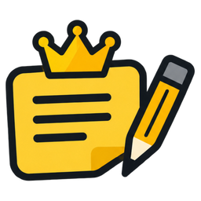

# 메모킹 안드로이드



PC 메모킹과 **같은 메모 폴더 형식**을 그대로 쓰는 휴대폰 앱입니다. 메모 1개 = `.md` 파일 1개, 머리말(색·고정·연결·예약 알림), `attachments/`, `_memoking/`(휴지통·LLM 인덱스·링크 미리보기)까지 데스크탑과 똑같이 읽고 씁니다. 그래서 두 기기가 같은 폴더를 동기화해 쓰면 PC에서 쓴 메모를 휴대폰에서 이어 쓰고, 그 반대도 됩니다.

## 설치

1. GitHub 저장소의 **Actions › Android APK** 에서 가장 최근 실행을 열고, 아래 **Artifacts › memoking-android** 를 내려받습니다 (zip 안에 `app-debug.apk`).
2. 휴대폰으로 APK를 옮겨 열면 설치됩니다. 처음에는 "출처를 알 수 없는 앱 설치"를 허용해야 해요.
3. 직접 빌드하려면 아래 [개발](#개발) 참고.

> APK는 저장소에 고정한 디버그 키로 서명돼서, 새로 빌드한 APK를 지우지 않고 업데이트로 설치할 수 있어요. (0.1.0 을 설치했었다면 서명이 달라 한 번은 지우고 설치해야 해요.) Play 스토어에 올릴 때는 릴리스 서명 키를 따로 만드세요.

## 처음 실행: 메모 폴더 고르기

| 고르는 것 | 설명 |
|---|---|
| **Google Drive와 동기화** (추천) | PC 메모킹이 쓰는 Google Drive 폴더(`내 드라이브 › 메모킹`)와 앱이 직접 맞춥니다. 다른 앱 필요 없음 |
| **휴대폰 폴더 고르기** | 휴대폰 저장공간의 아무 폴더 (Syncthing 같은 다른 동기화 앱과 함께 쓸 때) |
| **이 휴대폰에만 보관하기** | 앱 안 저장공간. 바로 시작하고, 나중에 설정에서 바꿀 수 있어요 |

### PC와 같은 메모 쓰기 — Google Drive 동기화

PC 메모킹은 **Google Drive for desktop** 이 동기화하는 폴더(`G:\내 드라이브\메모킹`)에 메모를 보관합니다. 휴대폰 메모킹은 **휴대폰에 로그인된 구글 계정**(Google Drive 앱에서 쓰는 계정)으로 그 Drive 폴더와 직접 동기화합니다. 사용자는 계정을 고르고 **허용**, 폴더 **메모킹** 을 고르면 끝이에요. PC 쪽은 바꿀 것이 없어요.

앱 주인(개발자)이 Google Cloud 에 앱을 처음 한 번 등록해야 합니다 (5분, 붙여 넣을 값 없음) → **[DRIVE-SETUP.md](DRIVE-SETUP.md)**

- 언제 맞추나: 앱을 열 때 · 메모를 고친 뒤 몇 초 · 화면을 보는 동안 1분마다 · 앱이 꺼져 있을 때 15분쯤마다(인터넷이 될 때) · 목록 위 ☁ 버튼으로 바로
- PC와 휴대폰에서 같은 메모를 함께 고치면 PC 쪽을 남기고 휴대폰 쪽은 `(휴대폰 충돌 …)` 사본으로 남깁니다 (글을 잃지 않음)
- 휴대폰에서 받아 둔 메모는 인터넷이 없어도 보고 고칠 수 있고, 연결되면 맞춥니다
- 열어 둔 메모가 PC에서 바뀌면 바로 불러오고, 쓰는 중이었다면 "바뀐 내용 보기 / 지금 내용 두기" 를 물어봅니다

## 기능

- **목록** — 실제 메모 색 카드를 메모지처럼 엇갈려 쌓기(두 줄, 넓은 화면은 3~4줄) 또는 한 줄씩(오른쪽 위 버튼). 고정한 메모가 먼저, 그다음 최근 고친 순. 카드 아래 태그·알림·첨부·연결 표시와 마지막 고친 시각
- **검색·태그·필터** — 본문 검색, 검색창에 `#태그`, 태그 줄을 눌러 거르기(여러 개 = 모두 가진 메모), 필터 버튼으로 색·담긴 것(고정·알림·사진·파일·웹 링크·연결)
- **카드 길게 누르기** — 색 바꾸기, 목록 맨 위에 고정, 다른 앱으로 보내기, 글 복사, 지우기
- **메모 편집** — PC와 같은 편집기(Milkdown): 제목·굵게·기울임·밑줄·취소선·글자 색·형광펜·목록·체크리스트·인용·표·태그 자동완성·링크 미리보기 카드. 서식 막대는 키보드 바로 위에, 옆으로 밀어 더 보기. 되돌리기·다시 하기, 키보드 내리기
- **사진·파일 넣기** — 📎(모든 파일)·🖼(사진 선택기). 메모 폴더 `attachments/` 에 저장되고, 사진은 바로 보이고 소리·동영상은 재생, 그 밖의 파일은 눌러서 다른 앱으로 열기. 사진은 두 번 눌러 사진 앱으로
- **다른 앱에서 공유하기** — 웹 페이지·글·사진·파일을 "메모킹에 메모하기" 로 보내면 새 메모가 됩니다 (PC 의 빠른 메모 `Ctrl+Alt+C` 처럼, 끝에 `> 출처: 앱 이름 · 시각`). 글자를 길게 눌러 나오는 메뉴에도 있어요
- **예약 알림** — 메모 화면의 🔔: 타이머·날짜와 시간·반복(매일·매주 요일·매월·매년)·켤 때. 앱이 꺼져 있어도 시스템 알람으로 제때 알림이 뜨고, 누르면 그 메모가 열립니다. "메모 띄우기" 알림은 앱이 열려 있으면 메모를 바로 띄워요. PC 와 같은 머리말(`reminders:`)에 저장되어 함께 동기화
- **알림 예약 탭** — 모든 메모의 알림을 다가오는 순으로, 켜고 끄기·지우기
- **알림 보관함 탭** — 휴대폰에 온 다른 앱 알림(카카오톡 같은 메신저는 보낸 사람·마지막 메시지까지)을 모아 둬서, 알림을 지웠거나 놓쳐도 다시 볼 수 있어요. 앱별 거르기·검색, 누르면 펼쳐서 메모로 만들기·복사·지우기. 메모킹 예약 알림도 함께 남고 누르면 그 메모로. 처음 한 번 안드로이드 설정에서 "알림 접근"을 허용해야 하고(보관함 탭의 **보관 시작하기**), 모은 알림은 이 휴대폰에만 남아요 (설정 › 다른 앱 알림 모아두기로 끄기)
- **메모 연결** — 🔗: 연결·역연결·내용이 닮은 메모 추천
- **PDF로 저장** — 메모 메뉴 › PDF로 저장 · 인쇄 (안드로이드 인쇄 화면에서 "PDF로 저장")
- **휴지통** — 설정 › 휴지통 보기: 되살리기(첨부도 함께)·영구 삭제·비우기, 오래된 메모 자동 영구 삭제(기본 30일)
- **LLM 인덱스** — `_memoking/index.json` 을 PC 와 같은 규칙으로 갱신
- **앱 바로가기** — 앱 아이콘을 길게 누르면 "새 메모"
- **라이트·다크 모드** — 휴대폰 설정을 따르고, 위·아래 시스템 막대도 화면(메모 색)에 맞춤

## 구조

```
android/
  app/src/main/java/com/memoking/app/
    MainActivity.kt      WebView 하나에 화면을 띄움 · 뒤로 가기 · 화면 가장자리(키보드) · 공유받기 · 파일/폴더 고르기
    Bridge.kt            화면이 부르는 기능 (window.MemoKingNative) — 데스크탑 preload.cjs + 메인 프로세스에 해당
    WebServer.kt         https://appassets.androidplatform.net/{app,m,vault}/… 를 앱 안 파일·메모 폴더로 이어 줌
    Storage.kt           메모 폴더 파일 읽기·쓰기 — 고른 폴더(SAF) / 앱 안 폴더
    Vaults.kt            지금 쓰는 메모 폴더 기억
    VaultFileProvider.kt 앱 안 폴더의 첨부를 다른 앱이 열 수 있게
    Alarms.kt            예약 알림을 시스템 알람에 맡기기 · 알림 띄우기 · 재부팅 뒤 다시 걸기
    NotiService.kt       알림 보관함: 다른 앱 알림 모으기 (NotificationListenerService) · 앱 아이콘
    Http.kt              링크 미리보기·인터넷 사진 받기
    drive/NativeAuth.kt  휴대폰 구글 계정으로 Drive 권한 (Google Play 서비스: 계정 고르기·허용)
    drive/GoogleAuth.kt  토큰 관리 · 예비 로그인 (휴대폰 브라우저 + 127.0.0.1 로 돌아오기, PKCE)
    drive/DriveApi.kt    Google Drive REST API v3
    drive/SyncEngine.kt  동기화 규칙 (지난번 모습과 비교해 올리기·내려받기·지우기·충돌 사본) — 단위 테스트 있음
    drive/DriveSync.kt   언제 맞출지, 앱이 꺼져 있을 때 시스템 작업
  app/src/test/          동기화 엔진 단위 테스트 (가짜 Drive)
  web/                   휴대폰 화면 (앱에 assets/www/m 으로 들어감)
    index.html           처음 설정 · 목록 · 메모 · 시트들
    js/app.js            시작, 화면 바꾸기, 설정·휴지통, 공유받기, 알림
    js/vault.js          desktop/vault.js 를 옮긴 것 (규칙 같음, 파일 읽기·쓰기만 앱에 맡김)
    js/list-view.js      목록 화면
    js/note-view.js      메모 화면 (app/js/note.js 의 휴대폰판)
    js/alarms.js         예약 알림 실행기 (desktop/alarms.js + 시스템 알람 맡기기)
    js/web-fetch.js      링크 미리보기 (desktop/link-previews.js 와 같은 저장 위치)
    js/drive.js          Google Drive 연결 화면 · 동기화 상태
    dev/                 PC 브라우저 미리보기 서버·자동 점검 (APK 에는 안 들어감)
```

공용 웹 코어 `app/`(편집기, 메모 파일 형식, 인덱서, 태그, 알림 계산, 예약 알림 패널 등)는 빌드할 때 `assets/www/app/` 으로 그대로 복사되어 데스크탑과 같은 코드가 돕니다.

## 개발

필요한 것: JDK 17, Android SDK (Android Studio 를 설치하면 함께 생김). Google Drive 로그인 설정을 APK 에 넣으려면 `android/local.properties` 에 `memoking.googleClientId=…` / `memoking.googleClientSecret=…`

| 명령 (저장소 맨 위에서) | 설명 |
|---|---|
| `cd android && ./gradlew assembleDebug` | APK 만들기 → `android/app/build/outputs/apk/debug/app-debug.apk` |
| `cd android && ./gradlew installDebug` | 연결한 휴대폰에 바로 설치 |
| `cd android && ./gradlew testDebugUnitTest` | 동기화 엔진 단위 테스트 |
| `npm run android:preview` | 휴대폰 화면을 PC 브라우저에서 미리보기 (`http://localhost:8790/m/index.html`, 크롬 개발자 도구의 휴대폰 보기로). 메모 폴더를 주려면 `npm run android:preview -- <폴더>` |
| `npm run android:smoke` | 미리보기 서버를 띄워 휴대폰 크기로 사용자처럼 조작하고, 메모 폴더에 쓰인 파일을 확인 (30개 항목, 캡처는 `out/android/`, Playwright 필요) |

Android Studio 로 `android/` 폴더를 열어도 됩니다. 디버그 빌드는 `chrome://inspect` 로 화면(WebView)을 살펴볼 수 있어요.

## 데스크탑과 다른 점

PC 에만 있는 기능: 스티커 창·끌어다 놓아 띄우기·메모 스택(탭)·왕관 스티커(늘 위에 두기)·영역 캡처·튜토리얼. 알림 보관함은 휴대폰에서는 안드로이드 알림을 모읍니다. 휴대폰에서는 한 번에 한 메모를 화면 가득 보고, 빠른 메모는 공유하기로 대신합니다.
